# 0030. Store Actor 存储引擎：无锁并发直读、单协程双阶段 Group Commit 与四阶段跨层数据流水线

## 状态
已采纳 (accepted) — 演进 [ADR-0029](0029-pebble-per-branch-storage-swmr-and-checkpoint-commit.md) 的单分支存储引擎内部并发模型与跨层写入流水线

## 背景
在 [ADR-0029](0029-pebble-per-branch-storage-swmr-and-checkpoint-commit.md) 确立「1 个 `Branch` 对应 1 个独立 Pebble 实例与 `blobs/` 1 MiB 块目录」的基础上，原存储引擎实现将文件元数据（`meta` / `pebblekv`）与数据块管理（`BlobStore`）分散在不同模块与锁域中，通过细粒度 Inode 读写锁（`RWMutex`）与每次 RPC 独立提交 Pebble Batch 协同，存在以下性能与工程边界瓶颈：
1. **并发写高频锁争用与逐次 Batch 提交开销**：多个并发写请求各自构造 Batch、争抢锁并独立更新 `"sys:stat"`，无法将同一时间窗口内的并发元数据变更合并为单次 Pebble 内存跳表编码与单次 WAL 追加。
2. **读路径锁开销与 Pebble 迭代器误用风险**：原设计要求 `Read` 持有目标 Inode `RLock()` 以防并发覆写删除旧块触发 `ENOENT`；同时若在 `ReadDir`、`ListXattr` 中误用 `IterOptions{LowerBound, UpperBound}` + `iter.First()`，Pebble 会完全绕过 SSTable 前缀布隆过滤器（Prefix Bloom Filter）。
3. **Pebble `IndexedBatch` 无法单条回滚与跳表底层数组膨胀**：`IndexedBatch` 底层的内存跳表（`batchskl.Skiplist`）不支持节点删除或截断回滚，一旦在校验完成前向共享 Batch 写入半条数据，单条命令报错将污染整批事务；且 `IndexedBatch.Reset()` 不会缩容已膨胀的跳表节点切片。
4. **跨层写入的局部写放大、块版本 TOCTOU 竞态与物理删块阻塞**：
   - 若将 `.blob` 磁盘 I/O 放进 Actor 单协程，会严重阻塞微秒级的元数据串行循环；
   - 若在 Actor 队列外完全无锁准备局部写（CoW），并发写同一文件时会出现「阶段 1 读取旧块版本 $\rightarrow$ 阶段 2 元数据指针已被前序请求覆盖」的 TOCTOU 竞态；
   - 若窗口内活跃尾块的连续局部写（`< 1 MiB`）在入队前直接原地修改 `.blob` 文件，一旦阶段 2 元数据校验失败（如配额超限 `ENOSPC`），磁盘上将残留已被破坏的脏块；反之若每次局部写都整块 CoW，又会产生 $O(N^2)$ 写放大；
   - 若在 Actor 循环内同步执行被替换旧块或 `Unlink`/`Truncate` 的 `os.Remove`，文件系统删除耗时（数毫秒至数百毫秒）会直接卡死后续所有批次的元数据提交。

## 决策

### 1. 核心定位与实例边界（读写分离 + 单协程串行 Group Commit）

- **实例粒度**：1 个 `StoreActor` 实例 = 1 个挂载的 `Branch` 工作区（或只读 `Commit` 快照），底层独占管理 1 个 `*pebble.DB` 实例与所属 `blobs/` 数据存储目录。
- **并发直读快路径（Fast Read Path）**：只读操作（`Lookup`、`GetAttr`、`ReadDir`、`ReadDirPlus`、`Readlink`、`GetXattr`、`ListXattr`、`StatFS`、`Read`）**不进入 Actor 消息队列、不加业务互斥锁**，仅经过生命周期读守卫（`lifecycleMu.RLock()`，无关闭竞争时仅 1 次原子加法）后直接在调用方协程并发读取 `*pebble.DB`、Actor 内存原子镜像与分片热块缓存 `hotShard`。
- **串行合并写路径（Serial Group Commit Path）**：所有元数据变更与持久化屏障操作（`Create`、`Mknod`、`Mkdir`、`Unlink`、`Rmdir`、`Rename`、`Link`、`Symlink`、`SetAttr`、`SetXattr`、`RemoveXattr`、`Fsync`、`FsyncDir`、`Write`、`Fallocate`）通过 **双缓冲 MPSC 内存队列（Mailbox）** 投递至 Actor 单协程，在同一个 `*pebble.IndexedBatch` 上串行完成纯内存校验与原地零拷贝编码，合并为 **1 次** 底层 WAL 提交。

---

### 2. 文件元数据层（Meta Layer）设计

#### 2.1 Pebble 键空间布局与前缀切分（`Comparer.Split`）

所有整数编号统一采用 **8 字节大端序（Big-Endian）** 编码，保持字节字典序与数值序严格一致：

| 键类型 | 物理编码格式 | 字节长度 | `Comparer.Split` 前缀长度 | 值（Value）编码格式 |
| :--- | :--- | :--- | :--- | :--- |
| **分支统计 (`StatKey`)** | `"sys:stat"` | 8 B | `len(key)` (8) | `25 B` 定长：`[ver(1B) \| LogicalBytes(8B) \| Inodes(8B) \| NextWriteSeq(8B)]` |
| **节点属性 (`InodeKey`)** | `"inode:" + uint64(ino)` | 14 B | `len(key)` (14) | `93 B` 定长属性头 + 可变长 `SymlinkTarget` |
| **目录项 (`EntryKey`)** | `"entry:" + uint64(parent) + ":" + name` | 15 B + `len(name)` | **`15`** (`"entry:<8B>:"`) | `13 B` 定长：`[ver(1B) \| Ino(8B) \| Mode(4B)]` |
| **扩展属性 (`XattrKey`)** | `"xattr:" + uint64(ino) + ":" + name` | 15 B + `len(name)` | **`15`** (`"xattr:<8B>:"`) | 原始二进制属性值 `[]byte` |
| **变更节点 (`DirtyKey`)** | `"dirty:" + uint64(ino)` | 14 B | `len(key)` (14) | `1 B` (`0x01`) |
| **孤儿节点 (`OrphanKey`)** | `"orphan:" + uint64(ino)` | 14 B | `len(key)` (14) | `1 B` (`0x01`) |
| **数据块索引 (`DataKey`)** | `"data:" + uint64(ino) + ":" + uint64(idx)` | 22 B | **`14`** (`"data:<8B>:"`) | `12 B` 定长：`[BlobID(8B) \| Length(4B)]` |

#### 2.2 `*pebble.Options` 初始化配置规范

1. **自定义 `Comparer`**：基于 `pebble.DefaultComparer` 浅拷贝，覆写 `Split` 方法：
   - 对 `entry:`、`xattr:` 返回 `15`（切出前缀 `<prefix>:<8B_id>:`）；
   - 对 `data:` 返回 `14`（切出前缀 `"data:<8B_ino>:"`）；
   - 对其余单键（`inode:`、`dirty:`、`orphan:`、`sys:`）返回 `len(key)`（全键参与 Bloom 过滤）。
2. **全层启用布隆过滤器**：为 `opts.Levels` 全部 7 层配置 `FilterPolicy: bloom.FilterPolicy(10)`。
3. **资源与同步参数**：`MemTableSize = 16 << 20`（16 MiB），进程内共享 `Cache = 64 << 20`（64 MiB），`MaxOpenFiles = 128`，`WALBytesPerSync = 4 << 20`（4 MiB），`FormatMajorVersion = pebble.FormatNewest`。

#### 2.3 Actor 独占内存状态结构

```go
type writeCmd struct {
	op       opKind
	req      any
	resp     any
	err      error
	toDelete []uint64      // 本条命令产生的待删物理块（被替换旧块或校验失败预写块），唤醒后由调用方 RPC 协程自行 os.Remove
	done     chan struct{} // 容量为 1，随 writeCmd 由 sync.Pool 复用
}

type StoreActor struct {
	diskID   string
	branchID string
	readOnly bool
	db       *pebble.DB

	// 1. 双缓冲 MPSC 写命令队列（RPC 协程向 active 追加，Actor 协程交换到 draining 批量处理）
	mb struct {
		mu       sync.Mutex
		active   []*writeCmd
		draining []*writeCmd
		notify   chan struct{} // 容量为 1 的非阻塞唤醒信号
		closed   bool
	}
	cmdPool sync.Pool

	// 2. Actor 写协程私有状态（仅在单协程 Loop 内无锁读写）
	batch       *pebble.Batch // db.NewIndexedBatch() 创建，支持同批写后读
	stat        BranchStat    // 权威内存统计：LogicalBytes, Inodes, NextWriteSeq
	nextIno     uint64        // 当前本地 Inode 分配游标
	reservedIno uint64        // 已向盘级分配器持久化预留的 Inode 上界（步长 4096）
	walDirty    bool          // 自上次 pebble.Sync 后是否存在未落盘的 NoSync 写入

	// 3. 并发读路径无锁镜像（每次 Batch 提交后刷新）
	atomicLogicalBytes atomic.Uint64
	atomicInodes       atomic.Uint64

	// 4. 延迟 Atime 内存脏表（读路径登记/叠加，写循环合并刷盘）
	atimeMu    sync.Mutex
	dirtyAtime map[uint64]int64 // ino -> unixNano

	// 5. 生命周期守卫（保护 s.db 不在在途直读或写阶段 1 预读期间被 Close 关闭）
	lifecycleMu sync.RWMutex
	closing     atomic.Bool
	loopDone    chan struct{} // Actor 后台写循环退出完成信号
}
```

#### 2.4 Pebble v2 核心接口选型对照表

| 路径分类 | 覆盖操作 | 选定 Pebble 接口 | 源码机制与选型依据 |
| :--- | :--- | :--- | :--- |
| **零 I/O 状态直读** | `StatFS` | 不调 Pebble，直读 `atomicLogicalBytes` / `atomicInodes` | 统计值常驻 Actor 内存，原子读取实现 **0 锁、0 I/O**。 |
| **并发单键点查** | `GetAttr`、`Lookup`、`Readlink`、`GetXattr` | `db.Get(key)`<br>（`closer.Close()` 前原地解码） | 内部复用 `getIterAllocPool`，按 MemTable $\rightarrow$ L0 $\rightarrow$ L6 逐层惰性求值并自动调 `SeekPrefixGE` 查 Bloom Filter；**严禁创建 `db.NewSnapshot()`** 以免争抢全局快照链表锁。 |
| **并发前缀范围扫描** | `ReadDir`、`ListXattr` | `db.NewIter(nil)` + **`iter.SeekPrefixGE(prefix)`** | **严禁使用 `IterOptions{Lower/UpperBound}` + `iter.First()`**（Pebble 中 `First()`/`SeekGE()` 完全绕过 SSTable Bloom Filter）；唯有 `SeekPrefixGE` 会触发 15B Prefix Bloom Filter，且在越过当前前缀时自动终止。 |
| **并发连续批量点查** | `ReadDirPlus`（扫出目录项后批量查子 `InodeKey`） | 子项按 `Ino` 升序排序后，**复用同一个 `iter` 循环调 `iter.SeekPrefixGE(InodeKey(ino))`** | 搜索键单调递增时自动激活 Pebble `TrySeekUsingNext` 优化：同块（4KB Data Block）相邻创建的子 Inode 直接在内存块内 `Next()` 步进，省去 N 次 `db.Get` 的 `loadReadState` 与二分查找。 |
| **串行同批写后读** | Actor 循环内前置校验读取 | `batch.Get(key)` / `batch.NewIter(nil)` + `SeekPrefixGE` | `*pebble.IndexedBatch` 在第 0 层先查内存跳表（`batchIter`），自动合并本批前 $k-1$ 条未提交改动与底层 `db`，保障同批写后读（Intra-Batch Read-Your-Writes）。 |
| **串行零拷贝写入** | Actor 循环内写入键值与删除键 | **`batch.SetDeferred(kLen, vLen)`**<br>**`batch.DeleteDeferred(kLen)`** | 直接在 `batch.data` 连续缓冲区上原地编码键值，调 `op.Finish()` 索引进跳表，消除每次编码 `make([]byte)` 的临时切片分配与二次拷贝；**严禁使用 `SingleDelete`**（覆盖写场景下会导致旧版本数据复活）。 |
| **批次提交与屏障** | 普通写批次 vs 含 `Fsync` / `FsyncDir` 批次 / 1s 兜底刷盘 | • 普通批次：`db.Apply(batch, pebble.NoSync)`<br>• 屏障批次：`db.ApplyNoSyncWait(batch, pebble.Sync)` + `batch.SyncWait()`<br>• 纯 WAL 刷盘：`db.LogData(nil, pebble.Sync)` | • 普通写批次合并为 1 次 `NoSync` 写入；<br>• `ApplyNoSyncWait` 立即将变更发布至 MemTable（对并发读可见）并异步唤醒 Pebble `LogWriter` 刷 WAL，允许与数据层 `Sync` 并行落盘后再通过 `batch.SyncWait()` 汇合。 |

#### 2.5 Actor 单轮写循环（Tick）4 步执行规约

1. **Step 1：单锁指针交换排空队列（Drain）**
   - Actor 协程收到 `<-mb.notify` 唤醒后，加 `mb.mu` 锁执行 **1 次切片交换** `mb.active, mb.draining = mb.draining[:0], mb.active` 并立即解锁，拿到本批 $N$ 条待处理命令。
2. **Step 2：逐条两阶段串行演进（`Validate` $\rightarrow$ `Mutate`）**
   - **Phase A — 纯内存只读预校验（绝不触碰 `batch` 写接口）**：
     - 通过 `s.batch.Get` / `s.batch.NewIter` 读取父目录、目标节点及目录项，完成全部 POSIX 语义校验与 Inode 号段预留检查。
     - **单条失败隔离铁律**：`IndexedBatch` 底层的内存跳表（`batchskl.Skiplist`）不支持节点删除与截断回滚；因此若任何校验失败，直接设置 `cmd.err = err` 并 `continue` 跳过，绝不向 `s.batch` 写入半条脏数据，同批其余命令不受影响。
   - **Phase B — 内存记账与原地写入（必定成功）**：
     - 更新 Actor 私有内存状态：`s.nextIno++`、`s.stat.NextWriteSeq++`、增减 `s.stat.Inodes` 与 `s.stat.LogicalBytes`。
     - 通过 `s.batch.SetDeferred` / `s.batch.DeleteDeferred` 将变更原地编码进 `s.batch`。
3. **Step 3：批次收敛与合并提交（Seal & Commit）**
   - 若本批包含通过校验的窗口内局部写增量（`mergedPatches`），先按 `blobID` 合并原地刷入对应 `.blob` 文件与 `hotShard`。
   - 若本批存在有效写入（`s.batch.Count() > 0`），在批次末尾仅调用 **1 次** `SetDeferred` 写入 `"sys:stat" -> EncodeBranchStat(s.stat)`。
   - 根据本批是否包含 `Fsync` / `FsyncDir` 命令，调用 `db.Apply(s.batch, pebble.NoSync)` 或 `db.ApplyNoSyncWait(s.batch, pebble.Sync)` + `s.batch.SyncWait()`。
   - 提交成功后刷新 `atomicLogicalBytes` 与 `atomicInodes` 原子镜像。
4. **Step 4：内存状态摘除、防膨胀重置与唤醒后调用方自清理（Reset, Wake & Caller Remove）**
   - **纯内存摘除待删块状态（0 磁盘 I/O）**：对本批各命令 `cmd.toDelete` 中的块，在 Actor 内同步调用 `blobs.DetachMeta(cmd.toDelete)` 从 `hotShard`、`dirtyFile`、`dirtyNew`、`inoBlobs` 中剔除（避免后续读或 `Fsync` 触碰已废弃块）。
   - **跳表内存防护**：Pebble 的 `IndexedBatch.Reset()` 内部调用 `b.index.Init()` 不会缩容已膨胀的跳表节点数组 `s.nodes`。重置时必须执行守卫：
     ```go
     if len(s.batch.Repr()) > 1<<20 || s.batch.Count() > 8192 {
         s.batch = s.db.NewIndexedBatch()
     } else {
         s.batch.Reset()
     }
     ```
   - **唤醒调用方并在队列外完成物理文件删除**：遍历 `s.mb.draining` 逐条发送 `cmd.done <- struct{}{}` 立即唤醒调用方协程（Actor 主循环 **0 `os.Remove` 系统调用**，耗时恒定微秒级，立即进入下一轮 Tick）；各 RPC 调用方协程在收到 `<-cmd.done` 后释放 `inodeLocks[ino & 0xfff]`，若 `len(cmd.toDelete) > 0` 则在当前 RPC 协程内执行 `blobs.RemoveFiles(cmd.toDelete)` 真正删除物理 `.blob` 文件（多块时并发删除），待物理文件全部删除完毕后将 `writeCmd` 归还 `cmdPool` 并向客户端返回响应。

#### 2.6 Actor 生命周期守卫与三步无死锁关闭规约（`Close` / `CloseDiscard`）

为防止并发直读（`db.Get` / `db.NewIter`）或写路径阶段 1 预读期间调用 `s.db.Close()` 触发 Pebble Panic，同时避免持读锁等待写队列与 `Close()` 写锁互锁，统一执行以下生命周期规约：

1. **读写统一入口守卫（`enter`）**：
   ```go
   func (s *StoreActor) enter() (func(), error) {
   	if s.closing.Load() {
   		return nil, ErrClosed
   	}
   	s.lifecycleMu.RLock()
   	if s.closing.Load() {
   		s.lifecycleMu.RUnlock()
   		return nil, ErrClosed
   	}
   	return s.lifecycleMu.RUnlock, nil
   }
   ```
   - **所有直读路径**（含使用迭代器的 `ReadDir`、`ReadDirPlus`、`ListXattr`、`Read`）与 **所有写操作入口**（阶段 1 开始前）均须先调用 `unlock, err := s.enter()` 并 `defer unlock()`，将 `db.Get`、`iter.NewIter() -> iter.Close()` 及阶段 1 预读完整包裹在 `RLock` 保护期内。
   - 若写请求在阶段 1 完成新块预写后、投递进入 `mb` 队列时发现 `mb.closed == true`，立即在队列外调用 `s.blobs.Remove(newBlobID)` 清理临时块并返回 `ErrClosed`。

2. **三步无死锁关闭序列（先排空写队列，再拿 `lifecycleMu.Lock()` 排空在途读）**：
   - **Step 1 — 拉闸拒新并封闭写队列**：
     - 置 `s.closing.Store(true)`，拦截所有后续新到达的读写请求（入口直接返回 `ErrClosed`）；
     - 加 `s.mb.mu` 锁，置 `s.mb.closed = true`，并向 `s.mb.notify` 发送非阻塞唤醒信号，通知 Actor 写循环在排空已入队命令后退出。
   - **Step 2 — 排空已入队写批次并停止 Actor 协程**：
     - 等待 `<-s.loopDone`：Actor 协程将 `mb.active` 中最后一批已入队的命令正常执行完 Step 1 ~ Step 4 并唤醒 `cmd.done`（使在途写 RPC 正常返回并释放 `lifecycleMu.RUnlock()` 与 `inodeLocks`）。
     - **区分正常关闭与销毁型关闭**：
       - `Close()`（句柄池 LRU 淘汰 / 服务优雅停机）：Actor 循环退出前将残留的 `dirtyAtime` 刷入 Pebble，若 `walDirty == true` 则执行一次 `s.db.LogData(nil, pebble.Sync)` 确保已提交数据落盘；
       - `CloseDiscard()`（`Rollback` / `DeleteBranch` / `DeleteDisk` 等目录即将被替换或删除的场景）：排空已入队批次后**直接跳过**尾部 `dirtyAtime` 与 `WAL Sync` 刷盘，省去无意义的磁盘 `fsync`。
   - **Step 3 — 排空在途直读并安全关闭 Pebble**：
     - 调用 `s.lifecycleMu.Lock()` 等待所有已进门的在途直读协程（及在 Step 1 被拒入队的阶段 1 写协程）全部释放 `RLock`；
     - 安全调用 `err := s.db.Close()`，随后 `s.lifecycleMu.Unlock()` 返回。

---

### 3. 数据存储层（Data Layer）与跨层四阶段流水线设计

#### 3.1 物理存储布局与核心常量

Data Layer 采用 **「Pebble 12B 定长索引（`DataKey`） + 分支私有 `blobs/` 不可变块文件 + 窗口内活跃块内存增量日志与每批原地合并」** 架构：

1. **分片边界与目录结构**：
   - **块大小上限（`BlobSize`）**：固定为 **`1 MiB`（`1 << 20` Bytes）**，与 Linux FUSE `MaxWrite = 1 MiB` 1:1 对齐；文件内字节偏移 `offset` 映射到块序号 `blockIdx = offset / 1 MiB`、块内偏移 `inBlock = offset % 1 MiB`。
   - **物理文件路径**：`<branch_dir>/blobs/<shard>/<blob_id_hex16>.blob`，其中 `<shard>` 为 `blobID & 0xff` 的 2 位十六进制分片目录（`00` ~ `ff` 共 256 个子目录），使用 `[256]atomic.Bool`（`shardReady`）缓存分片目录就绪状态，消除热路径重复 `os.MkdirAll`。
   - **空洞免分配（Sparse Hole）**：全零数据块不分配物理 `.blob` 文件、不写 `DataKey`；读取未命中 `DataKey`（或读取偏移超出 `BlobRef.Length` 但仍在 `Inode.Size` 内）时直接填零返回。
2. **元数据索引（`DataKey` $\rightarrow$ `BlobRef`）**：
   - 键：`"data:" + uint64(ino) + ":" + uint64(blockIdx)`（22 B，Prefix Bloom 切分前 14 B `"data:<8B_ino>:"`）。
   - 值：`[BlobID(8B) | Length(4B)]`（12 B 定长，`Length` 取值 `1..1048576`）。

#### 3.2 Data Layer 内存结构（`BlobStore` + Per-Inode 写定序锁）

```go
type BlobStore struct {
	dir        string
	shardReady [256]atomic.Bool

	// 1. 无锁 BlobID 分配游标（步长 4096 向盘级分配器持久化预留）
	nextBlobID     atomic.Uint64
	reservedBlobID atomic.Uint64
	allocMu        sync.Mutex

	// 2. 分片环形热块缓存（16 分片 × 64 槽位，总预算 64 MiB，分片独立加锁）
	// 刚写入的块直接零拷贝收养内存切片，支撑局部写 CoW 与 4 KiB 热读 100% 命中内存
	hot [16]hotShard

	// 3. Per-Inode 轻量分片定序锁（4096 分片 Mutex，仅占 32 KiB，按 ino & 0xfff 索引）
	// 串行化「同一个 Inode」的并发数据变更（跨越 Stage 1 读旧块准备至 Stage 2 db.Apply 完成），
	// 消除 Stage 1 -> Stage 2 的块版本 TOCTOU 竞态；不同文件写入 100% 并行且同批 Group Commit
	inodeLocks [4096]sync.Mutex

	// 4. 脏块与分片目录屏障追踪表（供 Fsync(ino) 与 Commit 精确刷盘）
	mu        sync.Mutex
	dirtyFile map[uint64]uint64              // blobID -> 所属 ino（未完成 fdatasync 的窗口内脏块）
	inoBlobs  map[uint64]map[uint64]struct{} // ino -> dirty blobID 集合（Fsync(ino) 只刷本文件的块）
	dirtyNew  map[uint64]struct{}            // 本窗口内新创建的 blobID（需在 Sync 时连带 fsync 父分片目录）
	dirtyDir  map[string]struct{}            // 删除过已持久化旧块的分片目录（需在 Sync 时 fsync 目录）
}
```

#### 3.3 读路径（`Read`）：100% 锁外并发直读（不进 Actor 队列、0 Inode 锁）

`Read(ino, offset, size)` 与 `Lookup`/`GetAttr` 一样，**完全不经过 Actor 消息队列**：

1. **读取文件属性**：直接调 `db.Get(InodeKey(ino))` 原地解码 `Inode`，校验是否为常规文件（`S_IFREG`）以及 `offset < inode.Size`，计算实际可读长度 `readLen = min(size, inode.Size - offset)`。
2. **定位区间块索引**：
   - 单块读取（`offset` 与 `offset+readLen-1` 在同一 `1 MiB` 块内）：直接调 **1 次** `db.Get(DataKey(ino, blockIdx))` 解码 `BlobRef{ID, Length}`。
   - 跨块读取：使用 `db.NewIter(nil)` + `SeekPrefixGE(DataKey(ino, firstBlock))` 顺序扫描对应 `DataKey`。
3. **读取物理块内容（`hotShard` $\rightarrow$ OS Page Cache）**：
   - 优先调 `BlobStore.hotReadAt(ref.ID, inBlock, dst)`：在 `hotShard.mu` 分片锁内直接从内存切片 `copy` 目标区间返回（0 系统调用，且与窗口内增量合并原地更新 `hotShard` 严格互斥、无并发读写切片竞态）；
   - 未命中则调 `os.Open` + `file.ReadAt`（`pread`）读取 `blobs/<shard>/<id>.blob`（直接命中内核 OS Page Cache）。
   - **并发覆写删除防护**：若读取瞬间旧块恰好被并发覆写提交并在 Stage 4 执行了 `os.Remove` 导致 `os.Open` 返回 `ENOENT`，`Read` 捕获 `ENOENT` 后自动重读一次最新 `DataKey`（最多重试 2 次），从而在读路径上实现 **0 Inode 锁开销**。
4. **延迟登记 Atime**：通过 `StoreActor.markAtimeDirty(ino, now)` 非阻塞写入内存 `dirtyAtime` 表，随后续写批次或后台刷盘合并提交。

#### 3.4 写路径跨层四阶段流水线：「队列外新块预写/增量暂存 $\rightarrow$ Meta 纯内存串行校验 $\rightarrow$ 每批同步原地合并 $\rightarrow$ 提交后调用方自清理」

为同时保证 **「Meta Layer 100% 纯内存微秒级串行」**、**「单条命令失败 100% 隔离（0 脏块回滚、0 GC）」** 与 **「局部写零 $O(N^2)$ 写放大」**，跨层写入按 **4 阶段流水线** 协同：

```mermaid
flowchart LR
    subgraph Stage1["阶段 1：RPC 协程（入队前 · 新块并行写 / 局部增量暂存）"]
        A0{"写入类型？"}
        A0 -->|"满 1MiB 整块写"| A1["锁外无锁分配 newBlobID<br/>并行写 <newBlobID>.blob"] --> A2["加 inodeLocks[ino & 0xfff]<br/>投递进 Actor 队列"]
        A0 -->|"局部写 / 截断 / 打洞"| A3["加 inodeLocks[ino & 0xfff]<br/>读已 Apply 的最新 DataKey"] --> A4{"块状态？"}
        A4 -->|"已固化旧块 CoW"| A5["读旧块 + 合并新数据<br/>写全新 <newBlobID>.blob"]
        A4 -->|"窗口内活跃块增量"| A6["不写临时文件，仅挂接内存增量日志<br/>patchLog(blobID, offset, data, newLen)"]
    end

    subgraph Stage2["阶段 2：Actor Meta 层（Step 2 · 100% 纯内存串行校验与编码）"]
        B1["Step 2 Phase A：纯内存只读校验<br/>(Inode 存活 / 权限 / 盘级配额)"]
        B1 -->|"校验失败"| B2["设置 cmd.err，不写 s.batch<br/>• 新块：newBlobID 挂入 cmd.toDelete<br/>• 窗口内增量：直接丢弃内存 patchLog (0 I/O)"]
        B1 -->|"校验通过"| B3["Step 2 Phase B：纯内存编码 s.batch<br/>• 更新 InodeKey & DataKey<br/>• 淘汰旧块挂入 cmd.toDelete<br/>• 合法增量汇入本批 mergedPatches"]
    end

    subgraph Stage3["阶段 3：每批同步合并与提交（Step 3 · Batch Merge & Apply）"]
        C1["按 blobID 合并本批 mergedPatches<br/>原地 WriteAt + Truncate 合入 <blobID>.blob<br/>并同步更新 hotShard 内存切片"] --> C2["合并写 sys:stat<br/>执行 db.Apply(s.batch, NoSync)"]
    end

    subgraph Stage4["阶段 4：内存摘除与调用方物理块清理（Step 4 · 0 阻塞 Actor / 0 GC）"]
        D1["Actor 纯内存摘除 cmd.toDelete 缓存与脏表<br/>立即发送 cmd.done 唤醒各 RPC 协程"] --> D2["RPC 协程释放 inodeLocks[ino & 0xfff]<br/>自行执行 os.Remove(cmd.toDelete) 删净物理文件后返回"]
    end

    A2 --> B1
    A5 --> B1
    A6 --> B1
    B2 --> D1
    B3 --> C1
    C2 --> D1
```



##### 核心设计约束与三类数据变更场景规约：

- **同文件写定序不变量（消除 Stage 1 $\rightarrow$ Stage 2 块版本 TOCTOU 竞态）**：
  - 凡涉及读取旧块状态的变更（局部写、块内截断、局部打洞），RPC 协程在进入阶段 1 前获取 `inodeLocks[ino & 0xfff]`，**持续持有至阶段 3 完成合并与 `db.Apply`（阶段 4 `<-cmd.done` 唤醒）后才释放**，保证阶段 1 `db.Get(DataKey)` 读到的永远是该文件最新已 `Apply` 的块版本。
  - 满 `1 MiB` 整块写无需读取旧块数据，**最耗时的 `.blob` 磁盘写入在锁外 100% 并行完成**；仅在写完 `.blob` 后、投递入队前获取 `inodeLocks[ino & 0xfff]` 并在 `<-cmd.done` 后释放，确保同文件整块写与局部写之间严格按 `Apply` 顺序定序。
  - `4096` 分片锁（仅占 `32 KiB`）使不同文件的并发写入互不阻塞，100% 并发执行阶段 1 并在阶段 2/3 合并进同一个批次提交。
- **Append-Only 新块 + 内存增量日志 + 每批同步原地合并（0 脏块回滚、0 GC）**：
  - 在阶段 2 Meta 层校验通过之前，**绝不修改任何已存在的 `.blob` 文件**：新块/CoW 写为独立的新文件 `<newBlobID>.blob`（校验失败直接 `os.Remove` 删除新文件）；窗口内活跃块局部写仅在内存中携带增量日志 `patchLog{blobID, offset, data, newLen}`（校验失败直接丢弃内存切片，0 磁盘 I/O）。
  - 阶段 2 保持 **100% 纯内存操作**；所有通过校验的 `patchLog` 进入阶段 3（每批同步合并阶段），按 `blobID` 聚合后一次性原地合入 `<blobID>.blob` 与 `hotShard`，不产生跨批次的碎片堆积，无需后台 GC。
- **物理文件删除移交 RPC 调用方协程（0 Actor 阻塞、请求返回前必删净）**：
  - 阶段 3 `db.Apply` 完成后，被替换或删除的块在 Pebble 元数据中已不可见；阶段 4 Actor 协程仅做**纯内存状态摘除**（从 `hotShard` 与 `dirtyFile` 移除），随后立即触发 `cmd.done` 唤醒调用方并继续处理下一批队列。
  - 耗时可能达数十至数百毫秒的物理文件 `os.Remove(cmd.toDelete)` 完全由**发起该请求的 RPC 协程在 `<-cmd.done` 唤醒后自行完成**（大文件删除多块时可在 RPC 协程内并发 `os.Remove`），待物理文件全部删净后再向客户端返回 RPC 响应，既保证 Actor 主循环零阻塞，又保证请求结束时磁盘无任何残留废块。

1. **满 `1 MiB` 整块写入（大文件高吞吐快路径）**：
   - **阶段 1（锁外并行预写 + 入队前加锁）**：RPC 协程在**不持 `inodeLocks`** 的状态下无锁分配 `newBlobID`，调用 `blobs.WriteForInode(ino, newBlobID, data)` 将 `1 MiB` 写入 `blobs/<shard>/<newBlobID>.blob`（进入 OS Page Cache 并零拷贝挂入 `hot` 缓存）。若磁盘满（`ENOSPC`）或 I/O 失败，当场清理半成品文件并返回错误，**不进入 Actor 队列**。预写成功后，获取 `inodeLocks[ino & 0xfff]` 并投递进 Actor 队列（`defer unlock()` 在 `<-cmd.done` 后执行）。
   - **阶段 2（Meta 纯内存校验与指针切换）**：
     - **Phase A**：通过 `s.batch.Get` 读取 `Inode` 与旧 `DataKey(ino, blockIdx)`，校验文件存活、可写标志与配额。若校验失败，将预写的 `newBlobID` 加入 `cmd.toDelete`，设置 `cmd.err` 并 `continue` 跳过（`s.batch` 零污染，同批其余命令正常提交）。
     - **Phase B**：调用 `s.batch.SetDeferred` 原地更新 `InodeKey`（更新 `Size`/`Mtime`/`Ctime`）、删除 `security.capability` 扩展属性、写入 `DataKey -> BlobRef{newBlobID, 1 MiB}`；若存在旧块，将 `oldRef.ID` 加入 `cmd.toDelete`。
   - **阶段 3 & 4（提交与调用方即时清理）**：`db.Apply(s.batch, pebble.NoSync)` 成功后，Actor 同步摘除 `cmd.toDelete` 的内存缓存与脏标记并唤醒 `cmd.done`；RPC 协程释放 `inodeLocks[ino & 0xfff]`，对 `cmd.toDelete` 执行物理文件 `os.Remove` 后返回。
2. **局部写（`< 1 MiB`）与「窗口内增量日志 + 每批同步原地合并」**：
   - RPC 协程先获取 `inodeLocks[ino & 0xfff]`（持有至 `<-cmd.done` 返回后释放），查询 `db.Get(DataKey(ino, blockIdx))`（此时读到的必定是最新已 `Apply` 状态）：
   - **分支 1 — 旧块不存在或已持久化/共享（`!blobs.WindowLocal(oldID)`）$\rightarrow$ 标准 CoW 新块**：
     - 阶段 1 读取旧块（优先命中 `hot` 缓存），合并新数据写出独立新文件 `<newBlobID>.blob`，随后按新块流程投递至阶段 2 切换 `DataKey`，并在阶段 4 `<-cmd.done` 后由 RPC 协程执行 `os.Remove(oldID)`。
   - **分支 2 — 旧块为当前 `Sync` 窗口内新建的私有脏块（`blobs.WindowLocal(oldID) == true`）$\rightarrow$ 内存增量日志 + 阶段 3 原地合并**：
     - **阶段 1（零磁盘 I/O、零整块拷贝）**：不创建临时块文件、不重读整个旧块，仅在请求中挂载内存增量日志 `patchLog{blobID: oldID, offset: patchOffset, data: patchBytes, newLen: targetLength}`（若跨越旧块尾部空洞写入，则从 `oldRef.Length` 补零至写入起点）。
     - **阶段 2（纯内存校验与登记）**：Phase A 校验失败则直接丢弃 `patchLog`（0 磁盘回滚开销）；Phase A 校验通过后，Phase B 将 `patchLog` 推入本批待合并队列 `mergedPatches`，并更新 `InodeKey`（若块有效长度 `Length` 未变，连 Pebble `DataKey` 都无需重写）。
     - **阶段 3（每批同步原地合并）**：在 `db.Apply` 提交前，遍历本批 `mergedPatches`（同一 `blobID` 的多条增量自动合并），对 `<oldID>.blob` 执行 `WriteAt + Truncate(newLen)` 并重新登记脏块标记 `markFile(oldID)`；同时在 `hotShard.mu` 锁内原地覆写/扩容对应内存缓存切片（若扩充后超出单分片预算则直接 `evictHot(oldID)`），确保后续 `Read` 100% 读到最新字节。
3. **文件删除 / 截断 / 打洞（`Unlink`、`SetAttr(Size)`、`Fallocate`）**：
   - **整块移除**（`Unlink` 链接数归零、`Truncate(0)`、整块打洞）：入队前无 Data I/O（`Truncate` / `Fallocate` 同样持 `inodeLocks[ino & 0xfff]` 入队以与同文件写入定序）；在阶段 2 中扫描目标 `DataKey` 范围并调用 `DeleteDeferred` 删除索引，同时将扫出的 `blobID` 加入 `cmd.toDelete`。待阶段 3 `db.Apply` 提交成功、阶段 4 Actor 摘除内存缓存并唤醒 `cmd.done` 后，由当前 **RPC 协程在队列外执行 `blobs.RemoveFiles(cmd.toDelete)`** 删除全部物理块文件，全部删毕后再返回响应（严格遵循「先删元数据指针，提交后再由调用方删物理块，0 阻塞 Actor」）。
   - **块内截断 / 局部打洞**：在 `inodeLocks[ino & 0xfff]` 保护下，若目标块为已固化旧块则在阶段 1 读出并写出 `<newBlobID>.blob`（若清零后全为 0 则仅删 `DataKey`）；若目标块为窗口内活跃块（`WindowLocal == true`），同样生成 `patchLog` 在阶段 3 原地截断/覆写并同步 `hotShard`。

#### 3.5 持久化屏障（`Fsync` / `FsyncDir`）的双层并行落盘

当本轮 Actor Tick 排出的命令批次中包含 `Fsync(ino)` 或 `FsyncDir(ino)` 时，Step 3 执行 **Meta WAL 与 Data Blob 并行落盘**：

```go
// 1. 立即将 s.batch 发布至 Pebble MemTable，并唤醒后台 LogWriter 异步刷盘 WAL
if err := s.db.ApplyNoSyncWait(s.batch, pebble.Sync); err != nil {
	return err
}
// 2. 当前协程并行刷盘本批所有 Fsync(ino) 关联的脏 .blob 文件与新建块分片目录
//    （FsyncDir 仅需等待 Pebble WAL，无需触发 blobs.SyncInode）
var dataErr error
for _, ino := range fsyncFileInodes {
	dataErr = errors.Join(dataErr, s.blobs.SyncInode(ino))
}
// 3. 汇合等待 Pebble WAL fsync 完成
walErr := s.batch.SyncWait()
return errors.Join(dataErr, walErr)
```

- **单文件精准屏障**：`blobs.SyncInode(ino)` 仅对该 `ino` 关联的脏 `.blob` 文件并发执行 `fdatasync`，不将同分支其他并发写入文件的脏块拖入本次屏障。
- **最小化目录 `fsync`**：仅当本次同步包含通过 `Write` **新建**的 `.blob` 文件（`dirtyNew`）或删除过**已持久化**旧块的分片目录（`dirtyDir`）时，才对相应分片目录执行 1 次 `fsync`；窗口内原地 `Patch` 不产生目录项变更，0 目录 `fsync`。
- **窗口固化翻转**：`blobID` 完成 `SyncInode` 或全局 `Sync` 后立即从 `dirtyFile` 移除（`WindowLocal(id)` 变为 `false`），此后对该块的任何修改自动转为 CoW 新块写入，保障已持久化状态与快照硬链接不可变。

## 结果
- **正面效果**：
  - **读写零互锁与微秒级批量提交**：只读操作（含 `Read`、`Lookup`、`GetAttr`、`ReadDirPlus`）100% 在队列外无锁直读 Pebble 与 `hotShard`（遇到并发覆写删块引发的极小概率 `ENOENT` 自动重读 `DataKey` 重试）；写操作通过双缓冲 MPSC 队列与 `SetDeferred`/`DeleteDeferred` 零拷贝合并为每批 1 次 `sys:stat` 写入与 1 次 Pebble WAL 提交。
  - **单条失败 100% 隔离且零脏块残留、零后台 GC**：通过「Phase A 纯内存只读预校验 $\rightarrow$ Phase B 原地写入」规避 `IndexedBatch` 跳表不可回滚限制；窗口内局部写通过内存 `patchLog` 在校验通过后的阶段 3 统一原地合并，校验失败直接丢弃内存切片（0 磁盘回滚开销、0 写放大），废弃物理块在阶段 4 唤醒后由调用方 RPC 协程在队列外同步删净（0 Actor 阻塞、0 后台 GC）。
  - **生命周期安全闭合**：三步关闭序列（先排空写队列再拿 `lifecycleMu.Lock()` 排空在途读）彻底根除关闭时的读写死锁与 Pebble `Close()` 并发 Panic，且 `CloseDiscard()` 避免了销毁/回档分支时的无意义刷盘。
- **代价与取舍**：
  - `BlobStore` 需维护 `4096` 分片 `inodeLocks`（占用 `32 KiB` 内存）以串行化同一文件的跨阶段并发局部写与截断，以及 `64 MiB` 分片环形热块缓存（`hotShard`）以支撑热读与局部写零磁盘重读。
