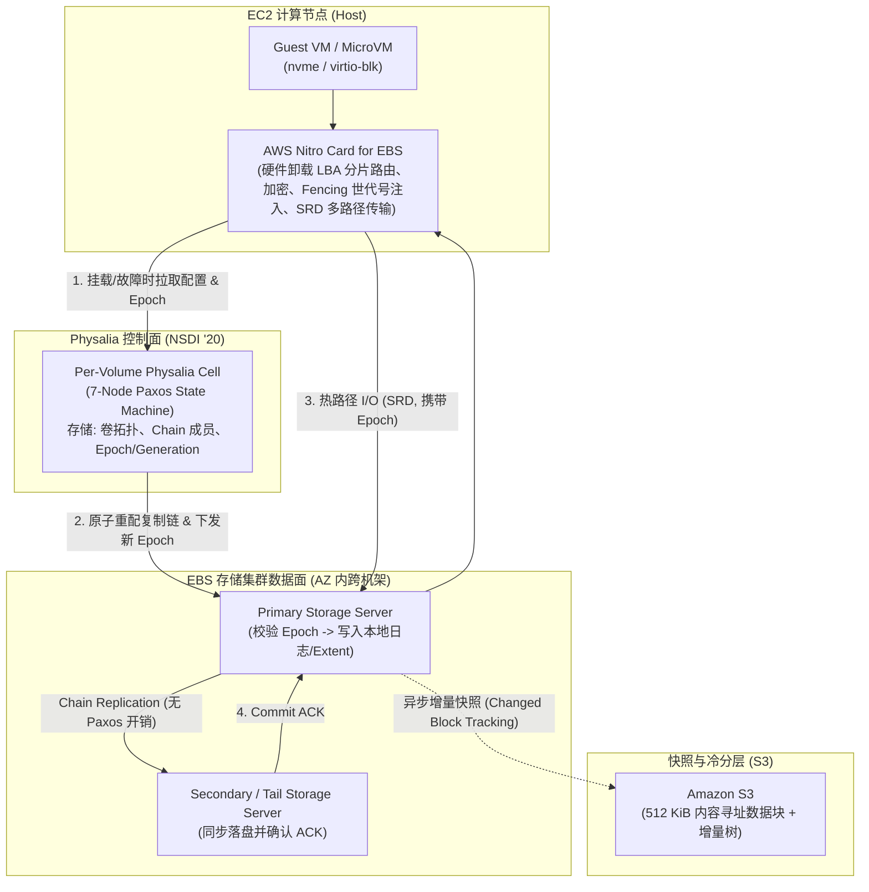
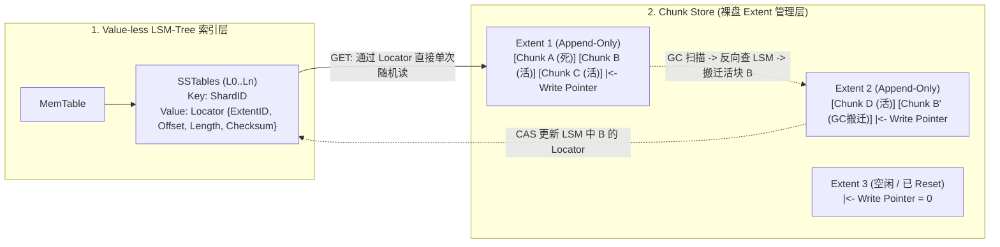
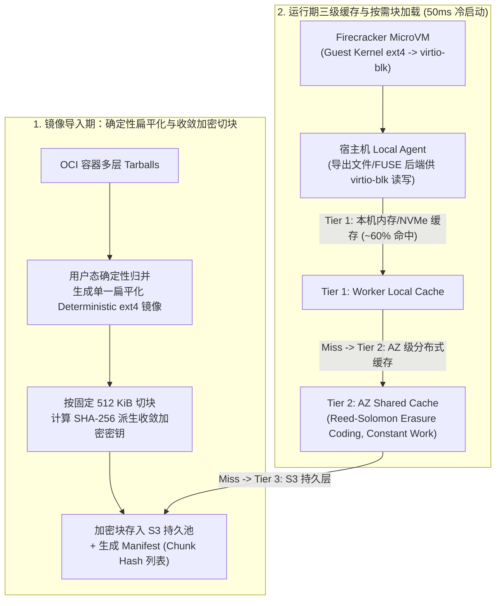

# AWS EBS 与关联底层存储引擎（Physalia / ShardStore / Lambda Container Loading / Block Express / Aurora）第一手文献深度调研报告

> **核心结论先行**：
> 1. **控制面按租户/按卷彻底细胞化（Physalia, NSDI '20）**：AWS EBS 放弃了中心化强一致大数据库，将单卷拓扑与代际（Generation / Epoch）拆入上百万个独立的 **7 节点 Paxos 微型数据库（Cell）**，且 Cell 节点与挂载该卷的客户端/存储节点同故障域就近放置（Colocation），使控制面可用性只与单卷自身的物理存活绑定，彻底消除全局级联雪崩。**Bowl 的 `1 Branch = 1 独立 PebbleDB 实例（StoreActor）` 在数据面元数据层与 Physalia 的微细胞隔离高度同构**。
> 2. **单机存储引擎采取「Value-less LSM 索引 + 块定位符（Locator）+ 外部不可变块/追加 Extent」解耦（ShardStore, SOSP '21）**：无论 S3/EBS 还是现代块引擎，均拒绝将大块数据直接塞入 LSM（避免 10x~30x 写放大与 Compaction 卡顿），也拒绝将“每个 `4 KiB` 小块存为 1 个宿主机小文件”（规避本地文件系统 `inode`/目录项与 `fsync` 抖动）。ShardStore 用 LSM 仅存 10~30B 的 `Locator`，数据追加进大块 Extent；**Bowl 当前在 [`ADR-0030`](../adr/0030-store-actor-group-commit-and-four-stage-data-pipeline.md) 采用 `Pebble 12B 定长 BlobRef + 分支私有 1 MiB 不可变 .blob 文件 + 窗口内内存 patchLog 原地合并`，在保持单文件 `1 MiB` 粒度（对齐 Linux FUSE `MaxWrite` 与硬链接零拷贝 `Commit`/`Fork`）的同时，规避了 ShardStore 多租户共享大 Extent 最棘手的后台 GC 搬迁竞态**。
> 3. **在线层与快照/容器分发层的双层粒度法则（EBS Direct APIs & Lambda USENIX ATC '23）**：AWS 在线块接口暴露 `4 KiB ~ 64 KiB` 最小 I/O 单元，但**一旦进入快照层（EBS Direct APIs）与 MicroVM 根文件系统按需加载层（AWS Lambda Container Loading, ATC '23），全部统一收敛为 `512 KiB`（$524,288\text{ B}$）固定块网格 + SHA-256 内容寻址**（Bowl 选定 `1 MiB` 固定块网格，处于同一数量级甜点区）。
> 4. **局部写与碎片治理的三条防坑铁律（Ceph BlueStore / ShardStore / Aurora 对比）**：
>    - **铁律一：严禁在 LSM 中做任意 `4 KiB` 变长区间分裂（1 裂 3）**——Ceph BlueStore `ExtentMap` 碎片化引发 RocksDB 元数据暴涨与 `BLUEFS_SPILLOVER` 生产雪崩即为反面教材；**必须坚持定长块网格（Fixed Block Grid：1 个 `DataKey` 永远只映射 1 条定长指针，绝不分裂）**；
>    - **铁律二：严禁使用数 GiB 超大 Extent，且严禁在无版本校验下盲跑后台 GC**——ShardStore 论文抓出的 **16 个生产级 Bug** 中，最致命的并发与崩溃一致性缺陷均集中于「前台覆写/删除 vs 后台 GC 搬迁 vs Extent Reset」三方交织；
>    - **铁律三：局部高频修改必须通过「固定块网格 + 窗口内增量日志（`patchLog` / Redo）合并 + 热块缓存（`hotShard`）」消化在持久化屏障之前**。

---

## 一、 一手核心文献与官方技术资料总表

| 编号 | 领域层级 | 文献 / 演讲 / 官方资料名称 | 作者与机构 | 发表会议 / 年份 | 核心公开 URL |
| :--- | :--- | :--- | :--- | :--- | :--- |
| **[1]** | 控制面微型共识库 | ***Millions of Tiny Databases*** (Physalia) | Marc Brooker, Tao Chen, Fan Ping (AWS) | **USENIX NSDI 2020** (pp. 463–478) | • [USENIX NSDI '20 Paper](https://www.usenix.org/conference/nsdi20/presentation/brooker) • [PDF 全文](https://www.usenix.org/system/files/nsdi20-paper-brooker.pdf) • [Marc Brooker 博客解读](https://brooker.co.za/blog/2020/02/26/tiny-databases.html) |
| **[2]** | 单机 KV+Extent 存储引擎与形式化验证 | ***Using Lightweight Formal Methods to Validate a Key-Value Storage Node in Amazon S3*** (ShardStore) | James Bornholt, Rajeev Joshi, Vytautas Astrauskas, Brendan Cully, Bernhard Kragl, Seth Markle, Kyle Sauri, Drew Schleit, Grant Slatton, Serdar Tasiran, Jacob Van Geffen, Andrew Warfield (AWS) | **ACM SOSP 2021** *(Best Paper)* (pp. 836–850) | • [ACM DOI: 10.1145/3477132.3483540](https://doi.org/10.1145/3477132.3483540) • [James Bornholt 论文 PDF](https://www.jamesbornholt.com/papers/shardstore-sosp21.pdf) • [Shuttle 开源模型检查器](https://github.com/awslabs/shuttle) |
| **[3]** | MicroVM 根文件系统快照与按需块加载 | ***On-demand Container Loading in AWS Lambda*** | Marc Brooker, Mike Danilov, Chris Greenwood, Phil Piwonka (AWS) | **USENIX ATC 2023** *(Best Paper)* (pp. 315–328) | • [USENIX ATC '23 Paper](https://www.usenix.org/conference/atc23/presentation/brooker) • [PDF 全文](https://www.usenix.org/system/files/atc23-brooker.pdf) • [Marc Brooker 博客解读](https://brooker.co.za/blog/2023/05/23/snapshot-loading.html) |
| **[4]** | MicroVM 虚拟化与快照 | ***Firecracker: Lightweight Virtualization for Serverless Applications*** | Alexandru Agache, Marc Brooker, Alexandra Iordache, Anthony Liguori, Rolf Neugebauer, Phil Piwonka, Diana-Maria Popa (AWS) | **USENIX NSDI 2020** (pp. 419–434) | • [USENIX NSDI '20 Paper](https://www.usenix.org/conference/nsdi20/presentation/agache) • [PDF 全文](https://www.usenix.org/system/files/nsdi20-paper-agache.pdf) |
| **[5]** | 硬件卸载与多路径低尾延迟传输层 | ***A Cloud-Scale Acceleration Architecture*** (Nitro & SRD) | Leah Shalev, Hani Ayoub, Nafea Bshara, Erez Sabbag (AWS Annapurna Labs) | **IEEE Micro**, Vol. 40, Issue 2, 2020 (pp. 33–39) | • [Amazon Science Publication](https://www.amazon.science/publications/a-cloud-scale-acceleration-architecture) • [IEEE DOI: 10.1109/MM.2020.2974847](https://doi.org/10.1109/MM.2020.2974847) |
| **[6]** | 存算分离日志结构数据库存储 | ***Amazon Aurora: Design Considerations for High Throughput Cloud-Native Relational Databases*** | Alexandre Verbitski, Anurag Gupta, Debanjan Saha, Murali Brahmadesam, Kamal Gupta, Raman Mittal, Sailesh Krishnamurthy, Sandor Maurice, Tengiz Kharatishvili, Xiaofeng Bao (AWS) | **ACM SIGMOD 2017** (pp. 1041–1052) | • [Amazon Science Publication](https://www.amazon.science/publications/amazon-aurora-design-considerations-for-high-throughput-cloud-native-relational-databases) • [SIGMOD '18 Quorum 续篇](https://www.amazon.science/publications/amazon-aurora-on-avoiding-distributed-consensus-for-i-o-commits-and-membership-changes) |
| **[7]** | EBS 快照直读写与内部架构分享 | • **AWS EBS Direct APIs 官方文档** • **AWS re:Invent STG304 / CMP307**: *Amazon EBS under the hood* & *io2 Block Express* | AWS EBS Team (Marc Brooker, Ashish Palekar, Gary Kimura 等) | **AWS Docs / re:Invent 2019–2023** | • [EBS Direct APIs Specification](https://docs.aws.amazon.com/ebs/latest/userguide/ebs-accessing-snapshot.html) • [EBS Multi-Attach & NVMe Reservations](https://docs.aws.amazon.com/ebs/latest/userguide/ebs-volumes-multi.html) • [EBS io2 Block Express Architecture](https://docs.aws.amazon.com/ebs/latest/userguide/block-express.html) |

---

## 二、 专题 1：AWS EBS 整体架构演进与数据面 / 控制面解耦

### 1.1 卷分片（Partition / Chunk）、LBA 映射与复制协议演进
根据 NSDI '20 Physalia 论文 [1] 与 AWS re:Invent *Amazon EBS Under the Hood* 技术分享 [7]，EBS 将单块虚拟磁盘（对应 Bowl 的 `Disk`）拆分为彻底解耦的三个平面：

1. **LBA 空间分片（Volume Partitioning）**：
   - 单个大吞吐 EBS 卷（最高 `64 TiB`）并非落在单台物理存储服务器上，而是由 Nitro EBS 卡在硬件层按固定 LBA 范围切分为多个独立的 **Partition（分片）**。
   - 每个 Partition 映射到一组独立的后端 Storage Server 复制组，Nitro 卡在发起读写时直接根据 `LBA -> Partition ID` 路由到对应分片的主节点（Primary），从而实现单卷 IOPS 与吞吐的水平扩展。
2. **热路径复制协议（Chain Replication $\rightarrow$ Quorum 的分工）**：
   - **数据面零 Paxos 原则**：如 Physalia 论文 §2.1 [1] 所述，EBS 数据面采用 **链式复制（Chain Replication）**（以及在 `io2` 多副本高耐久形态下的 **Primary-Secondary 变形**）。正常读写路径完全不跑分布式共识协议：
     1. **写入路径**：EC2 Nitro 卡将写请求（含 LBA、数据载荷、当前配置代际号 `Epoch/Generation`）发往该分片的 **Primary（头节点）** $\rightarrow$ Primary 校验 `Epoch` 合法后写入本地持久层，并将写入转发给 **Secondary / Tail（尾节点，位于同一 AZ 内的不同物理故障域/供电单元）** $\rightarrow$ Secondary 落盘后返回 ACK $\rightarrow$ Primary 向 Nitro 卡返回成功。
     2. **读取路径**：由于 Primary 与 Secondary 强一致同步复制，读请求可直接由 Primary 服务（若 Primary 拥塞或慢节点抖动，Nitro 卡可基于尾延迟策略读取已提交状态）。
   - **故障重配（Chain Repair）交由控制面**：仅当某台 Storage Server 宕机或发生网络分区时，Primary 或 Nitro 客户端才会请求 **Physalia 配置主控（Configuration Master）**，通过一次原子条件事务（Compare-And-Swap）递增 `Epoch`，将故障节点剔除出复制链（例如 `[S1, S2] -> [S1, S3]` 或提升 `S2` 为新 Primary），并在后台从存活副本向新节点流式补齐数据。

### 1.2 EBS Block Express、Nitro 卡硬件卸载与 SRD（Scalable Reliable Datagram）
在 IEEE Micro 2020 论文 [5] 与 `io2 Block Express` 架构 [7] 中，AWS 披露了如何将云盘尾延迟打入亚毫秒级（Sub-millisecond）并把单盘推至 **256,000 IOPS、4,000 MB/s 吞吐、99.999% 年化持久性（AFR 0.001%）**：

| 维度 | 传统云块存储（TCP + 宿主机软件虚拟化） | EBS Block Express（Nitro ASIC + SRD 协议） |
| :--- | :--- | :--- |
| **I/O 虚拟化路径** | Guest `virtio-blk` $\rightarrow$ VM Exit $\rightarrow$ 宿主机用户态进程（QEMU/守护进程） $\rightarrow$ 内核 TCP/IP 栈，消耗宿主机 CPU 且带来数十微秒上下文切换抖动。 | Guest NVMe 队列直通 **Nitro Card for EBS（专用 SoC/ASIC）**，实现 **0 宿主机 CPU 占用**，AES-XTS-256 块加密、CRC 校验与分片路由全部在硬件流水线完成。 |
| **底层网络传输层** | **TCP**：单流绑定单一 ECMP 哈希路径；一旦 Clos 网络中某个交换机队列拥塞或丢包，触发 **队头阻塞（Head-of-Line Blocking）** 与毫秒级 RTO 重传，导致存储 $P_{99.9}$ 尾延迟飙升至数十毫秒。 | **SRD（Scalable Reliable Datagram）**[5]：Nitro 芯片内置自定义传输层，**彻底解耦「可靠送达」与「按序送达」**： 1. **多路径喷洒（Multipath Spraying）**：单卷 I/O 同时打散在最多 **64 条并行网络路径**上传输； 2. **微秒级 RTT 探测与绕行**：硬件实时测量每条路径 RTT，微秒级重传丢包并立即绕开拥塞交换机； 3. **乱序完成**：块存储不同 LBA 的 I/O 天然无需跨请求保序，Nitro 卡直接乱序重组并向上层完成 NVMe 中断。 |
| **性能上界对比** | 传统 `gp3` / `io1`：最高 `16,000 ~ 64,000 IOPS`，吞吐 `1,000 MB/s`。 | `io2 Block Express`：单卷最高 **`256,000 IOPS`**、**`4,000 MB/s`** 吞吐、单卷容量 **`64 TiB`**，亚毫秒均值与极平缓的 $P_{99.9}$ 尾延迟。 |

### 1.3 单写者栅栏（Fencing / Generation Token）、SWMR 与 Multi-Attach
1. **单写者代际栅栏（Fencing via Configuration Epoch / Generation）**：
   - 在分布式存储中，最危险的致损场景是 **僵尸写端（Split-Brain / Zombie Writer）** 或 **僵尸主节点（Stale Primary）**：例如旧客户端或旧 Primary 因 GC 暂停/网络分区假死，控制面已将卷挂载给新实例或切换了新 Primary，随后旧节点恢复并把滞留在半路的旧写请求刷入磁盘，静默覆写新数据。
   - **EBS + Physalia 解决方案** [1]：每次卷挂载切换或复制链重配，Physalia Cell 都会单调递增一个 **64 位配置世代号（Configuration Epoch / Generation Token）**。所有 Storage Server 在磁盘上持久化当前接受的最大 `Epoch`；**任何携带 `req.Epoch < server.Epoch` 的读写请求在 Storage Server 入口当场被无条件拒绝（Fenced Off）**。
2. **EBS Multi-Attach 与 NVMe Reservations（对比 Bowl 的单分支 SWMR）**：
   - EBS 默认强制单实例挂载；仅在 `io1`/`io2` 上提供可选的 **Multi-Attach**（允许同一 AZ 内最多 **16 台** Nitro EC2 实例同时挂载同一块卷）[7]。
   - 但 AWS 官方文档明确警告：**EBS Multi-Attach 本身不提供分布式文件系统缓存一致性**（直接挂 `ext4`/`xfs` 会立即损坏文件系统元数据），业务必须自行跑集群文件系统（如 GFS2）或使用底层 **NVMe Reservations**（等效于 SCSI PR 持久预留锁：`Write Exclusive` / `Exclusive Access` 注册与抢占 Preempt-and-Abort）将非主节点显式栅栏隔离。
   - **对 Bowl 的印证**：Bowl 面向沙箱 `rootfs` 交付 POSIX 文件系统而非裸块设备，在 [ADR-0029](../adr/0029-pebble-per-branch-storage-swmr-and-checkpoint-commit.md) 中直接锁定 **单 `Branch` 一写多读（SWMR）+ `ClientSession` 租约与会话代数 `epoch` 校验 + 多写者通过零拷贝 `Fork` 子分支并行演进后再离线三路 `Merge`**，从架构根源上消除了 Multi-Attach 跨机分布式锁与内核 Page Cache 一致性风暴。

---

## 三、 专题 2：控制面微型状态机 —— Physalia (*Millions of Tiny Databases*, NSDI 2020)

### 2.1 论文元数据与核心架构指标
- **论文全称**：*Millions of Tiny Databases* [1]
- **作者**：Marc Brooker, Tao Chen, Fan Ping (Amazon Web Services)
- **发表会议**：17th USENIX Symposium on Networked Systems Design and Implementation (**NSDI '20**), Feb 2020, Santa Clara, CA.
- **核心量化指标**：
  - **服务规模**：支撑整个 AWS Region 内 **数百万（Millions）** 个活跃 EBS 卷的配置状态；
  - **单 Cell 副本数**：每个微型数据库（Cell）由 **7 个节点（7-Node Paxos）** 组成（多数派 Quorum = 4）；
  - **单 Cell 数据量**：每个 Cell 仅存储 **1 个 Partition Key**（即单个 EBS 卷或单个卷分片的元数据），数据体积仅 **数十字节至数 KiB**；
  - **集群规模**：由数千台物理/虚拟节点组成的 **Colony（群落）**，每台物理节点同时承载数千个不同 Cell 的 Paxos 副本；
  - **工程验证**：核心 Paxos 共识、成员变更与日志裁剪协议全部通过 **TLA+ 形式化规约与模型检查**，并在生产环境经历持续 Chaos 故障注入验证。

### 2.2 为什么放弃中心化大数据库，改用 "Millions of Tiny Databases"？
在构建 Physalia 之前，EBS 早期使用一套中心化的主备/分片配置数据库。Marc Brooker 在论文 §1–§2 [1] 中用 **CAP 定理在超大规模数据中心内的真实物理表现** 解释了为什么要推翻中心化大库：
1. **全局可用性 vs 客户端视角可用性（Client-Centric Availability）**：
   - 在包含数万台服务器、跨越多个建筑物与数千个机架的可用区（AZ）内，网络抖动、ToR 交换机故障、光纤切断或局部电源故障时刻都在发生。
   - 如果使用一个横跨全 AZ 的单一分布式大数据库（哪怕用分片 + 3 副本 Paxos），只要大数据库内部出现慢节点、网络不对称分区、全局 Compaction 风暴或脑裂恢复，**爆炸半径（Blast Radius）就是整个 AZ 的所有 EBS 卷同时无法重配或挂载**。
   - Physalia 提出了著名的洞见：**「没有任何客户端需要知道所有卷的状态；挂载卷 V 的 EC2 实例和存储节点，只需要读写卷 V 自己的那几百字节配置」**。
2. **故障域对齐与就近放置（Topology-Aware Colocation）**：
   - 当网络发生分区，把 AZ 切成子网 A 和子网 B 时：如果 EC2 实例和它的 EBS 存储节点都在子网 A，而传统中心化数据库的 Paxos 多数派恰好落在了子网 B，那么明明计算和存储之间网络完好，却因为连不上远端的控制面而停服！
   - Physalia 将每个卷的 **7 节点 Cell 精确放置在与该卷的 EC2 客户端及 EBS Storage Server 相同的网络/电源拓扑邻域内（同时保证 7 个节点分散在该邻域的不同机架/电源分支上以防单点故障）**。
   - **效果**：只要 EC2 实例和它的 EBS 存储节点还活着且能互通，服务于该卷的 Physalia Cell 多数派就必定在同一联通分量内可达！只有当该物理区域彻底断电（此时实例和存储本身也已宕机）时，该 Cell 才会不可用。

### 2.3 Paxos 状态机设计、日志裁剪（Log Trimming）与自动化修复（Repair）
由于一个集群内运行着 **数百万个独立的 Paxos 状态机**，Physalia 不能照搬重量级 Paxos 实现，而做了极致的精简（论文 §3–§4 [1]）：

| 核心机制 | Physalia 具体设计与工程实现 | 解决的核心痛点 |
| :--- | :--- | :--- |
| **窄接口原语** | 不支持跨键事务、不支持二级索引、不支持 SQL，仅支持针对单 Partition Key 的 **条件单键读写事务（Conditional Put / Compare-And-Swap）**（如：`if epoch == 42 then set chain = [S1, S3], epoch = 43`）。 | 状态机极度简单，内存与磁盘开销极小，单台机器可轻松托管数万个 Cell 实例。 |
| **两层教学日志裁剪（Two-Step Log Trimming）** | 每个 Cell 不断执行配置更新或定期心跳，Paxos 日志如果无限增长会撑爆磁盘。Physalia 采用 **Teach + Trim** 机制： 1. Leader 在提案槽位 $i$ 中附带当前完整键值快照（因整个 Cell 状态仅几百字节，每次快照成本极低）及已确认全员学习的位点； 2. 一旦确认 7 个节点（或存活多数派在重配后）均已应用位点 $i$，直接截断释放 $i$ 之前的所有历史 Paxos 日志。 | 无需复杂的后台 LSM Snapshot 与增量合并，任何时刻单 Cell 在磁盘上只保留最近极少数几条 Paxos 日志记录。 |
| **坏节点剔除与重配（Reconfiguration as Log Entry）** | 当 Cell 内某个节点硬件损坏或失联超时，控制面直接在该 Cell 的 Paxos 日志中提交一条 **成员变更提案（Membership Change）**，用健康的节点替掉失联节点，随后老节点上的残留数据直接丢弃。 | 由于单 Cell 数据量仅数 KiB，新节点加入 Cell 时瞬间即可从 Leader 同步全量状态（微秒/毫秒级修复），极大缩短了脆弱窗口（MTTR）。 |

### 2.4 Physalia 对 Bowl 架构的直接映照
将 Physalia 的设计思想与 Bowl [ADR-0029](../adr/0029-pebble-per-branch-storage-swmr-and-checkpoint-commit.md) / [ADR-0030](../adr/0030-store-actor-group-commit-and-four-stage-data-pipeline.md) 对比：
- **反中心化大表**：Bowl 早期曾将所有 `Disk` 的 `inodes`、`entries`、`chunks`、`file_locks` 塞进中心化 PostgreSQL（相当于未演进前的单体元数据大库）；[ADR-0029](../adr/0029-pebble-per-branch-storage-swmr-and-checkpoint-commit.md) 彻底将其拆解为 **每个 `Branch` 独占一个本地 `PebbleDB` + `StoreActor`（微型数据库）**，PostgreSQL 仅保留盘级分支树拓扑与 `ClientSession` 租约。
- **爆炸半径与无锁隔离**：正如 Physalia 中单个 Cell 故障或高负载绝不影响其他卷，Bowl 中 Sandbox C 和 Sandbox D 挂载不同 `Branch` 时各自操作独立的 `StoreActor` 与独立目录，Compaction、WAL 刷盘与目录锁 100% 物理隔离。

---

## 四、 专题 3：单机存储引擎与日志结构追加 —— ShardStore (*SOSP 2021*)

### 3.1 论文元数据与系统定位
- **论文全称**：*Using Lightweight Formal Methods to Validate a Key-Value Storage Node in Amazon S3* [2]
- **作者**：James Bornholt, Rajeev Joshi, Vytautas Astrauskas, Brendan Cully, Bernhard Kragl, Seth Markle, Kyle Sauri, Drew Schleit, Grant Slatton, Serdar Tasiran, Jacob Van Geffen, Andrew Warfield (AWS)
- **发表会议**：28th ACM Symposium on Operating Systems Principles (**SOSP '21**), Oct 2021 *(Best Paper Award)*.
- **代码规模与定位**：使用 **Rust** 从零编写的 **~40,000 行（40k LoC）** 高性能单机键值存储引擎，部署在数万台存储服务器上，负责将上层对象分片（Shards，由 Erasure Coding 切分出的块）持久化到底层 HDD/NVMe 磁盘。

### 3.2 为什么既不在 LSM 里直接存 Value，也不把每个小块存成宿主机独立小文件？
在 ShardStore 之前，AWS 存储节点演进经历了两代痛点（论文 §2.1 [2]）：
1. **为什么放弃“1 个数据块 = 1 个宿主机本地文件系统（ext4/XFS）小文件”**？
   - 存储节点单盘容量高达十数 TiB，承载数千万至上亿个异构大小的块（从几 KiB 到数 MiB）。
   - 如果每个小块都在 ext4/XFS 上创建一个独立文件：每次写入需要穿透 VFS 分配本地 `inode`、更新目录 B-Tree、修改空闲空间位图并写文件系统 Journal，导致 **1 次逻辑写引发多次随机磁盘元数据 I/O**；且当目录下文件数突破数百万/数千万时，目录项查找、`open/close/unlink` 系统调用与 `fsync` 延迟剧烈劣化。
2. **为什么放弃在 LSM-Tree（如 RocksDB / `PebbleDB`）中直接内联存储 Value**？
   - LSM-Tree 在后台不断执行多层 Compaction（L0 $\rightarrow$ L1 $\rightarrow$ ... $\rightarrow$ Ln），写放大高达 **10x ~ 30x**。如果把几十 KiB 到几 MiB 的数据块直接作为 LSM Value 写入，磁盘带宽与 SSD 寿命会被后台反复搬运冷数据的 Compaction 彻底吞噬（即 WiscKey 论文揭示的经典问题）。

### 3.3 Value-less LSM 索引 + Locator + Append-Only Extent 架构
ShardStore 采用了 **键值分离（Key-Value Separation）** 架构（论文 §2.1, Figure 1 [2]）：

1. **核心组件**：
   - **Extent（盘区 / 段文件）**：将物理存储划分为固定大小的连续区域（通常为数十 MiB，如 `16 MiB ~ 64 MiB`，对齐 SMR 叠瓦盘 Zone 或 NVMe Erase Block）。每个 Extent 维护一个单调递增的 **写指针（Write Pointer）**，**仅允许在写指针处顺序追加写入（Append-Only），严禁原地覆写**，仅支持将整个 Extent 的写指针归零（**Reset**）。
   - **Chunk Store**：在多个 Extent 之上抽象出块存储层，提供 `PUT(data) -> Locator` 与 `GET(Locator) -> data`。`Locator` 是定长紧凑指针（包含 `ExtentID`、块在 Extent 内的字节偏移 `Offset`、长度 `Length` 与校验元数据）。
   - **Value-less LSM-Tree**：主索引是一棵不存实际数据的 LSM-Tree（Key 为块标识，Value 仅为十几至几十字节的 `Locator`）。
2. **读写与 Soft Updates 崩溃恢复机制**：
   - **写入 (`PUT`)**：先把数据块顺序追加到某个活跃数据 Extent 的 Write Pointer 处（推进写指针），拿到返回的 `Locator`；然后将 `(Key -> Locator)` 插入 LSM-Tree。
   - **读取 (`GET`)**：先查 LSM-Tree 拿到 `Locator`，随后根据 `Locator.{ExtentID, Offset, Length}` 执行 **1 次精准磁盘 `pread`** 返回数据。
   - **Soft Updates 崩溃一致性（无重型双写 WAL）**：ShardStore 采用 **Soft Updates（软更新依赖定序）**：
     - **核心不变量 1（先写数据块、后落盘元数据指针）**：**任何元数据指针（如 LSM SSTable 或 Superblock）落盘前，它所引用的目标数据 Chunk 必须已经在对应 Extent 上完成持久化落盘**；
     - **核心不变量 2（指针解除落盘前绝不重用物理空间）**：在将某个 Extent 执行 `Reset` 重用其物理空间前，所有指向该 Extent 的旧 `Locator` 必须已经从持久化的 LSM 树中彻底抹除。
     - **崩溃后果**：如果在步骤 1（数据写入 Extent）成功、步骤 2（更新 LSM）落盘前崩溃，重启后最多在 Extent 尾部留下一段无任何 LSM Key 指向的孤儿字节（Orphaned Chunk），不破坏任何已有数据一致性，后续由后台 GC 自然回收。

### 3.4 后台空间回收（Chunk Reclamation / GC）的并发竞态与写放大陷阱
由于 Extent 只能追加写、不能原地删改，当上层执行删除或同名覆写时，旧 Chunk 变成无人引用的死空间（Dead Space / Holes）。ShardStore 必须运行后台 **Chunk Reclamation（垃圾回收器）**（论文 §2.1 & §3.2 [2]）：
1. **GC 四步标准流程**：
   - **Step 1（正向扫描 Extent）**：挑选垃圾比例高的源 Extent $E_{\text{src}}$，从偏移 `0` 到 `WritePointer` 顺序扫描其中的每一个 Chunk（头部记录了自描述归属标识）；
   - **Step 2（反向查 LSM 判活）**：拿着扫出的块标识去查 LSM-Tree 当前的 `Locator`：
     - 若 LSM 中该 Key 已不存在，或当前 `Locator` 指向别的位点 $\rightarrow$ 说明该 Chunk 已死，直接跳过丢弃；
     - 若 LSM 中当前 `Locator` 依然指向 $E_{\text{src}}$ 的当前偏移 $\rightarrow$ 说明该 Chunk 是**活数据（Live Chunk）**，必须搬迁！
   - **Step 3（搬迁活块并条件更新 LSM）**：将活 Chunk 追加写入新的目标 Extent $E_{\text{dst}}$ 拿到新 `Locator'`，随后对 LSM 执行**条件更新（CAS）**：仅当 LSM 中该 Key 的 `Locator` 仍等于旧 `Locator` 时才更新为 `Locator'`；
   - **Step 4（重置源 Extent）**：当 $E_{\text{src}}$ 内所有活块均已迁出且对应的 LSM 修改均已持久化 Flush 到磁盘后，调用 `Reset(E_src)` 将写指针归零，重新放回空闲池。
2. **三大致命竞态与写放大陷阱**：
   - **竞态 1（GC 搬迁与前台并发覆写/删除 ABA 竞态）**：GC 在 Step 2 看到块 $C_1$ 是活的，正准备将其搬到 $E_{\text{dst}}$ 并更新 LSM；此时前台线程突然处理了用户的 `PUT(Key, C_2)` 或 `DELETE(Key)`！如果 GC Step 3 不做原子 CAS 而直接盲写 LSM，**后台 GC 就会用旧数据 $C_1$ 覆盖掉用户刚写入的新数据 $C_2$，或者让已被用户删除的 Key 死而复生（Zombie Resurrection）**！
   - **竞态 2（LSM 尚未 Flush 落盘就提前 Reset 源 Extent 导致崩溃后悬空指针）**：GC 将活块从 $E_{\text{src}}$ 搬到 $E_{\text{dst}}$，并更新了 LSM 的 **内存 MemTable**，随后立即将 $E_{\text{src}}$ 执行了 `Reset` 并写入了新数据。此时机器突然断电重启！由于 MemTable 还没 Flush 成磁盘 SSTable，重启后磁盘上的旧 SSTable 依然指着 $E_{\text{src}}$，但 $E_{\text{src}}$ 已经被覆盖成了别人的数据——**产生静默数据错乱（Silent Data Corruption / Dangling Locator）**！
   - **写放大陷阱（Live-Dead Mixing）**：若 Extent 很大（如数 GiB）且冷热数据混杂，为了回收 30% 的死空间，GC 必须把剩下 70% 的活数据反复读出再写一遍，同时还要向 LSM 写入海量 `Locator` 更新，导致磁盘带宽被 GC 占满。

### 3.5 SOSP '21 论文抓出的 16 个真实生产级 Bug 分类与防坑指南
James Bornholt 等人在论文 §5（Table 1）中详细披露了通过 **可执行参考模型（Reference Models）+ 属性测试（`proptest`）+ 故障/崩溃注入 + 无状态并发模型检查器（`Shuttle`）** 在上线前拦截的 **16 个高危生产 Bug** [2]。我们将其归纳为 **5 大故障类别** 并对照 Bowl [`services/storage/internal/store`](../../services/storage/internal/store) 提炼防坑指南：

| 类别 | Bug 数量与验证工具 | 典型真实 Bug 触发路径还原（源自论文 §5） | 对 Bowl `store` 引擎的防坑铁律与代码印证 |
| :--- | :--- | :--- | :--- |
| **1. 后台 GC 回收与前台写入/删除的生命周期竞态** | **4 个** (`proptest` + `Shuttle`) | • **GC 复活已删键**：GC 线程读取某 Chunk 准备搬迁时，前台并发删除了该 Key，GC 线程在未重检版本号的情况下将新 `Locator` 写回 LSM。 • **GC 搬迁覆盖并发新写**：前台将 Key 更新为 `Locator_2`，GC 把旧 `Locator_1` 搬迁为 `Locator_3` 并错误覆盖。 • **自引用死锁**：LSM Flush 过程中触发同步空间回收，回收又尝试向同一个 LSM 申请锁写入新 `Locator` 造成死锁。 | **防坑铁律**： 1. **当前实现（[ADR-0030](../adr/0030-store-actor-group-commit-and-four-stage-data-pipeline.md)）**：采用单块单文件（`1 MiB .blob`）+ 阶段 4 由调用方同步 `os.Remove`，**0 后台数据块搬迁 GC**； 2. **若演进为 `.pack` 段文件 + 后台 GC**：GC 更新 `DataKey` 必须投递进 `StoreActor` 的同一个单协程 `IndexedBatch` 队列，在 Phase A 严格比对 `curRef == expectedOldRef`（原子 CAS），若前台已修改或已删除则直接放弃搬迁块，**100% 杜绝 GC 覆盖新写或复活已删键**！ |
| **2. 崩溃一致性与重放顺序违约（Crash Consistency & Soft Updates）** | **5 个** (Crash Injection + Reference Model) | • **未 Flush 即 Reset Extent**：如 §3.4 竞态 2 所述，GC 更新了内存索引后未等待 LSM Flush 屏障完成就 Reset/删除了旧 Extent，断电重启后旧 SSTable 指向已被重写的 Extent。 • **部分写入（Torn Write）与写指针漂移**：崩溃发生在追加 Chunk 写了一半时，重启后软件恢复出的 Write Pointer 与磁盘实际状态不一致，导致后续追加写错位。 • **重启恢复重复回放**：重启恢复扫描日志时，已删除的操作被乱序重放导致旧数据复活。 | **防坑铁律**： 1. **先写数据块、后改 `DataKey`**：阶段 1 先完成物理块写入，阶段 2/3 再提交 `PebbleDB` Batch（[`data_rw.go:129-171`](../../services/storage/internal/store/data_rw.go#L129-L171)）； 2. **旧块/旧段删除必须在 LSM 持久化之后**：在 `Fsync` 时严格执行 `ApplyNoSyncWait(pebble.Sync)` 与 `SyncInode` 并行落盘汇合（[`fsync.go`](../../services/storage/internal/store/fsync.go)），且若引入 `.pack` GC，**必须等 `PebbleDB` WAL Sync 确认新指针落盘后，才能 `os.Remove` 旧 `.pack` 文件**。 |
| **3. 范围查询 / 迭代器边界与前缀过滤缺陷** | **3 个** (`proptest` 功能模型对比) | • **迭代器漏键 / 越界**：在合并内存缓冲（MemTable）与多层磁盘块迭代时，遇到同名覆盖墓碑（Tombstone）或边界键（Inclusive vs Exclusive upper bound）时跳过了合法键。 • **反向查找索引失步**：二级/反向索引在覆盖写时未清理旧映射。 | **防坑铁律**： Bowl 在 [ADR-0030](../adr/0030-store-actor-group-commit-and-four-stage-data-pipeline.md) 严禁使用 `SingleDelete`（防止覆盖写旧值复活），并强制统一使用 `SeekPrefixGE` + `ComparerSplit` + 显式前缀越界检查（[`data_partial.go:193-203`](../../services/storage/internal/store/data_partial.go#L193-L203)）。 |
| **4. 并发内存池、分配器与生命周期竞态（Shuttle 并发交织）** | **2 个** (`Shuttle` 随机调度器) | • **线程池 / 资源池关闭死锁（Shutdown Race）**：关闭存储引擎时，工作线程正在等待队列或持有读句柄，而主关闭线程持锁等待工作线程退出，在特定线程交织下死锁（需要 >100,000 步原子操作交织才能复现，Loom 无法跑完，被 Shuttle 抓出）。 | **防坑铁律**： Bowl 在 [`actor.go:990-1085`](../../services/storage/internal/store/actor.go#L990-L1085) 实现了三步无死锁关闭序列：「1. `closing=true` 拉闸拒新并置 `mb.closed` $\rightarrow$ 2. 等待 `<-loopDone` 排空写队列并唤醒在途写释放读锁 $\rightarrow$ 3. 拿 `lifecycleMu.Lock()` 排空在途直读后关 `PebbleDB`」，并通过 `CloseDiscard` 跳过销毁分支时的无意义刷盘。 |
| **5. 磁盘满（ENOSPC）/ 异常路径资源泄漏与状态污染** | **2 个** (Fault Injection) | • **预留空间泄漏（Reservation Leak）**：写入过程中因磁盘空间不足或局部校验失败中途报错返回，但前置步骤预留的 Extent 空间配额或内存记账未回滚，导致可用空间逐渐归零。 | **防坑铁律**： `StoreActor` 将写循环严格拆分为 **Phase A（纯内存只读校验，失败直接跳过，0 状态污染 `IndexedBatch`）** 与 **Phase B（必定成功的内存记账与 `SetDeferred`）**，且阶段 1 预写的新块若在 Phase A 失败立即挂入 `cmd.toDelete` 由调用方删净（[`data_rw.go:300-351`](../../services/storage/internal/store/data_rw.go#L300-L351)）。 |

---

## 五、 专题 4：快照、克隆与块粒度设计（EBS Snapshots, Direct APIs & Lambda ATC '23）

### 4.1 为什么 AWS 在线层用 `4 KiB ~ 64 KiB`，而快照层与 Lambda 容器层统一锁定 `512 KiB`？
对比 EBS 在线卷、EBS Direct APIs [7] 与 USENIX ATC '23 *On-demand Container Loading in AWS Lambda* [3]，可以清晰看到 AWS 的 **双层块粒度（Dual-Granularity）** 黄金法则：

| 维度 | EBS 在线数据面层（Online Volume） | EBS 快照层（EBS Direct APIs） | AWS Lambda 容器按需加载层（ATC '23） | Bowl 分支与快照存储层（[ADR-0029](../adr/0029-pebble-per-branch-storage-swmr-and-checkpoint-commit.md) / [ADR-0030](../adr/0030-store-actor-group-commit-and-four-stage-data-pipeline.md)） |
| :--- | :--- | :--- | :--- | :--- |
| **固定块粒度** | `4 KiB`（SSD 扇区对齐）~ `16 KiB` / `64 KiB` | **`512 KiB`** ($524,288\text{ B}$) | **`512 KiB`** ($524,288\text{ B}$) | **`1 MiB`** ($1,048,576\text{ B}$，对齐 Linux FUSE `MaxWrite`) |
| **寻址与去重标识** | `VolumeID + LBA` | `SnapshotID + BlockIndex` (`offset / 512 KiB`) + `BlockToken` + **SHA-256** | 确定性 `ext4` 偏移分块 + **收敛加密（Convergent Encryption）SHA-256 哈希** | `DataKey(ino, blockIdx)` (`offset / 1 MiB`) $\rightarrow$ `BlobRef{BlobID, Length}` |
| **为什么选 `512 KiB ~ 1 MiB` 而非 `4 KiB`？** | 在线层直面 Guest OS 随机小 I/O，需支持细粒度页读写或 CoW。 | 1. **元数据体量压缩 128~256 倍**：`10 GiB` 镜像按 `4 KiB` 切分有 **2,621,440 个块**（仅哈希索引就高达上百 MiB）；按 `512 KiB` 切分仅 **20,480 个块**，按 `1 MiB` 切分仅 **10,240 个块**！ 2. **网络/S3 吞吐效率**：S3/远端缓存的首字节延迟（TTFB）远高于传输延迟，`512 KiB ~ 1 MiB` 能跑满高带宽并摊薄每次 RPC/HTTP 头部开销。 3. **预取局部性（Spatial Locality）**：文件系统（如 `ext4`）将相近文件与元数据聚集分配，拉取 `512 KiB ~ 1 MiB` 天然具备预读命中率，同时避免拉取整层（数百 MiB）造成的带宽浪费。 |

### 4.2 EBS 快照机制：指针表冻结（Pointer Map Freeze）、增量 CBT 与按需懒加载惩罚
1. **秒级快照定格（Pointer Map Freeze & Redirect-on-Write）**：
   - 调用 `CreateSnapshot` 时，EBS 立即定格当前卷 LBA 指针表（或递增快照代际号），`CreateSnapshot` API 瞬间返回，新写入通过 **Redirect-on-Write（重定向写）** 写入新物理位点，不覆盖快照引用的旧块。
   - 后台异步将自上次快照以来置位的 **变更块位图（Changed Block Tracking / Dirty Bitmap）** 聚合为 `512 KiB` 块上传至 S3。
2. **EBS Direct APIs 契约（[AWS 官方规范](https://docs.aws.amazon.com/ebs/latest/userguide/ebs-accessing-snapshot.html)）**：
   - `ListSnapshotBlocks` / `ListChangedBlocks(FirstSnapshotId, SecondSnapshotId)`：直接对比两个快照的 `512 KiB` 块索引树，秒级返回变更的 `BlockIndex`（`0, 1, 2...`）与对应的 `BlockToken`（免读取未变更数据块，**与 Bowl `Diff` 对比 `DirtyKey` 及 `BlobRef.ID` 相等性 $O(1)$ 短路完全同构**）；
   - `GetSnapshotBlock` / `PutSnapshotBlock`：以 `512 KiB` 为单位直读/直写快照块，强制携带 `Checksum`（`SHA256`）。
3. **从快照恢复新卷（Clone / Restore）的懒加载首读延迟（First-Touch Penalty）与对策**：
   - 当用户从 EBS Snapshot 创建新卷（相当于 `Fork`）并立即挂载 EC2 时，EBS 卷在数秒内即可 `available`，但此时数据仍在 S3 中！
   - **问题（First-Touch Penalty）**：当 EC2 首次读取某个尚未拉到本地 Storage Server 的块时，会触发同步从 S3 拉取 `512 KiB` 块回填，导致首读延迟飙升至数十毫秒、IOPS 暴跌。AWS 为此不得不推出高价的 **Fast Snapshot Restore (FSR)**（后台预先把 S3 快照全量水化预热到 EBS 存储池）。
   - **Bowl 的优势对比**：Bowl 的活跃 `Branch` 与本地 `Commit` 快照存储在本地 NVMe 的 `/data/disks/<disk_id>/` 下，通过 **Pebble `Checkpoint` + 数据块共享** 实现 `Commit` 与 `Fork`（[ADR-0029](../adr/0029-pebble-per-branch-storage-swmr-and-checkpoint-commit.md)）——**不仅创建耗时是毫秒级（0 字节拷贝），而且派生出的新 `Branch` 读取未修改块时 100% 命中本地 NVMe 与宿主机共享 OS Page Cache，彻底没有 EBS S3 懒加载的首读延迟惩罚**！

### 4.3 USENIX ATC 2023 *On-demand Container Loading in AWS Lambda* 深度拆解
这篇获得 USENIX ATC '23 最佳论文奖的文献 [3] 揭示了 AWS Lambda 如何支撑 **最大 10 GiB 容器镜像、15,000 容器/秒突发扩容、冷启动 P50 低至 50 ms** 的底层块存储架构：

1. **核心洞察：容器镜像的极端稀疏性（Sparsity）与跨租户重复率**：
   - 论文实测生产数据显示：**容器启动与运行期间平均仅访问整个镜像 `6.4%` 的字节**；且 **约 `75%` 的上传容器镜像中，独有（Unique）字节占比不到 `5%`**（绝大多数是 Alpine/Ubuntu/Python/Node.js 基础层与公共依赖）[3]。
2. **为什么抛弃 OverlayFS，改用“确定性 `ext4` + `512 KiB` 固定块”？**
   - 如果在 Guest 内跑多层 `OverlayFS`：每次 `open()`/`stat()` 都要在数十层目录树中逐层向下查找（引发严重的元数据读放大），且文件级跨租户共享极难兼顾安全隔离与高性能。
   - **Lambda 的做法** [3]：
     1. **构建期展平为确定性 `ext4`（Deterministic ext4）**：Lambda 不使用内核挂载制作镜像，而是编写了一个**完全确定性的用户态 `ext4` 生成器**——将多层 OCI 镜像合并为一棵目录树，固定 `Inode` 编号分配顺序、归零随机 UUID/时间戳、按确定性布局分配数据块，生成字节级 100% 确定性的裸 `ext4` 镜像。
     2. **按 `512 KiB` 固定网格切分 + 收敛加密（Convergent Encryption）**：将 `ext4` 镜像按 `512 KiB` 切块。对每个明文块 $B$ 计算加密哈希 $H = \text{SHA256}(B)$，再用 $H$ 作为密钥派生出对称加密密钥 $K = \text{KDF}(H)$ 将块加密为密文块 $C$，并以 $\text{SHA256}(C)$ 寻址。这样**既保证了缓存层和 S3 只存密文（不懂明文），又让不同客户容器里相同的基础镜像块生成完全相同的密文块，实现跨全网天然块级去重**！
     3. **运行期写入隔离**：Guest MicroVM 通过 `virtio-blk` 挂载该块设备，写操作由宿主机 Local Agent 拦截并重定向（Redirect-on-Write）到本地临时可写层，底层 `512 KiB` 只读块跨所有沙盒共享。
3. **三级缓存架构与 Reed-Solomon 纠删码（Erasure Coding）防尾延迟**：
   - **Tier 1（Worker 本地缓存）**：单台宿主机上多个 MicroVM 共享本地内存/NVMe 块缓存；
   - **Tier 2（AZ 级分布式共享缓存）**：为避免缓存节点故障或部署重启引发穿透风暴（Cache Stampede），Tier 2 将每个 `512 KiB` 块用 **Reed-Solomon 纠删码（如拆分为 $k$ 个数据分片 + $m$ 个校验分片，例如 4+1 / 8+2）** 分散存储在多台缓存节点上。Local Agent 拉取块时支持对冲请求（Hedging），只要最快返回的 $k$ 个分片到达即可立即拼出 `512 KiB` 块，实现极度稳定的尾延迟与 **Constant Work（恒定工作量）** 特性；
   - **Tier 3（Amazon S3）**：冷块回源兜底。

---

## 六、 专题 5：局部写、碎片控制与 LSM 元数据膨胀陷阱（横向架构大对比）

### 5.1 死穴一：为什么无限制的 `4 KiB` 变长区间分裂（1 裂 3）会导致 LSM 元数据雪崩？（Ceph BlueStore 教训）
在变长区间映射（Variable-Length Extent Map）设计中（典型代表为 **Ceph BlueStore 的 `onode_t` / `ExtentMap`**），系统试图用区间树记录 `[logical_offset, length) -> [physical_offset, length)`：
1. **“1 裂 3”元数据分裂爆炸**：
   - 假设最初顺序写入了一个 `1 GiB` 的连续大文件（仅占 **16 条** `64 MiB` 的元数据记录）。
   - 随后上层应用（如 SQLite 数据库、日志或构建工具）在文件不同偏移处随机覆写 `4 KiB` 页：由于底层是异地追加写（Redirect-on-Write），每次覆写都会把原本连续的区间切碎成 **前、中、后 3 条独立区间**：
     $$[0, 512\text{ KiB}) \rightarrow P_0, \quad [512\text{ KiB}, 516\text{ KiB}) \rightarrow P_1, \quad [516\text{ KiB}, 1024\text{ KiB}) \rightarrow P_0 + 516\text{ KiB}$$
   - 对 `1 GiB` 文件随机改数万次 `4 KiB` 后，原本 16 条记录会裂解成 **高达 262,144 条** 细碎的区间映射记录！
2. **Ceph BlueStore 的生产级灾难（`ExtentMap` 碎片雪崩与 `BLUEFS_SPILLOVER`）**：
   - 在 Ceph BlueStore 中，当对象的 `ExtentMap` 碎片化膨胀超出 `onode` 内联阈值时，不得不将其拆分为多个 `ExtentMap Shards`（`bnode` 键）频繁重写进 RocksDB。
   - **后果**：每次 `4 KiB` 随机写都会触发对数十字节至数 KiB 的 Extent 分片键的读改写，在 LSM-Tree 中产生海量新版本与 Tombstone 墓碑；RocksDB 体积急剧膨胀并溢出快速 NVMe 分区（触发著名的 **`BLUEFS_SPILLOVER`** 告警），后台 Compaction 彻底占满磁盘 I/O，直接导致存储节点心跳超时脱机！
   - **额外的后台引用计数灾难**：一旦一个大物理块被切碎引用（如前 `512 KiB` 仍被引用、中间 `4 KiB` 被覆写、后 `508 KiB` 仍被引用），你就**无法直接删除旧的物理块**！必须额外维护复杂的物理块子区间引用计数（Reference Counting / Shared Blob Bitmap）与后台碎片整理器（Compactor）。

### 5.2 死穴二：为什么 `.pack`（Extent）绝不能做成 `1 GiB ~ 4 GiB` 超大文件？（ShardStore GC 陷阱）
如果走向另一个极端——把 `.pack`（Extent）段文件做成 `1 GiB ~ 4 GiB` 甚至单盘单文件：
1. **冷热绑架（Live-Dead Mixing）：1% 的活数据绑架整个 `4 GiB` 文件**：
   - 在沙箱工作负载中，临时构建产物（如 `/tmp`、`*.o`、包管理器缓存）几秒内就被删除，而系统库与源码长期存活。若它们混写在同一个 `4 GiB` 的超大 `.pack` 中，哪怕里面 `3.5 GiB` 全废了，只要还有 `500 MiB` 活数据（或被某个老 `Commit` 引用），这 `4 GiB` 文件就不能整包删除！
2. **后台 GC 引发“卡死前台”的 I/O 巨浪（Stop-the-World Write Stall）**：
   - 为了回收一个 `4 GiB` 包里的死空间，GC 线程必须把里面剩下的 **`500 MiB ~ 2 GiB` 活数据全部读出来、重写到新包、再反查修改数万条 `PebbleDB` 指针**。这会瞬间吃光 NVMe 写带宽，导致前台沙箱写入直接卡死（Write Stall）好几秒！
   - 反之，如果将 `.pack` 严格限制在中等大小（如 **`16 MiB ~ 64 MiB`**），许多存临时文件的包很快就会 100% 全死——**0 字节数据搬迁，直接 `os.Remove` 秒删**；就算做低水位搬迁，单次也只搬几 MiB，几毫秒内即可无感完成。
3. **宿主机 `ext4/xfs` 内部碎片化（若依赖 `fallocate(PUNCH_HOLE)`）**：
   - 如果在一个无限大的单文件里对死掉的 `4 KiB` / `64 KiB` 块频繁调用 `fallocate(FALLOC_FL_PUNCH_HOLE)`，虽然释放了磁盘空间，但会把宿主机 `ext4/xfs` 自身的底层 Extent B-Tree 打成几十万个碎片，导致宿主机内核元数据操作急剧变慢；而中等大小（`64 MiB`）的 `.pack` 可以通过 `os.Remove` 整包连根拔起，让宿主机文件系统彻底归零重置。

### 5.3 五大主流架构路线全景对比表（Ceph BlueStore / ShardStore / Aurora / Bowl 现状 / EBS 演进方向）

| 评估维度 | Ceph BlueStore (`ExtentMap`) | AWS ShardStore (SOSP '21) | AWS Aurora Storage (SIGMOD '17) | **Bowl 现状 (`1 MiB` 独立 `.blob`, [ADR-0030](../adr/0030-store-actor-group-commit-and-four-stage-data-pipeline.md))** | **Bowl × EBS 融合演进方向（固定块网格 + `64 MiB` `.pack` 段）** |
| :--- | :--- | :--- | :--- | :--- | :--- |
| **逻辑寻址网格** | **变长区间（Variable Extent）**，最小分配粒度 `4 KiB` | **定长/变长对象分片（Shard）**，Key $\rightarrow$ `Locator{Extent, Offset, Len}` | **定长数据页（Page，如 `16 KiB`）** + 保护组固定 **`10 GiB` Segment** | **固定 `1 MiB` 块网格**： `DataKey(ino, blockIdx)` $\rightarrow$ `12B BlobRef{ID, Length}`（[`keys.go:205`](../../services/storage/internal/store/keys.go#L205)） | **固定 `64 KiB`（或 `1 MiB`）块网格**： `DataKey(ino, blockIdx)` $\rightarrow$ `16B Locator{PackID, Offset, Length}`（**1 Key = 1 指针，绝不分裂！**） |
| **物理数据落盘形态** | 裸盘位图分配器（Bitmap Allocator）分配任意大小物理块 | 多键值共享的数十 MiB **Append-Only Extent**（写指针追加） | 存储节点先收 **Redo Log 流**，后台异步物化为完整数据页版本 | 分支私有 `blobs/<00..ff>/<blob_id>.blob` **数万个不可变独立小文件**（[`blob.go:229`](../../services/storage/internal/store/blob.go#L229)） | `Disk` 级共享 **`64 MiB` Append-Only `.pack` 段文件**（句柄常驻内存 `fd` 池，读写 `pwrite`/`pread` **0 次 `open/close`**） |
| **LSM 元数据复杂度** | ❌ **高危**：“1 裂 3”碎片化导致 `ExtentMap` 膨胀与 RocksDB 雪崩 | ✅ **极简**：每块仅 1 条定长 `Locator`；GC 搬迁时通过 CAS 更新 | ✅ **轻量**：按页 ID + LSN 索引版本链 | ✅ **极简恒定**：每 `1 MiB` 永远最多 1 条 22B Key + 12B Value | ✅ **极简恒定**：每 `64 KiB`（或 `1 MiB`）永远最多 1 条定长 Key/Value，**彻底杜绝 `ExtentMap` 分裂雪崩** |
| **局部写（Partial Write）处理** | 拆裂区间或 CoW + WAL | 整块重新追加写，旧块成死洞待 GC | 计算层只发字节级 Redo 增量，存储节点在内存合并进 Page | • **窗口内（`WindowLocal`）**：内存 `patchLog` 阶段 3 原地合并（0 写放大）； • **已固化（`!WindowLocal`）**：读出 `1 MiB` 旧块写新 `.blob`（`4 KiB` 改写有 256x 写放大） | • **窗口内**：同样可保留内存 `patchLog` / `hotShard` 合并； • **已固化**：若网格定为 `64 KiB`，从常驻 `fd`（或 `hotShard`）读 `64 KiB` 合并后追加写进活跃 `.pack`（**写放大比 `1 MiB` 缩小 16 倍，且 0 前台 `os.Remove`**） |
| **宿主机文件数与 `Commit` / `Fork` 开销** | 裸盘无宿主机文件 | 单盘仅数千个固定 Extent 文件（常驻 `fd`） | 段文件固定 | • `100 GiB` 数据约 **10 万~100 万个 `.blob` 小文件**（无法常驻 `fd`）； • `Commit`/`Fork` 需遍历 256 个子目录对数万个 `.blob` 逐个调 `os.Link()` | • `100 GiB` 数据仅 **1,600 个 `64 MiB` `.pack` 文件**（全部常驻 `fd`，仅占 `~500 KB` 内存）； • `.pack` 在 `Disk` 级全局只读共享，**`Commit`/`Fork` 仅做 `PebbleDB` `Checkpoint`，数据层 0 次 `os.Link()`，常数级几毫秒完成！** |
| **空间回收（GC）机制** | 引用计数位图释放 | 后台扫描低水位 Extent $\rightarrow$ CAS 搬迁活块 $\rightarrow$ Reset | 按最小安全 LSN 裁剪旧日志 | 阶段 4 调用方同步 `os.Remove`（0 后台 GC，但并发读需捕获 `ENOENT` 重试） | • **前台 0 `os.Remove`，并发读永无 `ENOENT`**； • **后台轻量 GC**：全死 `64 MiB` 包直接 `os.Remove` 秒删；低水位包单次仅搬几 MiB 活块并通过 Actor Phase A 校验 CAS 更新指针。 |

---

## 七、 对照 Bowl `services/storage/internal/store` 的架构复盘与演进指南

结合上述 AWS EBS 五大核心文献（Physalia、ShardStore、Lambda ATC '23、Block Express、Aurora）以及我们在 @[conversation:"GitHub Git 新架构探索"] 中的推演，对当前 [`services/storage/internal/store/`](../../services/storage/internal/store) 的设计得失与下一步演进总结如下：

### 7.1 当前 `store` 已经做对、且被 AWS 一手文献强力印证的设计（必须保留）
1. **单分支独立 `StoreActor` + `PebbleDB`（同构于 Physalia *Millions of Tiny Databases*）**：
   - [`actor.go:151-208`](../../services/storage/internal/store/actor.go#L151-L208) 将每个 `Branch` 封装为独占 `PebbleDB` 的 `StoreActor`，写操作通过双缓冲 MPSC `Mailbox` 投递，在单协程内使用 `IndexedBatch` + `SetDeferred` 原地零拷贝合并为 1 次 WAL 提交；读操作在 `lifecycleMu.RLock()` 守卫下 100% 锁外并发直读（`GetAttr`、`Lookup`、`ReadDir`、`Read`）。
2. **Phase A（纯内存只读校验）与 Phase B（必定成功的原地编码）严格分离（印证 ShardStore 防坑铁律 5）**：
   - [`actor.go:598-678`](../../services/storage/internal/store/actor.go#L598-L678) 通过 `ReadView` 与 `MutateView` 隔离校验与写入，单条命令校验失败（如 `ENOSPC` 或权限错误）0 污染同批其他命令，彻底免疫 ShardStore 论文中的预留泄漏与状态污染 Bug。
3. **三步无死锁关闭序列（印证 ShardStore 防坑铁律 4）**：
   - [`actor.go:990-1085`](../../services/storage/internal/store/actor.go#L990-L1085) 先置 `closing = true` 并关闭 `Mailbox` 等待 `<-loopDone` 排空写队列（让在途写释放读锁），最后拿 `lifecycleMu.Lock()` 排空在途直读后安全关闭 `PebbleDB`，徹底根除 Shuttle 模型检查器抓出的关闭死锁竞态。
4. **定长块网格寻址（`DataKey(ino, blockIdx)`，1 Key = 1 定长指针，绝不分裂）**：
   - [`keys.go:205-225`](../../services/storage/internal/store/keys.go#L205-L225) 采用固定块序号作为 Key，无论上层怎么随机覆写，永远不会触发 Ceph BlueStore 的“1 裂 3” `ExtentMap` 元数据雪崩。
5. **双层并行持久化屏障（`ApplyNoSyncWait` + 数据层 `SyncInode` 汇合）**：
   - [`fsync.go`](../../services/storage/internal/store/fsync.go) 将 `PebbleDB` WAL 刷盘与数据层脏文件 `fdatasync` 并行执行后汇合，严格满足 ShardStore 的 Soft Updates 崩溃一致性定序（数据先落盘、指针后生效）。

### 7.2 若将 Data Layer 从「独立 `.blob` 小文件」升级为「AWS EBS / ShardStore 式 `64 MiB` `.pack` 段文件」的防坑清单
如果后续我们在 `labs` 分支进一步把 [`blob.go`](../../services/storage/internal/store/blob.go) 的「1 个块 = 1 个宿主机 `.blob` 小文件」演进为 **「固定 `64 KiB`（或 `1 MiB`）块网格 + `Disk` 级共享 `64 MiB` Append-Only `.pack` 段文件 + 常驻 `fd` 池」**，必须严格遵守从 AWS EBS / ShardStore 提炼出的 **5 条工程铁律**：

1. **绝不搞变长区间分裂（保持 `DataKey(ino, blockIdx)` 1 Key = 1 指针）**：
   - `DataKey` 的 Value 从 `12B BlobRef{BlobID, Length}` 扩展为 `16B`（或 `20B`）定长 `PackLocator{PackID(8B), Offset(4B), Length(4B)}`；
   - 局部覆写绝不在 `PebbleDB` 里拆分成前、中、后 3 条记录，彻底免疫 Ceph BlueStore `ExtentMap` 碎片雪崩。
2. **`.pack` 段大小锁定在 `64 MiB`（绝不搞 `1 GiB ~ 4 GiB` 超大包）**：
   - `64 MiB` 既能让 `100 GiB` 盘只有 `1,600` 个物理文件（全部句柄常驻内存 `fd` 表，仅占 `~500 KB` 内存，消灭每次读写的 `open/close` 系统调用，且 `Commit`/`Fork` 0 次数据文件 `os.Link`），又能保证后台 GC 单次最多只扫 `64 MiB`，几毫秒内完成搬迁并整包 `os.Remove`，绝不引发前台 Write Stall。
3. **Chunk 自描述头部（Self-Describing Header）支撑快速恢复与 GC 扫描**：
   - 参照 ShardStore 论文 §2.1，每次向 `.pack` 追加写入一个块时，在块数据前附加一个紧凑的 **24B 自描述头** `[Magic(4B) |CRC32(4B) | Ino(8B) | BlockIdx(8B) | Length(4B)]`；
   - 这样后台 GC 顺序扫描旧 `.pack` 时，无需维护反向索引表，直接读出头部 `(Ino, BlockIdx)` 即可去 `PebbleDB` 正向点查 `DataKey(Ino, BlockIdx)` 判断该块是否仍指向当前 `(PackID, Offset)`（是否存活）。
4. **后台 GC 搬迁必须通过 `StoreActor` 单协程 CAS 校验（防御 ShardStore Bug 类别 1）**：
   - GC 协程在锁外将旧 `.pack` 中的活块拷入新 `.pack` 拿到 `newLocator` 后，向对应的 `StoreActor` 投递一条轻量 `opRelocate` 命令；
   - 在 `StoreActor` 的 Phase A 中，校验当前 `s.batch.Get(DataKey(ino, blockIdx))` 是否**依然完全等于** `oldLocator`：若相等则在 Phase B 原地替换为 `newLocator`；若不等（说明前台刚刚并发覆写或删除了该块），直接丢弃本次搬迁，100% 杜绝后台 GC 覆盖前台新数据或复活已删文件！
5. **先 Sync 元数据、后删旧 `.pack`（防御 ShardStore Bug 类别 2 悬空指针）**：
   - 当旧 `.pack` 内的活块全部迁出后，**绝不能在 `PebbleDB` 仅更新了内存 `MemTable` 时就立刻 `os.Remove` 旧 `.pack`**；必须等待关联分支执行一次 `FlushWAL()`（`pebble.Sync`）确认新 `PackLocator` 已落盘到 WAL/SSTable 后，再从 `fd` 池关闭并物理删除旧 `.pack` 文件，确保任何时刻断电重启都绝不会出现指向已删 `.pack` 的悬空指针（Dangling Locator）。
