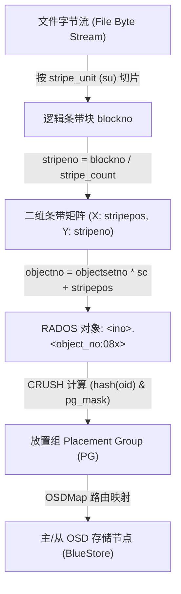
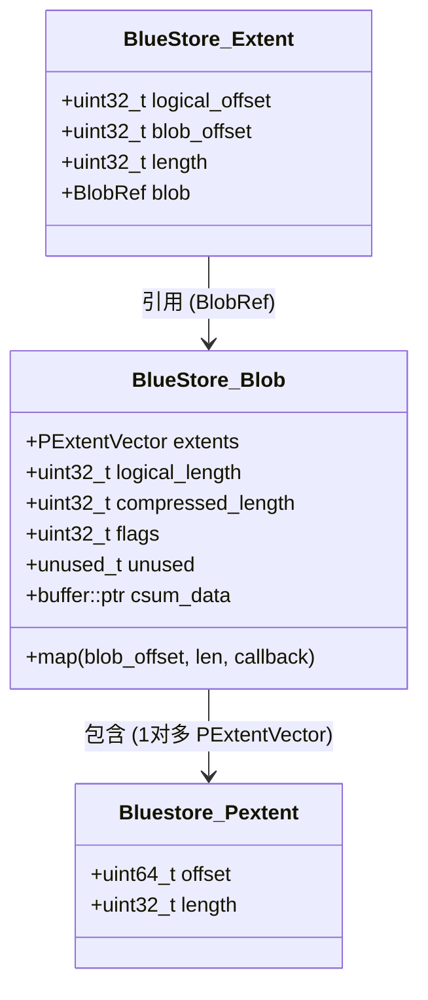
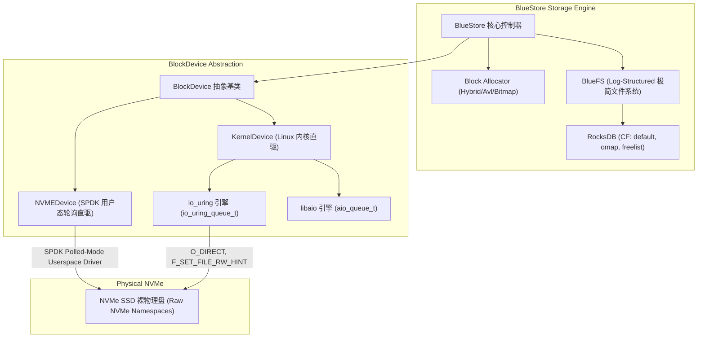
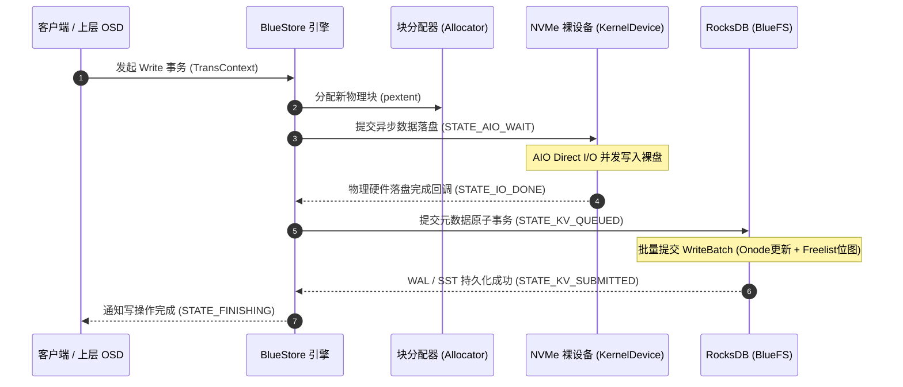
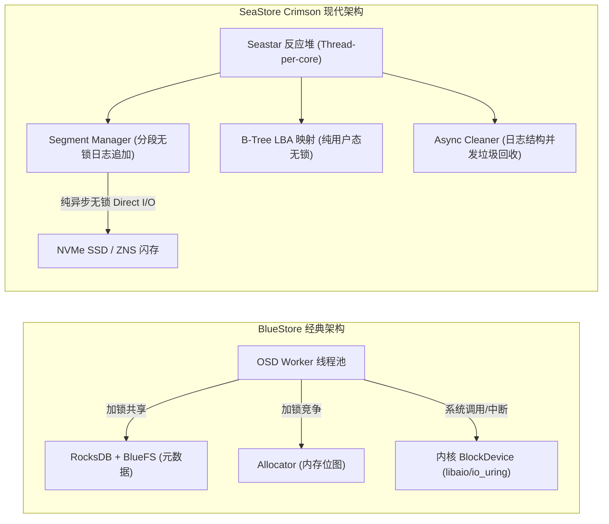
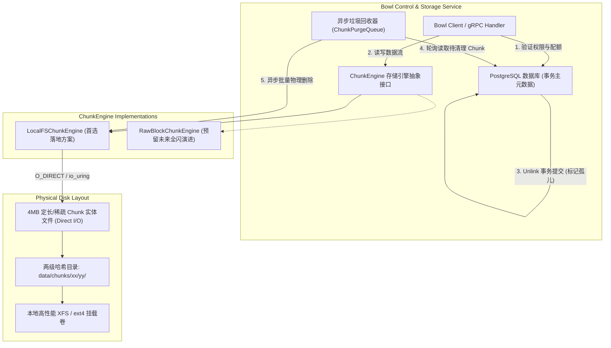

# CephFS 与 BlueStore / SeaStore 数据层深度调研报告：面向 Bowl 的分块寻址与 NVMe 存储引擎设计

## 1. 概述与核心结论

本报告对 Ceph 分布式存储系统（源码仓库路径：`/Users/fanxing/code/other/filesystem/ceph`）的数据层进行基于一手源码的深度调研，重点剖析 **CephFS 文件分块条带化协议**、**BlueStore 本地 NVMe SSD 存储引擎** 及 **Crimson SeaStore 新一代全闪引擎** 的物理落盘机制。

### 1.1 关键调研结论提炼

1. **确定性无寻址元数据（Deterministic Striping）**：CephFS 不依赖集中的 Extent 索引表记录文件字节流与底层对象的映射，而是基于不可变布局规则 `file_layout_t`（包含 `stripe_unit`、`stripe_count`、`object_size`），通过固定的数学计算实现字节偏移到对象命名（`<ino_hex>.<object_no:08x>`）的双向确定性计算（见 `src/osdc/Striper.cc`）。
2. **两层映射与三级解耦（Lextent -> Blob -> Pextent）**：BlueStore 内部将逻辑对象切分为逻辑切片（Logical Extent, `lextent`），通过中介对象 `Blob` 解耦压缩、校验与共享引用关系，最终映射到裸设备的物理连续块（Physical Extent, `pextent`），从而在没有外部文件系统的情况下实现了高效的 COW、零打洞与稀疏文件管理（见 `src/os/bluestore/BlueStore.h` 与 `bluestore_types.h`）。
3. **NVMe SSD 针对性旁路优化**：
   - 彻底摒弃本地文件系统（XFS/ext4），消除 POSIX 双写日志放大与千万级小文件目录分裂（Dentry Lock）瓶颈；
   - 采用 `KernelDevice` 结合 `io_uring`/`libaio`，并通过 Linux `F_SET_FILE_RW_HINT` 多流接口指导 SSD 固件 GC 分流（见 `src/blk/kernel/KernelDevice.cc`）；
   - 在 SSD 上将 `min_alloc_size` 设为 4KB（`bluestore_min_alloc_size_ssd`），并将延迟写阈值 `prefer_deferred_size_ssd` 强制置为 0，彻底规避小覆写导致的 RocksDB WAL 与裸盘双写放大（见 `src/common/options/global.yaml.in`）。
4. **状态机与原子事务双写一致性**：BlueStore 严格执行“**先落盘新数据块（AIO），再原子提交 RocksDB 元数据（Onode + Freelist）**”的依赖序（`STATE_AIO_WAIT -> STATE_IO_DONE -> STATE_KV_SUBMITTED`）。即便节点掉电，未引用的孤儿物理块在崩溃恢复阶段会被 Freelist 重新覆盖，杜绝脏数据引用。
5. **异步截断与异步清除流水线**：
   - 截断（Truncate）操作通过 `truncate_seq` 与 `truncate_size` 随 Client 读写请求动态透传，由 OSD 在执行前置时序比对并延迟抢先截断，避免全局锁；
   - 删除（Unlink）操作由 MDS 软删除至 `StrayManager` 后推入持久化 `PurgeQueue`，在后台按对象步长并发分发 RADOS 删除请求，平滑后台 I/O 尖峰。

---

## 2. 维度一：分块与寻址模型

### 2.1 CephFS 条带化模型（`ceph_file_layout` 与 `Striper`）

CephFS 将上层 POSIX 文件字节流转化为扁平的 RADOS 对象池。此转换过程由静态布局结构定义，避免了集中式 Extent 映射元数据表。

#### 2.1.1 布局数据结构与默认参数

- **源码位置**：
  - `src/include/ceph_fs.h:68-83`（结构体 `struct ceph_file_layout`）
  - `src/include/fs_types.h:107-127`（结构体 `struct file_layout_t` 与默认值）
- **核心字段**：
  ```c
  struct ceph_file_layout {
      __le32 fl_stripe_unit;        /* 条带单元大小（字节），必须为页面对齐 */
      __le32 fl_stripe_count;       /* 并行条带化的对象数量（宽度） */
      __le32 fl_object_size;        /* 单个 RADOS 对象的最大容量（字节） */
      __le32 fl_cas_hash;           /* 保留字段 */
      __le32 fl_object_stripe_unit; /* 纠删码对象内分块，保留 */
      __le32 fl_pg_pool;            /* 绑定的 RADOS 数据存储池 ID */
  } __attribute__ ((packed));
  ```
- **默认取值**（`src/include/fs_types.h:125-127`）：
  ```cpp
  static file_layout_t get_default() {
      return file_layout_t(1<<22, 1, 1<<22); // stripe_unit=4MB, stripe_count=1, object_size=4MB
  }
  ```
  在默认情况下，`stripe_unit == object_size == 4MB`，且 `stripe_count == 1`。这代表文件直接按 4MB 连续切块，不进行横向交错条带化。当配置 `stripe_count > 1` 且 `stripe_unit < object_size` 时，触发 RAID-0 式跨对象交叉条带化。

#### 2.1.2 确定性对象寻址与命名规范

- **对象命名格式**：
  - **源码位置**：`src/osdc/Striper.h:60-63`、`src/osdc/Striper.cc:29-32`
  - **命名规则**：
    ```cpp
    char buf[32];
    snprintf(buf, sizeof(buf), "%llx.%%08llx", (long long unsigned)ino);
    ```
    对象名称格式严格为：`<Inode_Hex>.<Object_Index_8Hex>`。
    例如 Inode 编号为 `0x10000000001` 的文件，其第 0、1 个分块对象名称分别为：
    `10000000001.00000000`、`10000000001.00000001`。
- **条带化数学转换算法**：
  - **源码位置**：`src/osdc/Striper.cc:182-240`（函数 `Striper::file_to_extents`）
  - **计算逻辑**：
    给定文件内连续字节区间 `[offset, offset + len)`：
    ```cpp
    uint64_t su = layout->stripe_unit;
    uint64_t stripe_count = layout->stripe_count;
    uint64_t object_size = layout->object_size;
    uint64_t stripes_per_object = object_size / su;

    uint64_t blockno = cur / su;                         // 全局条带单元序号
    uint64_t stripeno = blockno / stripe_count;          // 水平条带行号 (Y 轴)
    uint64_t stripepos = blockno % stripe_count;         // 条带组内对象偏移序号 (X 轴)
    uint64_t objectsetno = stripeno / stripes_per_object;// 对象组序号
    uint64_t objectno = objectsetno * stripe_count + stripepos; // 全局对象序号

    uint64_t block_start = (stripeno % stripes_per_object) * su;
    uint64_t block_off = cur % su;
    uint64_t x_offset = block_start + block_off;        // 映射到目标对象内的物理偏移
    ```
- **客户端调用集成**：
  - `src/osdc/ObjectCacher.h:722-733`：`ObjectCacher::file_read` 与 `file_write` 在处理缓存前，均直接调用 `Striper::file_to_extents` 换算对应的 `ObjectExtent`。
  - `src/client/Client.cc:4717-4720, 18058, 18173`：CephFS 客户端读写在下发 OSD 操作前，调用 `Striper::file_to_extents` 确定路由目标 PG 与主 OSD。



---

### 2.2 BlueStore 内部三层寻址模型（`lextent -> Blob -> pextent`）

在单个 OSD 内部，BlueStore 将接收到的 RADOS 对象数据映射到底层 NVMe 裸设备上。为支持高效的 COW、快照复用、数据压缩及 Checksum 校验，BlueStore 建立了三级映射模型。

#### 2.2.1 三层映射定义与关键数据结构

- **Logical Extent (`lextent`)**：
  - **源码位置**：`src/os/bluestore/BlueStore.h:881-895`（结构体 `BlueStore::Extent`）
  - **定义**：描述对象逻辑地址空间的一段连续区间。
  - **字段**：
    - `uint32_t logical_offset`：对象内的逻辑偏移。
    - `uint32_t blob_offset`：对应内部 Blob 的起始偏移。
    - `uint32_t length`：逻辑长度。
    - `BlobRef blob`：引用的下层数据存储单元。
- **Blob (`bluestore_blob_t`)**：
  - **源码位置**：`src/os/bluestore/bluestore_types.h:544-600`
  - **定义**：单次 I/O、压缩、校验或写时复制（COW）的独立管理单元，承载元数据与物理块的关联关系。
  - **核心属性**：
    - `PExtentVector extents`：该 Blob 所映射的一个或多个物理块向量（`bluestore_pextent_t`）。
    - `uint32_t logical_length`：原始逻辑数据长度。
    - `uint32_t compressed_length`：压缩后的磁盘占用长度。
    - `uint8_t csum_type`、`uint8_t csum_chunk_order`、`buffer::ptr csum_data`：校验和类型（CRC32c/xxhash 等）与按块校验位图。
    - `unused_t unused`：用于记录预分配块中尚未实际写入数据的位图（`FLAG_HAS_UNUSED`），优化小块打洞与写入空间。
- **Physical Extent (`pextent`)**：
  - **源码位置**：`src/os/bluestore/bluestore_types.h:149-160`（结构体 `bluestore_pextent_t`）
  - **定义**：裸设备上连续的物理扇区/字节区间。
  - **字段**：
    - `uint64_t offset`：裸设备物理绝对字节偏移。
    - `uint32_t length`：物理连续字节长度。



#### 2.2.2 逻辑寻址到物理扇区的解算流程

- **源码位置**：`src/os/bluestore/bluestore_types.h:915-934`（函数 `bluestore_blob_t::map`）
- **寻址逻辑**：
  当给定 `lextent` 的 `blob_offset` 与 `length` 读取底层数据时，`map` 函数遍历 `extents` 数组：
  ```cpp
  auto p = extents.begin();
  while (x_off >= p->length) {
    x_off -= p->length;
    ++p; // 跨越前置物理块
  }
  while (x_len > 0 && p != extents.end()) {
    uint64_t l = std::min(p->length - x_off, x_len);
    f(p->offset + x_off, l); // 计算物理裸盘目标偏移：p->offset + x_off
    x_off = 0;
    x_len -= l;
    ++p;
  }
  ```

#### 2.2.3 Onode 结构与多分片 ExtentMap（Resharding 机制）

- **源码位置**：
  - `src/os/bluestore/bluestore_types.h:1197-1225`（`struct bluestore_onode_t`）
  - `src/os/bluestore/BlueStore.h:984-995`（`struct ExtentMap`）
  - `src/os/bluestore/BlueStore.cc:3420-3450, 3561-3570`（`ExtentMap::maybe_reshard`）
- **Onode 存储模型**：
  Onode 是对象在 RocksDB 中的核心元数据记录（Key: `O<oid>`，Prefix: `PREFIX_OBJ`）。
  Onode 内置内联存储的小型 `ExtentMap`。当对象经历大规模随机写入、打洞或快照时，`Extent` 数量急剧增加。若单个 Onode 超出 RocksDB 推荐 Key-Value 大小阈值，BlueStore 会触发分片机制：
  - `onode.extent_map_shards` 保存分片索引列表（`shard_info { offset, bytes }`）；
  - 超出内联限制的 Extent 区间会被切分并落盘到独立 RocksDB 键中（Key: `O<oid>#<shard_offset>`）；
  - `ExtentMap::fault_range(db, offset, length)`（`BlueStore.cc:3420`）按需通过前缀扫描将所需区间的 Extent 分片加载至内存。

---

## 3. 维度二：NVMe SSD 物理落盘与 I/O 引擎架构

### 3.1 历史演进：FileStore 架构缺陷复盘

在引入 BlueStore 之前，Ceph 采用基于传统 POSIX 文件系统（主要是 XFS、btrfs）的 FileStore 引擎，遭遇了严重架构瓶颈：

1. **双写日志（Double-Write Journaling）放大**：
   POSIX 文件系统不提供跨文件数据写与元数据变更（如 Extended Attributes `xattr`）的原子事务。FileStore 为保证掉电一致性，必须先将写请求与元数据完整追加写入裸分区或者专用日志文件（FileStore Journal）并 `fsync`，然后再写回文件系统中的目标对象文件。这意味着**单次写 I/O 承担 200% 的写放大**。
2. **XFS 目录分片与 Dentry Lock 竞争**：
   单个 PG 包含数百万对象。为避免单个目录下小文件过多导致 Lookup 性能退化，FileStore 实现了层级目录折叠机制（Subdirectory Split/Merge，如 `current/DIR_A/DIR_B/`）。频繁的对象增删导致剧烈的目录重命名（`rename`）与 XFS Inode/Directory 锁争用，I/O 延迟毛刺严重。
3. **元数据一致性与崩溃检查负担**：
   崩溃恢复时，FileStore 必须对整个底层文件系统执行昂贵的回放与扫描校验，无法实现秒级快速重连。

---

### 3.2 BlueStore 裸设备直管与多引擎并发（`BlockDevice` 体系）

BlueStore 彻底旁路本地文件系统，直接将裸磁盘划分为自描述的物理 Block Device，并自建 RocksDB（基于微型文件系统 BlueFS）管理全局元数据。



#### 3.2.1 驱动接口与内核旁路设计

- **源码位置**：
  - `src/blk/BlockDevice.h:30-100`（抽象基类 `BlockDevice`）
  - `src/blk/kernel/KernelDevice.h` 与 `src/blk/kernel/KernelDevice.cc:80-120`（`KernelDevice`）
  - `src/blk/kernel/io_uring.cc:16-100`（`ioring_queue_t`）
  - `src/blk/spdk/NVMEDevice.h:30-80` 与 `src/blk/spdk/NVMEDevice.cc`（`NVMEDevice`）
- **KernelDevice 的异步引擎选择**（`KernelDevice.cc:88-105`）：
  ```cpp
  bool use_ioring = cct->_conf.get_val<bool>("bdev_ioring");
  unsigned int iodepth = cct->_conf->bdev_aio_max_queue_depth;

  if (use_ioring && ioring_queue_t::supported()) {
    bool use_ioring_hipri = cct->_conf.get_val<bool>("bdev_ioring_hipri");
    bool use_ioring_sqthread_poll = cct->_conf.get_val<bool>("bdev_ioring_sqthread_poll");
    io_queue = std::make_unique<ioring_queue_t>(iodepth, use_ioring_hipri, use_ioring_sqthread_poll);
  } else {
    io_queue = std::make_unique<aio_queue_t>(iodepth);
  }
  ```
  - **io_uring 实现细节**（`src/blk/kernel/io_uring.cc:54-75`）：采用 `io_uring_prep_writev` 与 `io_uring_prep_readv`，开启 `IOSQE_FIXED_FILE` 预注册文件描述符，减少系统调用陷入；支持开启 SQPOLL（`use_ioring_sqthread_poll`）与 HIPRI 轮询（`use_ioring_hipri`）。
  - **libaio 后备机制**：在老旧内核上回退至 `io_submit` 与 `io_getevents`。
- **SSD 寿命与固件 GC 协同：Linux Multi-Stream Hint**：
  - **源码位置**：`src/blk/BlockDevice.h:46-60`、`src/blk/kernel/KernelDevice.cc:85`
  - BlueStore 为每个打开的物理设备维护一组不同生命周期的文件句柄数组：
    `fd_directs.resize(WRITE_LIFE_MAX, -1)`。
    通过 `fcntl(fd, F_SET_FILE_RW_HINT, ...)` 分别向底层 NVMe 驱动透传写入流寿命提示：
    `WRITE_LIFE_SHORT`（RocksDB WAL / 频繁覆写元数据）、`WRITE_LIFE_MEDIUM`、`WRITE_LIFE_LONG`（大块持久化冷数据）。该机制避免冷热数据在同一个 SSD 闪存擦除块（Erase Block）中混合存放，降低了 SSD 内部的垃圾回收写放大（WA）。
- **SPDK NVMEDevice（用户态零拷贝极速路径）**：
  在高性能场景下，BlueStore 可配置编译 SPDK 支持。`NVMEDevice` 直接通过 PCIe BAR 空间与 DMA 映射在用户态向 NVMe Submission Queue (SQ) 提交写命令，并利用 Completion Queue (CQ) 进行 Polled-Mode 轮询，完全剥离了 Linux 内核上下文切换与中断开销。

---

### 3.3 物理分配粒度 `min_alloc_size` 与块分配器架构

#### 3.3.1 `min_alloc_size` 的配置规则与第一性原理

- **源码位置**：`src/common/options/global.yaml.in:4779-4820`
- **参数矩阵**：
  ```yaml
  bluestore_min_alloc_size: 0      # 0 表示依据介质类型自动路由
  bluestore_min_alloc_size_hdd: 4_K # HDD 历史上曾设为 64KB，现代版本统一收敛至 4KB
  bluestore_min_alloc_size_ssd: 4_K # SSD 默认锁定 4096 字节 (4KB)
  ```
- **本质机理**：
  `min_alloc_size` 是底层分配器能够指派给单一物理 Extent 的最小不可分割单元。
  - **SSD 采用 4KB**：现代 NVMe 固件的物理扇区（LBA）与内部 Flash 页通常为 4KB。4KB 分配与文件系统及内存 Page 完全对齐，小块覆写无需进行跨 64KB 块的读-改-写（Read-Modify-Write, RMW），大幅削减写放大与 COW 拷贝开销。
  - **代价**：当总容量达到数十 TB 时，4KB 块数量达到数十亿个，分配器需要更多内存维护空闲状态。

#### 3.3.2 块分配器体系（Bitmap vs AVL vs Hybrid）

- **源码位置**：
  - `src/os/bluestore/Allocator.cc:38-60`（工厂方法 `Allocator::create`）
  - `src/os/bluestore/BitmapAllocator.cc`
  - `src/os/bluestore/AvlAllocator.cc`
  - `src/os/bluestore/HybridAllocator.h`
- **分配器算法对比**：

| 分配器类型 | 内部数据结构 | 核心优势 | 劣势与瓶颈 | 适用场景 |
| :--- | :--- | :--- | :--- | :--- |
| **`BitmapAllocator`** | 多层分级位图（Bitmask Hierarchy） | 空间跟踪精确到 4KB，寻址速度恒定，便于位运算并发合并 | 内存开销严格正比于物理盘容量（每 TB 消耗固定内存），大块连续空间查找效率略低 | 小容量固态盘或内存极其充裕的环境 |
| **`AvlAllocator`** | 按长度与偏移双向排序的 AVL 树 | 连续大块区间分配极快（$O(\log N)$），天然抗碎片化 | 碎片严重时 AVL 树节点急剧膨胀，单节点内存开销远超位图（每个区间需指针与高度信息） | 早期机械盘或写密集且无碎片的负载 |
| **`HybridAllocator`**（**默认**） | AVL/Btree + Bitmap 混合双层架构 | **动态自适应**：大跨度连续空间在 AVL 树中管理，细碎小 Extent 溢出下沉至 Bitmap，通过 `bluestore_hybrid_alloc_mem_cap` 强力封顶内存 | 架构复杂度高，跨层移动时涉及锁迁移 | **生产全场景默认配置**（`bluestore_allocator: hybrid`） |

---

## 4. 维度三：写路径、随机覆盖写与读路径

### 4.1 写路径分解与调度决策（`_do_write_data`）

- **源码位置**：`src/os/bluestore/BlueStore.cc:17980-18040`
- **对齐切分算法**：
  当应用发起写入 `offset ~ length` 时，BlueStore 根据 `min_alloc_size`（SSD 上为 4KB）将区间切分为三段：
  ```cpp
  head_offset = offset;
  head_length = p2nphase(offset, min_alloc_size); // 头部未对齐零头

  tail_offset = p2align(end, min_alloc_size);    // 尾部未对齐起始
  tail_length = p2phase(end, min_alloc_size);     // 尾部未对齐零头

  middle_offset = head_offset + head_length;     // 中间 4KB 对齐主干
  middle_length = length - head_length - tail_length;

  if (head_length) {
    _do_write_small(txc, c, o, head_offset, head_length, p, wctx);
  }
  if (middle_length) {
    _do_write_big(txc, c, o, middle_offset, middle_length, p, wctx);
  }
  if (tail_length) {
    _do_write_small(txc, c, o, tail_offset, tail_length, p, wctx);
  }
  ```

---

### 4.2 大块对齐写 vs 小块覆盖写：延迟写（Deferred Write）与 COW 的分支选择

#### 4.2.1 大块写路径（`_do_write_big`）

- **源码位置**：`src/os/bluestore/BlueStore.cc:17415-17480`
- **执行逻辑**：
  1. 调用分配器分配新的物理连续块 `pextent`；
  2. 若开启压缩且满足压缩块尺寸，交由压缩线程池压缩；
  3. 计算对应区间的 Checksum 并存入新创建的 `Blob`；
  4. 组装异步 I/O 上下文，调用 `bdev->aio_write` 直接向裸盘下发 Direct I/O；
  5. 在 `txc` 事务中准备更新 `ExtentMap`，建立 `lextent -> Blob` 的映射关系。

#### 4.2.2 小块随机覆盖写与 SSD 的延迟写策略

- **源码位置**：
  - `src/os/bluestore/BlueStore.cc:16879-17070`（`_do_write_small` 与 `_do_write_small_with_maybe_blob_reuse`）
  - `src/common/options/global.yaml.in:4863-4882`（`bluestore_prefer_deferred_size_*`）
- **核心分支判断**：
  在 HDD 上，`bluestore_prefer_deferred_size_hdd` 默认为 64KB。当覆写尺寸小于该阈值时，BlueStore 会将数据打包为 `bluestore_deferred_op_t`，直接写入 RocksDB 的 WAL。这样把对机械盘的随机小寻道覆写转换为顺序 WAL 写入，后续由后台线程批量刷盘。
- **SSD 上的关键设计：`prefer_deferred_size_ssd == 0`**：
  在 NVMe SSD 上，`prefer_deferred_size_ssd` **硬编码默认配置为 0**。
  - **设计原因**：NVMe SSD 具备极高的并发随机写 IOPS，没有机械寻道开销。如果将小写请求写入 RocksDB WAL，再由后台线程执行二次落盘，**会导致双倍写放大并消耗闪存寿命**。
  - **SSD 实际执行路径**：
    1. **可变 Blob 闲置空间直写**：若覆盖位置位于原 Blob 分配范围内且此前为未写入的空洞块（`is_unused(b_off, b_len)` 为真），直接下发原地 AIO 写裸盘，并清除 `unused` 标记位（`BlueStore.cc:17034-17070`）；
    2. **新块分配与写时复制（COW）**：若原块已被持久化或被共享引用（如创建了快照），BlueStore 在分配器中申请新的 4KB `pextent`，将数据写入新块，并在 `txc` 元数据事务中重定向 `lextent` 指针，原 `pextent` 的引用计数递减或被释放放入 `txc->released`（`BlueStore.cc:16910-16940`）。

---

### 4.3 数据完整性（Checksum）与 RocksDB/BlueFS 状态机流水线

#### 4.3.1 块级校验和机制

- **源码位置**：`src/os/bluestore/bluestore_types.h:565-570`、`src/common/Checksummer.h`
- 写入时，Blob 根据配置的 `csum_type`（默认 CRC32c，支持 xxhash64、crc32c_16 等）与 `csum_chunk_order`（默认 12，即 $2^{12} = 4096$ 字节），为每个 4KB 物理块计算一个校验和，保存在 `bluestore_blob_t::csum_data` 中并持久化在 RocksDB。
- 读路径（`BlueStore::_do_read`）在读取裸设备块后，立即调用 `Checksummer::verify` 执行校验。若发生静默数据损坏（Silent Data Corruption），直接向上层抛出 `-EIO` 并触发副本修复。

#### 4.3.2 事务状态机（`_txc_state_proc`）与依赖顺序

- **源码位置**：`src/os/bluestore/BlueStore.cc:14947-15060`
- **核心依赖原则**：**新分配的数据块必须先在物理裸设备上完全落盘完成，才能向 RocksDB 提交元数据指针变更**。



- **状态转移详解**：
  1. `STATE_PREPARE`：内存阶段，划分 Extent、计算 Checksum、分配物理盘块并加入 I/O 队列；
  2. `STATE_AIO_WAIT`：调用 `io_queue->submit()` 下发 AIO，等待内核或 SPDK 硬件写入完成中断；
  3. `STATE_IO_DONE`：物理数据已安全落盘，但上层尚不可见；
  4. `STATE_KV_QUEUED` -> `STATE_KV_SUBMITTED`：将包含 Onode 更新、ExtentMap 变更、Freelist 分配/释放的元数据写入 RocksDB `WriteBatch`，并由专用 `kv_sync_thread` 批量落盘；
  5. `STATE_KV_DONE`：元数据已持久化。若存在未完成的延迟写（Deferred Ops），此时转入 `STATE_DEFERRED_QUEUED` 执行真正的覆盖写；
  6. `STATE_FINISHING`：触发应用回调，释放内存锁定。

---

### 4.4 读路径（Read Path）

- **源码位置**：`src/os/bluestore/BlueStore.cc:16250-16350`（`BlueStore::_do_read`）
- **步骤**：
  1. 检索内存 Onode 缓存（若 Cache Miss 则从 RocksDB 加载）；
  2. 遍历 `ExtentMap` 查询目标读取区间覆盖的 `Extent` 列表；
  3. 若遭遇未分配的逻辑空洞区间（Hole），直接在内存 Buffer 中填零填充，不发起物理 I/O；
  4. 对已分配区间，通过 `Blob::map` 换算物理绝对偏移，调用 `bdev->read` 或 `bdev->aio_read` 从裸设备读取；
  5. 读取完毕后，使用 `Blob` 中的校验码比对数据；若为压缩 Blob，则调用解压器还原原始逻辑字节流。

---

## 5. 维度四：稀疏文件、Truncate、Zero/Punch Hole 与空间核算

### 5.1 稀疏文件与零块检测

- **稀疏存储本质**：BlueStore 的对象逻辑大小（`onode.size`）与物理分配容量完全解耦。未写入的区间在 `ExtentMap` 中没有任何 `lextent` 记录（零条目）。
- **零块自动检测**：
  - **源码位置**：`src/os/bluestore/BlueStore.cc:16920-16930`
  - 若配置 `bluestore_zero_block_detection = true`，当写入全零数据块时，BlueStore 直接拦截该块的物理分配，仅对 `ExtentMap` 执行打洞，不消耗任何物理介质扇区。

---

### 5.2 分布式截断时序协调协议（`truncate_seq` / `truncate_size`）

在分布式共享存储中，文件截断请求与并发客户端的并发读写存在网络乱序竞争。CephFS 采用版本序号机制解决此一致性问题。

- **源码位置**：
  - `src/include/ceph_fs.h:971-972`（Inode 元数据携带 `truncate_seq` 与 `truncate_size`）
  - `src/osd/PrimaryLogPG.cc:5875-5885, 5970-5974, 6089-6095, 7145-7177`（OSD 处理操作逻辑）
- **协议流程**：
  1. 客户端发起 `truncate()`，MDS 将该文件的 `truncate_seq` 递增，并更新 `truncate_size`，向客户端发放 Caps；
  2. 客户端向 OSD 发起读写时，必须在操作头部强制附加当前感知的 `op.extent.truncate_seq` 和 `op.extent.truncate_size`；
  3. **OSD 端的延迟抢先截断（PrimaryLogPG.cc:5970-5974）**：
     ```cpp
     if ((oi.truncate_seq < op.extent.truncate_seq) &&
         (op.extent.offset + op.extent.length > op.extent.truncate_size) &&
         (oi.size > op.extent.truncate_size)) {
       size = op.extent.truncate_size; // 立即自动截断读取边界
     }
     ```
     若 OSD 发现请求中的 `truncate_seq` 大于对象本地记录的 `oi.truncate_seq`，说明此前发生的截断广播因网络乱序滞后于当前读写。**OSD 立即优先执行截断裁剪，然后再处理该读写请求**；
  4. 反之，若收到的 `truncate_seq <= oi.truncate_seq`，说明这是一个滞后的过时截断命令，OSD 直接作为 No-op 丢弃（`PrimaryLogPG.cc:7168-7172`）。

---

### 5.3 本地裁剪、打洞与物理空间释放（`punch_hole`）

- **源码位置**：
  - `src/os/bluestore/BlueStore.cc:4593-4655`（`BlueStore::ExtentMap::punch_hole`）
  - `src/os/bluestore/BlueStore.cc:18450-18485`（`BlueStore::_zero` 与 `_do_zero`）
  - `src/os/bluestore/BlueStore.cc:18490-18545`（`BlueStore::_truncate` 与 `_do_truncate`）
- **区间分割四种形态（`ExtentMap::punch_hole` 实现分析）**：
  当对区间 `[offset, offset + length)` 执行打洞或截断时：
  1. **切分中间（Split Middle）**：打洞区间完全落在某个 `lextent` 内部。该 `lextent` 被分裂为前半截与后半截两个独立的 `lextent`，中间部分生成 `OldExtent` 待释放（`BlueStore.cc:4606-4616`）；
  2. **裁剪尾部（Deref Tail）**：打洞区间覆盖 `lextent` 后半部，缩减当前 `lextent->length`；
  3. **整块删除（Deref Whole）**：打洞区间完整覆盖 `lextent`，将其从 `extent_map` 红黑树中彻底移除；
  4. **裁剪头部（Deref Head）**：打洞区间覆盖 `lextent` 前半部，调整 `logical_offset` 与 `blob_offset`，保留尾部。
- **空间释放与 Quota 原子更新**：
  被剔除的 Extent 收集到 `WriteContext::old_extents`。在事务提交流程（`_wctx_finish`）中，若对应 Blob 的引用计数清零，其涵盖的所有 `pextent` 会作为释放记录插入 `txc->released`，随后在 RocksDB 提交时通知 `Allocator::release` 归还给物理空闲位图，同时原子更新 `txc->statfs_delta` 保证集群配额（Quota）与物理使用量强一致。

---

## 6. 维度五：垃圾回收与异常恢复机制

### 6.1 MDS 异步清理流水线（`StrayManager` 与 `PurgeQueue`）

POSIX 语义规定，当最后一个打开的文件句柄关闭且硬链接计数（`nlink`）归零时，文件数据才可真正物理销毁。在包含数百万对象的分布式存储中，同步删除会导致客户端 `close()` 调用陷入严重阻塞。CephFS 将此过程完全异步化。

```mermaid
flowchart TD
    Client["客户端执行 unlink()"] --> MDS["MDS 校验权限与 nlink"]
    MDS -->|"nlink == 0 但仍有 handle 打开"| StrayDir["移动至内部目录: ~mds0/stray*"]
    StrayDir -->|"最后客户端关闭文件句柄"| StrayMgr["StrayManager 判定待销毁"]
    StrayMgr -->|"组装 PurgeItem"| PQ["PurgeQueue 队列"]
    PQ -->|"Journaler 顺序写"| MDSJournal["MDS 元数据日志 (持久化保障)"]
    PQ -->|"后台并发工作线程"| Striper["Striper::get_num_objects 换算对象集"]
    Striper -->|"批量异步发送 CEPH_OSD_OP_DELETE"| RADOS["RADOS OSD 数据节点集群"]
    RADOS -->>|"全部删除 ACK"| PQCommit["推进 Journal expire_to 位点"]
```

#### 6.1.1 软删除与 Stray 状态流转

- **源码位置**：`src/mds/StrayManager.h` 与 `src/mds/StrayManager.cc`
- 当文件被 `unlink` 时，MDS 并不立即清理对象，而是将对应的 `dentry` 重命名移动到保留的隐藏目录 `~mds<rank>/stray<num>/` 下。
- `StrayManager` 持续监控各 Stray Inode 的打开句柄引用计数。一旦文件关闭且无活跃引用，立即调用 `PurgeQueue::push_free_item` 启动物理清除。

#### 6.1.2 PurgeQueue 持久化事务与批量并发清理

- **源码位置**：
  - `src/mds/PurgeQueue.h:38-70`（结构体 `class PurgeItem`）
  - `src/mds/PurgeQueue.cc:631-710`（函数 `PurgeQueue::_execute_item`）
- **PurgeItem 结构体**：
  ```cpp
  class PurgeItem {
    Action action;          // PURGE_FILE, TRUNCATE_FILE, PURGE_DIR
    inodeno_t ino;          // 目标 Inode
    uint64_t size;          // 文件最终大小
    file_layout_t layout;   // 文件分块布局
    SnapContext snapc;      // 快照上下文
  };
  ```
- **执行机制**：
  1. **WAL 日志化**：`PurgeItem` 必须先通过 `Journaler` 写入 MDS 的元数据日志池，确保 MDS 发生故障重启时，待删除队列零丢失；
  2. **批量并发投递**（`PurgeQueue.cc:642-655`）：
     根据 `item.layout` 与 `item.size`，调用 `Striper::get_num_objects` 计算出全量关联的 RADOS 对象列表（如 `0 ~ N` 号对象）；
     在内存中构造 `PurgeItemCommitOp`，并发向后端各 OSD 发送异步批量删除命令（`PURGE_OP_RANGE` / `CEPH_OSD_OP_DELETE`）；
  3. **水位限流与收尾**：通过配置参数 `mds_max_purge_ops_per_pg` 严格控制并发清理的请求密度，防止后台删除流量冲垮正常读写；全部对象确认删除后，推进 Journal 提交位点 `expire_to`。

---

### 6.2 BlueStore 崩溃恢复与空间状态重建

当 OSD 节点在遭遇断电、内核崩溃后重启时，BlueStore 依靠事务顺序屏障与 RocksDB 原子提交机制保障一致性。

#### 6.2.1 事务双写防重与空闲块屏障

由于 BlueStore 在数据落盘时严格遵循“**数据块 Direct I/O 先落盘，RocksDB 事务后提交**”的铁律：
- **场景 A：数据落盘阶段发生断电**：此时 RocksDB 中没有任何新元数据引用该物理块，该物理块在下次扫描时被视为无效空闲块，不影响文件系统逻辑一致性；
- **场景 B：RocksDB 提交中或提交后断电**：RocksDB 内部自身的 WAL 机制确保了 `WriteBatch` 要么完整提交，要么全部回滚。一旦提交成功，新 Onode、ExtentMap 与 Freelist 分配记录同时永久生效。

#### 6.2.2 延迟写重放（`_deferred_replay`）

- **源码位置**：`src/os/bluestore/BlueStore.cc:16162-16220`
- 在前次运行中若存在已写入 RocksDB WAL 但尚未真正执行裸设备刷盘的 Deferred 覆盖写操作：
  1. OSD 启动阶段遍历 RocksDB 中前缀为 `PREFIX_DEFERRED` 的所有键；
  2. 将键值反序列化为 `bluestore_deferred_transaction_t`；
  3. 为每个记录构造一个初始状态为 `STATE_KV_DONE` 的 `TransContext`；
  4. 重新下发驱动落盘，等待硬件落盘完成后将 `PREFIX_DEFERRED` 键从 RocksDB 中安全删除。

#### 6.2.3 FreelistManager 与内存 Allocator 位图重建

- **源码位置**：
  - `src/os/bluestore/FreelistManager.h:15-60`
  - `src/os/bluestore/BlueStore.cc:7605-7615, 8945-8955`
- **位图加载与校验流程**：
  1. 启动初始化时，`Allocator` 默认将全部介质空间标记为全部占用或全部空闲；
  2. BlueStore 调用 `FreelistManager::enumerate_next` 扫描 RocksDB 中持久化的已分配/空闲区间：
     ```cpp
     fm->enumerate_reset();
     uint64_t offset, length;
     while (fm->enumerate_next(db, &offset, &length)) {
       alloc->init_add_free(offset, length); // 重新填装内存中的 Hybrid/Bitmap 分配器
     }
     ```
  3. 执行 `_get_ondisk_reserved()` 扣除磁盘头标签（`BDEV_FIRST_LABEL_POSITION`）及 BlueFS 超级块占用区域；
  4. 若开启 `bluestore_fsck_on_mount`，系统遍历全量 Onode 的全部 `Extent`，与 `Allocator` 位图进行比对（交叉引用核对），一旦检测到孤儿块或重复引用块，立即报错拦截。

---

## 7. 维度六：Crimson SeaStore 新一代全闪引擎演化与对比

为了突破多核 NUMA 架构下线程锁切换与 RocksDB LSM-Tree 写放大（Compaction）的双重瓶颈，Ceph 开发了面向极速全闪介质（NVMe SSD / CXL / ZNS）的下一代存储引擎 **SeaStore**（源码目录：`src/crimson/os/seastore/`）。

### 7.1 核心设计范式革新



### 7.2 技术特性详细对照表

| 评估维度 | FileStore（早期历史） | BlueStore（当前主力成熟） | Crimson SeaStore（全闪演进） |
| :--- | :--- | :--- | :--- |
| **元数据存储底座** | 本地文件系统目录树 + Inode xattr | 嵌入式 RocksDB 运行在微型 BlueFS 上 | **自研 Log-Structured 存储，彻底消除 RocksDB** |
| **并发线程与调度模型** | 多线程竞争，依赖内核 POSIX 锁与队列 | 跨线程池（OSD Op 线程、KV 提交线程、AIO 回调线程） | **Seastar 纯异步反应堆（Thread-per-core，无共享无锁）** |
| **物理落盘路径** | 双写 POSIX Journal -> 写入 XFS 文件 | 新数据直写裸设备 -> RocksDB 提交元数据 | **段式日志追加（Segmented Journal），无双写开销** |
| **逻辑地址映射（LBA）** | 依赖操作系统 VFS 与底层 Inode Extent 树 | 三级自描述结构：`lextent -> Blob -> pextent` | **B-Tree LBA 映射管理器（`btree_lba_manager.cc`）** |
| **覆盖写（Overwrite）** | 覆盖写文件，引起本地文件系统日志刷盘 | SSD 上 4KB 粒度 COW 或闲置块直写；HDD 上 WAL 延迟写 | **重定向写（Out-of-place Write）结合日志追加与 Backref 更新** |
| **垃圾回收（GC）机制** | 依赖内核文件系统自带的 Block Group 分配器 | 无后台搬迁，依赖 ExtentMap 打洞与物理分配器直接释放 | **段级异步清洗器（`async_cleaner.cc`）**：前台搬迁存活 Extent 并擦除整段 |
| **新型介质支持（ZNS）** | 不支持（传统文件系统无法处理顺序写约束） | 仅能通过模拟驱动支持，随机写开销极大 | **原生支持 ZNS 分区设备**（`segment_manager/zbd.cc`） |

---

## 8. 维度七：对 Bowl 架构设计的启发与务实选型

### 8.1 Bowl 架构定位与业务边界约束

Bowl 当前基于 PostgreSQL 统一管理高强度的 POSIX 元数据语义（包含 `disk`、`inode`、`dentry`、`handle`、`session`、`xattr`、`quota` 及锁语义，参见 Bowl ADR 0001 至 ADR 0018）。
在数据层落地阶段，Bowl 面临的核心决策是：**如何将文件数据块（Chunk）高效、稳定地持久化在本地 NVMe SSD 上**。

---

### 8.2 存储方案深度对比矩阵

| 方案类别 | 方案 A：基于本地文件系统存 Chunk 文件（如 XFS/ext4） | 方案 B：预分配大文件（Container）管理 Extent | 方案 C：自研裸设备 Extent 存储引擎（类 BlueStore/SeaStore） |
| :--- | :--- | :--- | :--- |
| **物理存储介质形式** | 挂载的本地文件系统，按规则分级存储单个 Chunk 文件（如 `chunks/ab/cd/<chunk_id>`） | 在本地文件系统上预先申请数个若干 GB/TB 的巨大稀疏容器文件，内部自建块分配表 | 独占裸 NVMe SSD 命名空间（Raw Block Device），接管磁盘物理 LBA 扇区 |
| **元数据存储方案** | 严重冗余：PostgreSQL 记录一次，本地 OS 文件系统 Inode/Dentry 再记录一次 | 简洁统一：PostgreSQL 直接记录 `{chunk_id, container_id, offset, length}` | 极致但沉重：PostgreSQL 存元数据，存储引擎内部仍需自备 RocksDB/B-Tree 记录物理 Extent |
| **工程实现复杂度** | **极低**：直接利用标准操作系统系统调用（`read/write/open/unlink`） | **中等**：需在 Go 服务中实现定长/变长 Extent 分配器与空闲链表管理 | **极高**：需实现驱动抽象、AIO/io_uring 引擎、崩溃位图校验及设备损坏管理 |
| **I/O 吞吐与延迟瓶颈** | 百万级文件导致 OS 目录项锁（Dentry Contention）及文件系统日志双写瓶颈 | 预分配固定文件，无 OS 目录元数据开销，单文件连续块 Direct I/O | 零内核开销，最极致的 NVMe 硬件吞吐与确定性超低延迟 |
| **崩溃恢复与一致性** | 易产生孤儿文件：PostgreSQL 提交成功但文件未落盘，或删除文件失败留下无主孤儿文件 | 状态统一：物理块占用与释放完全受控于 PostgreSQL 事务的行锁与提交状态 | 需编写极其完备的本地一致性检查工具（类 `bluestore-fsck`），极度消耗工程资源 |

---

### 8.3 现实瓶颈分析：为什么在初始阶段不要模仿 BlueStore 制造裸设备轮子？

1. **第一性原理与开发成本代价**：
   BlueStore 耗费了 Ceph 核心团队数年时间迭代（直到 Nautilus/Octopus 版本才彻底稳定）。其之所以不得不直接管理裸设备，是因为分布式存储 OSD 本身需要承担成百上千节点的分布式事务与并发调度，且早期的 Linux 文件系统在特定高并发下有缺陷。
2. **Bowl 具备强大的关系型元数据底座**：
   Bowl 已经拥有事务严密、强一致性的 PostgreSQL 元数据引擎。所有关于 Inode 与 Chunk 的路由关系、租约与配额均已在 DB 内完成仲裁。若在底层再引入一套裸盘 Extent 分配与本地元数据引擎，将造成**严重的元数据层级冗余与状态分裂**。
3. **现代 Linux NVMe 文件系统的成熟度**：
   在 Linux 6.x+ 内核中，配合现代 NVMe SSD，XFS 文件系统的 Extent 扩展性能极其优越。通过合理配置挂载参数（`noatime,nodiratime,logbufs=8,logbsize=256k`）以及 Direct I/O，文件系统元数据瓶颈可以被有效规避。

---

### 8.4 针对 Bowl 第一阶段的务实架构推荐

```
➡️ 核心推荐方案：
构建「两级分层哈希目录 + 定长/稀疏 4MB Chunk 文件 + Direct I/O / io_uring + PostgreSQL 事务型 PurgeQueue」架构。
```



#### 8.4.1 详细设计规范

1. **分块模型对齐 CephFS 默认经验**：
   - 采用固定的 **4MB Chunk 粒度**（`chunk_size = 4 * 1024 * 1024`）。
   - 文件偏移直接映射：
     $$\text{chunk\_index} = \lfloor \text{offset} / 4194304 \rfloor$$
     $$\text{chunk\_offset} = \text{offset} \pmod{4194304}$$
   - 寻址无集中索引，直接在 PostgreSQL 中维护轻量级的 `chunk` 记录或由 `(inode_id, chunk_index)` 确定性计算。
2. **两级哈希目录布局防 Dentry 竞争**：
   - 严禁将全量 Chunk 堆放在同一目录下。
   - 依据 `chunk_id` 的散列值（如 SHA256 或 Inode+Index 的低位 Hex）进行两层打散：
     `$DATA_DIR/chunks/3a/f2/<disk_id>_<inode_id>_<chunk_index>.chunk`
   - 保证单个叶子目录下的文件数不超过数千个，彻底消除 XFS 目录树加锁抖动。
3. **I/O 路径采用 Direct I/O 或 io_uring**：
   - 读写数据时显式开启 `O_DIRECT`，绕过 Linux 内核 Page Cache，避免大文件流式读写挤占 PostgreSQL 数据库的可用系统内存；
   - 在 Linux 平台上采用 `io_uring` 执行异步读取与写入，单线程即能打满 NVMe SSD 的硬件带宽。
4. **借鉴 MDS PurgeQueue 实现事务性异步删除（Anti-Orphan）**：
   - 杜绝在用户请求链路（如 `unlink`、`truncate`）中同步执行本地磁盘物理删除；
   - 在 PostgreSQL 中设立 `chunk_purge_queue` 表（包含 `disk_id`、`chunk_id`、`created_at`、`retry_count`）；
   - 用户 `unlink` 时，在同一个 PostgreSQL 事务中删除 Inode/Chunk 元数据并将条目写入 `chunk_purge_queue`；
   - 后台常驻 `PurgeWorker` 协程按 Batch 捞取队列任务，调用底层存储物理删除文件，删除成功后移出队列。即使服务发生意外崩溃重启，未完成的物理删除任务依靠数据库事务保证零泄漏。
5. **接口严密抽象为未来平滑演进铺路**：
   定义清晰的 Go 数据访问接口（如 `ChunkStore`）：
   ```go
   type ChunkStore interface {
       WriteChunk(ctx context.Context, diskID string, chunkID string, offset int64, data []byte) error
       ReadChunk(ctx context.Context, diskID string, chunkID string, offset int64, length int64) ([]byte, error)
       TruncateChunk(ctx context.Context, diskID string, chunkID string, size int64) error
       DeleteChunk(ctx context.Context, diskID string, chunkID string) error
   }
   ```
   第一阶段提供 `LocalFSChunkStore` 实现；当未来单机性能达到数百万 IOPS 极限瓶颈时，可无缝平替为基于大文件 Extent 预分配甚至裸设备 SPDK 直驱的 `RawDeviceChunkStore`，而上层业务协议与 PostgreSQL 元数据逻辑完全无需变更。

---

## 9. 参考文献与源码索引列表

1. **CephFS 条带化与分块**：
   - `src/include/ceph_fs.h:68-83`：`struct ceph_file_layout` 定义
   - `src/include/fs_types.h:107-127`：`struct file_layout_t` 与默认布局参数
   - `src/osdc/Striper.h:35-65` 与 `src/osdc/Striper.cc:182-240`：`Striper::file_to_extents` 核心数学计算
   - `src/client/Client.cc:4717-4720, 18058, 18173`：CephFS 客户端分块读写调用链
2. **BlueStore 架构与映射模型**：
   - `src/os/bluestore/BlueStore.h:881-895`：`BlueStore::Extent` 定义
   - `src/os/bluestore/bluestore_types.h:149-160`：`bluestore_pextent_t` 物理块定义
   - `src/os/bluestore/bluestore_types.h:544-600, 915-934`：`bluestore_blob_t` 结构体及其物理切片映射 `map`
   - `src/os/bluestore/bluestore_types.h:1197-1225`：`bluestore_onode_t` 核心对象节点
   - `src/os/bluestore/BlueStore.cc:3420-3450, 3561-3570`：`ExtentMap` 分片重平衡机制
3. **物理设备与 I/O 驱动引擎**：
   - `src/blk/BlockDevice.h:30-100`：`BlockDevice` 驱动抽象与 `WRITE_LIFE_*` 多流接口
   - `src/blk/kernel/KernelDevice.cc:80-120`：`KernelDevice` 初始化与 `io_uring`/`libaio` 引擎分支
   - `src/blk/kernel/io_uring.cc:16-100`：`io_uring` 高性能提交与固定文件描述符机制
   - `src/blk/spdk/NVMEDevice.h:30-80`：SPDK NVMe 用户态轮询驱动
   - `src/common/options/global.yaml.in:4779-4820`：`bluestore_min_alloc_size_ssd` 4KB 默认项
   - `src/os/bluestore/Allocator.cc:38-60`：`Allocator::create` 分配器工厂
4. **读写状态机与原子事务**：
   - `src/os/bluestore/BlueStore.cc:14947-15060`：`_txc_state_proc` 事务执行状态机
   - `src/os/bluestore/BlueStore.cc:16879-17070`：`_do_write_small` 随机小写与闲置空间复用
   - `src/os/bluestore/BlueStore.cc:17415-17480`：`_do_write_big` 对齐连续写
   - `src/os/bluestore/BlueStore.cc:17980-18040`：`_do_write_data` 写入对齐切割
   - `src/common/options/global.yaml.in:4863-4882`：`bluestore_prefer_deferred_size_ssd` 0 值配置
5. **打洞、截断与垃圾回收**：
   - `src/os/bluestore/BlueStore.cc:4593-4655`：`ExtentMap::punch_hole` 物理打洞算法
   - `src/os/bluestore/BlueStore.cc:18450-18485`：`BlueStore::_zero` 零块打洞
   - `src/os/bluestore/BlueStore.cc:18490-18545`：`BlueStore::_truncate` 截断物理实现
   - `src/osd/PrimaryLogPG.cc:5970-5974, 7145-7177`：OSD 端 `truncate_seq` 时序裁剪协议
   - `src/mds/PurgeQueue.h:38-70` 与 `src/mds/PurgeQueue.cc:631-710`：MDS 异步对象清理队列
   - `src/os/bluestore/BlueStore.cc:16162-16220`：`_deferred_replay` 崩溃重放逻辑
6. **Crimson SeaStore 演化**：
   - `src/crimson/os/seastore/seastore.h`：SeaStore 引擎接口
   - `src/crimson/os/seastore/lba/btree_lba_manager.cc`：B-Tree 逻辑地址转换
   - `src/crimson/os/seastore/journal/segmented_journal.cc`：段式日志追加
   - `src/crimson/os/seastore/async_cleaner.cc`：异步段垃圾回收
   - `src/crimson/os/seastore/segment_manager/zbd.cc`：Zoned Block Device 分区设备直驱
