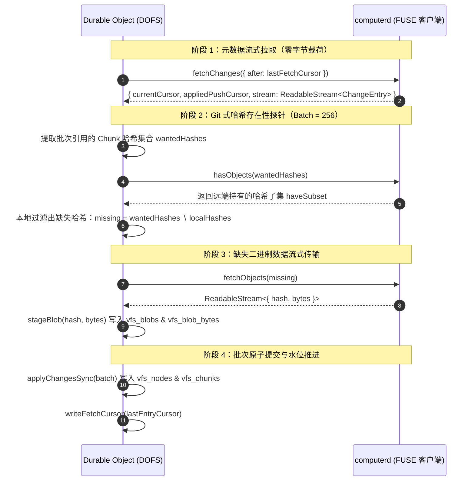

# Cloudflare Computer 存储数据层深度调研报告

## 摘要

本报告针对 Cloudflare 虚拟机与沙箱环境的核心存储数据层系统——`computer`（涵盖核心包 [`packages/dofs`](file:///Users/fanxing/code/other/filesystem/computer/packages/dofs)、[`packages/computerd`](file:///Users/fanxing/code/other/filesystem/computer/packages/computerd)、[`packages/rpc`](file:///Users/fanxing/code/other/filesystem/computer/packages/rpc) 以及 [`docs/`](file:///Users/fanxing/code/other/filesystem/computer/docs) 架构设计规范）进行基于一手源码的深度调研。

调研重点解析其**定长内容寻址分块模型（Content-Addressed Chunking）**、**SQLite 嵌入式存储拓扑**、**用户态与内核 FUSE 写缓冲机制**、**Git 式两阶段协商数据传输协议**以及**无主垃圾回收机制（GC）**。在此基础上，结合 Bowl 项目当前的架构决策（PostgreSQL 元数据管理 + NVMe SSD 裸盘/分块文件存储），系统性推导两者在持久化不变量、并发事务、写放大与垃圾回收层面的本质差异与演进取舍。

---

## 维度 1：分块与寻址模型

### 1.1 定长分块机制与数学寻址不变量

DOFS（Durable Object Filesystem）采用固定尺寸的块切分策略，分块大小被严格硬编码为 $512\text{ KiB}$（$524,288$ 字节）：

* 源码定义：[`packages/dofs/src/fs/writeFile.ts:29`](file:///Users/fanxing/code/other/filesystem/computer/packages/dofs/src/fs/writeFile.ts#L29) 中明确导出常量：
  ```typescript
  export const CHUNK_SIZE = 512 * 1024;
  ```
* 块切分函数：[`packages/dofs/src/fs/writeFile.ts:298-309`](file:///Users/fanxing/code/other/filesystem/computer/packages/dofs/src/fs/writeFile.ts#L298-L309) 的 `chunksOf(bytes: Uint8Array)` 遍历数据并按 `CHUNK_SIZE` 对数据切片：
  ```typescript
  export function chunksOf(bytes: Uint8Array): PreparedChunk[] {
    const chunks: PreparedChunk[] = [];
    for (let offset = 0; offset < bytes.byteLength; offset += CHUNK_SIZE) {
      const end = Math.min(offset + CHUNK_SIZE, bytes.byteLength);
      const slice = bytes.subarray(offset, end);
      const hash = sha256(slice);
      chunks.push({ hash, bytes: slice, size: slice.byteLength });
    }
    return chunks;
  }
  ```
* 块边界刚性校验：在 [`packages/dofs/src/fs/writeFile.ts:410-421`](file:///Users/fanxing/code/other/filesystem/computer/packages/dofs/src/fs/writeFile.ts#L410-L421) 的 `assertChunkWindows` 中，系统对块窗口施加了刚性校验：
  ```typescript
  export function assertChunkWindows(chunkRefs: ChunkRef[], canonical: string): void {
    for (let idx = 0; idx < chunkRefs.length; idx++) {
      const { size } = chunkRefs[idx];
      const last = idx === chunkRefs.length - 1;
      if (size === CHUNK_SIZE || (last && size < CHUNK_SIZE)) continue;
      throw createWorkspaceError(
        "EINVAL",
        `chunk ${idx} of ${chunkRefs.length} holds ${size} bytes; only the last chunk may be shorter than ${CHUNK_SIZE}: ${canonical}`,
        canonical,
      );
    }
  }
  ```
  **核心不变量**：除文件最后一个 Chunk 允许尺寸小于 `CHUNK_SIZE` 外，前面所有的 Chunk 必须**严格填满 $512\text{ KiB}$**，严禁溢出或不足。

* 逻辑寻址数学映射：基于上述不变量，任意文件字节偏移量 `offset` 与长度 `length` 的读取范围 $[offset, offset + length)$ 可直接通过算术整除推导 Chunk 索引区间，无需任何多级索引树遍历：
  * 起始块索引：$firstIdx = \lfloor offset / CHUNK\_SIZE \rfloor$
  * 结束块索引：$lastIdx = \lfloor (end - 1) / CHUNK\_SIZE \rfloor$（其中 $end = \min(offset + length, fileSize)$）
  * 源码位置：[`packages/dofs/src/fs/readFile.ts:244-245`](file:///Users/fanxing/code/other/filesystem/computer/packages/dofs/src/fs/readFile.ts#L244-L245)。

### 1.2 数据库 Schema 与索引设计

在 [`packages/dofs/src/schema/core.ts:26-88`](file:///Users/fanxing/code/other/filesystem/computer/packages/dofs/src/schema/core.ts#L26-L88) 中，DOFS 构建了一套去中心化的 Inode-Chunk 关联 Schema（当前 `SCHEMA_VERSION = 10`）：

```sql
-- 1. 单例元数据与全局递增修订号（rev）
CREATE TABLE IF NOT EXISTS vfs_meta (
  k TEXT PRIMARY KEY,
  v INTEGER NOT NULL
);

-- 2. Inode 元数据表（记录文件类型、权限、修改时间、修订号及缓存文件总大小）
CREATE TABLE IF NOT EXISTS vfs_nodes (
  inode         INTEGER PRIMARY KEY AUTOINCREMENT,
  type          TEXT    NOT NULL CHECK(type IN ('file','dir','symlink')),
  mode          INTEGER NOT NULL DEFAULT 493,        -- 默认 0o755
  mtime         INTEGER NOT NULL,                    -- 毫秒时间戳
  rev           INTEGER NOT NULL DEFAULT 0,          -- 单调递增修订号
  mount_root    TEXT,                                -- 挂载点归属标签
  stub_size     INTEGER,                             -- 懒加载存根尺寸
  manifest_hash BLOB,                                -- 指向 vfs_manifests 的 sha256
  link_target   TEXT,                                -- 符号链接目标路径
  size          INTEGER NOT NULL DEFAULT 0           -- 缓存的逻辑文件总尺寸
);
CREATE INDEX IF NOT EXISTS vfs_nodes_by_rev ON vfs_nodes(rev);
CREATE INDEX IF NOT EXISTS vfs_nodes_by_manifest_hash
  ON vfs_nodes(manifest_hash) WHERE manifest_hash IS NOT NULL;

-- 3. 目录项表（无 ROWID，利用复合主键叶子节点实现覆盖索引）
CREATE TABLE IF NOT EXISTS vfs_dirents (
  parent_inode INTEGER NOT NULL,
  name         TEXT    NOT NULL,
  child_inode  INTEGER NOT NULL,
  PRIMARY KEY (parent_inode, name)
) WITHOUT ROWID;
CREATE INDEX IF NOT EXISTS vfs_dirents_by_child ON vfs_dirents(child_inode);

-- 4. 内容寻址元数据表（Blob 索引与 GC 时间钟）
CREATE TABLE IF NOT EXISTS vfs_blobs (
  hash      BLOB    PRIMARY KEY,                     -- 32 字节 sha256 二进制
  size      INTEGER NOT NULL,                        -- 块字节长度
  last_seen INTEGER NOT NULL                         -- 最后引用活跃时间戳（GC 时钟）
);

-- 5. 实际二进制 Chunk 载荷表（外键级联删除）
CREATE TABLE IF NOT EXISTS vfs_blob_bytes (
  hash  BLOB PRIMARY KEY REFERENCES vfs_blobs(hash) ON DELETE CASCADE,
  bytes BLOB NOT NULL
);

-- 6. 文件 Chunk 拓扑映射表（无 ROWID，聚簇存储）
CREATE TABLE IF NOT EXISTS vfs_chunks (
  inode INTEGER NOT NULL,
  idx   INTEGER NOT NULL,                            -- 文件内 0 阶递增块索引
  hash  BLOB    NOT NULL,                            -- 引用 vfs_blobs.hash
  size  INTEGER NOT NULL,                            -- 块尺寸冗余，加速局部扫描
  PRIMARY KEY (inode, idx)
) WITHOUT ROWID;
CREATE INDEX IF NOT EXISTS vfs_chunks_by_hash ON vfs_chunks(hash);
```

#### 设计决策剖析
1. **`WITHOUT ROWID` 聚簇优势**：
   * `vfs_dirents` 使用 `PRIMARY KEY (parent_inode, name) WITHOUT ROWID`。路径解析时，B-tree 索引叶子节点直接存放 `child_inode`，避免从索引跳转回 rowid 表的额外 B-tree 寻道。
   * `vfs_chunks` 使用 `PRIMARY KEY (inode, idx) WITHOUT ROWID`。同一文件的连续 Chunk 按照 `(inode, idx)` 物理顺序紧凑排列在 B-tree 叶子节点中，`ORDER BY idx` 范围扫描无需二次回表。
2. **元数据冗余列 `size` 的引入**：
   在早期版本中，文件大小依赖 `SELECT SUM(size) FROM vfs_chunks WHERE inode = ?` 计算。Schema v3 在 `vfs_nodes` 中固化了 `size` 缓存列，使 `stat()`、`lstat()` 和越界截断检查从 $O(\text{chunks})$ 降为 $O(1)$ 查找（参见 [`packages/dofs/src/schema/core.ts:5-7`](file:///Users/fanxing/code/other/filesystem/computer/packages/dofs/src/schema/core.ts#L5-L7)）。

---

## 维度 2：物理存储布局

### 2.1 Chunk 物理持久化机制与冷热解耦

在 DOFS 的底层物理设计中，Chunk 数据由 SQLite 的 B-tree 页面管理，分为两级解耦结构：
* **活跃元数据区（`vfs_blobs`）**：存放固定大小的元组 `(hash, size, last_seen)`。每当文件引用该 Blob 时，仅更新 `last_seen` 毫秒时间戳。
* **物理二进制区（`vfs_blob_bytes`）**：存放实际的不透明大对象（`bytes BLOB`）。
* **解耦收益**：避免每次更新活跃引用时重写存储数百 KiB 载荷的 SQLite 溢出页（Overflow Pages）。更新 `last_seen` 仅触碰 `vfs_blobs` 的固定尺寸 B-tree 叶子节点，大幅减轻 SQLite WAL 的写放大（参见 [`docs/03_filesystem_schema.md:118-125`](file:///Users/fanxing/code/other/filesystem/computer/docs/03_filesystem_schema.md#L118-L125)）。

### 2.2 大文件与小文件存储拓扑

* **小文件与空文件**：
  * 0 字节文件：`vfs_nodes.size = 0, manifest_hash = NULL`，在 `vfs_chunks` 中**没有任何记录**（行数为 0，零开销）。
  * 小于或等于 $512\text{ KiB}$ 的文件：仅拥有一个 `idx = 0` 的 Chunk 映射行，指向一个特定尺寸的 Blob。
* **大文件**：
  * 大文件按 $512\text{ KiB}$ 切割为 $N$ 个 Chunk，在 `vfs_chunks` 中拥有 $N$ 行记录。
  * `vfs_manifests` 辅助清单表：
    ```sql
    CREATE TABLE vfs_manifests (
      hash      BLOB    PRIMARY KEY,
      size      INTEGER NOT NULL,
      encoded   BLOB    NOT NULL,
      last_seen INTEGER NOT NULL DEFAULT 0
    );
    ```
    当整文件一次性提交时，系统在 `vfs_manifests` 中记录由有序 Chunk 列表编码生成的清单（JSON 或二进制格式，参见 [`docs/03_filesystem_schema.md:143-180`](file:///Users/fanxing/code/other/filesystem/computer/docs/03_filesystem_schema.md#L143-L180)）。具有完全相同内容分布的大文件共享相同的 `manifest_hash`，在网络同步时直接跳过逐块比对。

### 2.3 外部存储与本地扩展设计

* **当前现状**：所有 Chunk 数据与元数据完全内嵌于 Cloudflare Workers Durable Objects 内置的 SQLite 数据库。工作区受限于 Durable Object 的物理上限（约 $10\text{ GB}$）。
* **分层扩展规划（Tiering to R2）**：
  在 [`docs/03_filesystem_schema.md:355-374`](file:///Users/fanxing/code/other/filesystem/computer/docs/03_filesystem_schema.md#L355-L374) 规划了分层冷存：
  ```sql
  ALTER TABLE vfs_blobs ADD COLUMN location TEXT NOT NULL DEFAULT 'sqlite'; -- 'sqlite' | 'r2'
  ```
  对于超过设定阈值（如 $4\text{ MiB}$）的大对象，直接旁路上传至 Cloudflare R2 对象存储，键名由 `hex(hash)` 决定；热数据与元数据留在 SQLite。

---

## 维度 3：写路径、随机覆盖写与读路径

### 3.1 跨块读路径（Positional Read Primitive）

[`packages/dofs/src/fs/readFile.ts:199-273`](file:///Users/fanxing/code/other/filesystem/computer/packages/dofs/src/fs/readFile.ts#L199-L273) 提供了 `readRangeSync(db, path, offset, length)`：

1. **写缓冲优先读取（Read-Your-Own-Writes）**：
   ```typescript
   const buffered = getWriteBuffer(db, node.inode);
   if (buffered?.dirty) {
     if (offset >= buffered.size) return new Uint8Array();
     const end = Math.min(offset + length, buffered.size);
     return buffered.buf.slice(offset, end);
   }
   ```
   若当前 Inode 正处于打开写缓冲状态（`writeBuffer`），直接返回内存中的最新切片，防止从 SQLite 读到未提交的陈旧数据。
2. **界限裁剪与索引计算**：
   通过 `offset` 与 `totalSize` 计算有效终点 `end`，并推导 Chunk 闭区间 `[firstIdx, lastIdx]`。
3. **批量区间拉取与密集断言**：
   ```typescript
   const chunks = db.all<{ idx: number; hash: Uint8Array }>(
     "SELECT idx, hash FROM vfs_chunks WHERE inode = ? AND idx BETWEEN ? AND ? ORDER BY idx",
     node.inode,
     firstIdx,
     lastIdx,
   );
   assertDenseRange(chunks, firstIdx, lastIdx, path);
   ```
4. **切片拼接**：
   按索引遍历 Chunk，通过 [`packages/dofs/src/fs/blobCache.ts`](file:///Users/fanxing/code/other/filesystem/computer/packages/dofs/src/fs/blobCache.ts) 读入二进制数据，计算源偏移 `srcStart = Math.max(0, offset - start)` 与源终点 `srcEnd = Math.min(bytes.byteLength, end - start)`，拷贝并拼接至目标输出缓冲区。

### 3.2 写路径、随机写与 Read-Modify-Write (RMW)

DOFS 支持两种写路径：**直接分块写（Direct Chunked Write）** 与 **内存缓冲写（Buffered Write）**。

#### A. 直接分块更新与 RMW 原语
在 [`packages/dofs/src/fs/writeFile.ts:1010-1096`](file:///Users/fanxing/code/other/filesystem/computer/packages/dofs/src/fs/writeFile.ts#L1010-L1096) 的 `writeRangeSync` 中，若未启用缓冲，则直接触发 `applyChunkedInodeUpdate`（[`writeFile.ts:638-697`](file:///Users/fanxing/code/other/filesystem/computer/packages/dofs/src/fs/writeFile.ts#L638-L697)）：
1. **块范围判定**：
   目标写入区间覆盖的所有 Chunk（`offset < end && start < writeEnd`）被标记为 `touched`。
2. **块级 RMW 重建**：
   ```typescript
   const existingBytes = old !== undefined ? readChunkBytes(db, inode, idx) : new Uint8Array();
   const chunkBytes = buildChunkBytes(idx, start, end, existingBytes);
   // buildChunkBytes 内部逻辑：
   // 1. 初始化大小为 (end - start) 的 Uint8Array
   // 2. 拷贝已有数据 existingBytes（填充前缀/后缀）
   // 3. 将新写入的 bytes 覆盖到 [copyStart - start, copyEnd - start] 区间
   ```
3. **内容重哈希与 Blob 提交**：
   ```typescript
   const chunk = { hash: sha256(chunkBytes), bytes: chunkBytes, size: chunkBytes.byteLength };
   upsertChunkBlob(db, chunk, mtime);
   db.run(
     "INSERT OR REPLACE INTO vfs_chunks (inode, idx, hash, size) VALUES (?, ?, ?, ?)",
     inode, idx, chunk.hash, chunk.size,
   );
   ```
4. **未触碰块优化**：
   若某块既未被标记为 `touched`，且其尺寸与原块完全相等，代码执行 `if (old?.size === intendedSize && !touched) continue;`，**完全跳过该块的 SQL 写入与重哈希**，从而保持 SQLite 行不变。

#### B. FUSE 进程内存缓冲聚合（`computerd` 侧）
在 [`packages/computerd/src/fuse/driver.ts:233-246`](file:///Users/fanxing/code/other/filesystem/computer/packages/computerd/src/fuse/driver.ts#L233-L246) 与 [`packages/dofs/src/fs/writeBuffer.ts:15-51`](file:///Users/fanxing/code/other/filesystem/computer/packages/dofs/src/fs/writeBuffer.ts#L15-L51) 中，为避免 Linux 内核每次 4KB/128KB 系统调用都触发 SQLite 事务与 SHA256 计算，驱动层实现了写缓冲：
* `create` / `open`：在内存建立 `FileEntry` 或 `WriteBufferEntry`，并分配动态倍增的 `buf: Buffer`（[`driver.ts:348-358`](file:///Users/fanxing/code/other/filesystem/computer/packages/computerd/src/fuse/driver.ts#L348-L358)）。
* `write`：数据直接写入内存 Buffer，标记 `dirty = true` 并记录 `dirtyRanges`（[`driver.ts:653-702`](file:///Users/fanxing/code/other/filesystem/computer/packages/computerd/src/fuse/driver.ts#L653-L702)）。
* `flush` / `release` / `fsync`：触发 `flushEntry`（[`driver.ts:374-397`](file:///Users/fanxing/code/other/filesystem/computer/packages/computerd/src/fuse/driver.ts#L374-L397)），通过 `writeFileRangesSync` 一次性将脏区间批量切分为 Chunk 并写入数据库。

### 3.3 数据面 RPC 传输契约与流式传输

容器内的 `computerd` 与远端 Durable Object 之间的通信采用 **Capnweb RPC** 协议，通过单条长期存活的 WebSocket 连接承载（默认端口 45678，参见 [`docs/08_capnweb_interface.md:18-37`](file:///Users/fanxing/code/other/filesystem/computer/docs/08_capnweb_interface.md#L18-L37)）。

数据面通过 [`packages/rpc/src/interface.ts`](file:///Users/fanxing/code/other/filesystem/computer/packages/rpc/src/interface.ts) 定义的 `SyncRPC` 接口交互，具备三大特征：



1. **零载荷元数据流（Metadata-only Stream）**：
   `ChangeEntry` 中**绝不内联数据字节**，仅携带元数据及 Chunk 清单 `chunks: Array<{ hash: Uint8Array; size: number }>`。
2. **两阶段内容协商（Git 式 `hasObjects` 探测）**：
   拉取方读取最多 `PULL_BATCH_SIZE = 256` 个变更条目（[`packages/rpc/src/sync-driver.ts:65`](file:///Users/fanxing/code/other/filesystem/computer/packages/rpc/src/sync-driver.ts#L65)），汇总 Chunk 哈希后向对端发送 `hasObjects(hashes)`。对端返回其已有的哈希列表，接收方结合本地数据库求差集，精准获知缺失哈希（`missing`）。
3. **流式二进制 Chunk 传输**：
   双方调用 `fetchObjects(missing)` 或 `pushObjects(stream)`，以 `ReadableStream<{ hash, bytes }>` 的纯流式管道收发数据，使得内存常驻开销被严格限制在单批次范围内，彻底杜绝大文件传输导致 OOM。

---

## 维度 4：稀疏文件、Truncate、Fallocate / Punch Hole 与配额

### 4.1 稀疏文件与空洞（Hole）的物理实现

在传统文件系统（如 Ext4/XFS）中，稀疏文件的空洞表现为元数据树中未分配物理数据块（Extent 缺失）。然而在 DOFS 中：

1. **逻辑全密集强约束**：
   [`packages/dofs/src/fs/readFile.ts:166-177`](file:///Users/fanxing/code/other/filesystem/computer/packages/dofs/src/fs/readFile.ts#L166-L177) 明确声明：
   ```typescript
   function assertDenseRange(
     chunks: Array<Pick<ChunkRow, "idx">>,
     firstIdx: number,
     lastIdx: number,
     path: string,
   ): void {
     for (let idx = firstIdx; idx <= lastIdx; idx += 1) {
       if (chunks[idx - firstIdx]?.idx !== idx) {
         throw createWorkspaceError("EIO", `missing chunk data for ${path}`, path);
       }
     }
   }
   ```
   **DOFS 假定文件在 `vfs_chunks` 中的 Chunk 索引必须绝对连续。若检测到任何 `idx` 跳跃或缺失，直接判定底层存储损坏并抛出 `EIO`。**
2. **空洞的落盘机制（零填充 + CAS 去重）**：
   * 当发生越过 EOF 的跳跃写（如文件大小 0，写入 offset 1MB），在内存 Buffer 中通过 `buf.fill(0, oldSize, targetSize)` 显式填零（[`packages/dofs/src/fs/writeFile.ts:1034`](file:///Users/fanxing/code/other/filesystem/computer/packages/dofs/src/fs/writeFile.ts#L1034)）。
   * 在持久化至 SQLite 时，`applyChunkedInodeUpdate` 遍历中间所有的空洞块（`idx = 0, 1, ...`），生成的 `chunkBytes` 全为 `0x00`。
   * **去重拯救**：所有填零块的 SHA-256 哈希值完全相同（$512\text{ KiB}$ 全 0 的 SHA-256 签名）。因此在 `vfs_blobs` 和 `vfs_blob_bytes` 中，全 0 块**全局仅占用一行存储**！但在 `vfs_chunks` 表中，每个空洞块索引依然会插入一条包含该哈希的映射行。

### 4.2 Truncate 截断与尾块抹零

在 [`packages/dofs/src/fs/writeFile.ts:1098-1171`](file:///Users/fanxing/code/other/filesystem/computer/packages/dofs/src/fs/writeFile.ts#L1098-L1171) 的 `truncateFileSync` 中：
* **截断至 0**：
  直接物理删除映射并清空元数据：
  ```typescript
  db.run("DELETE FROM vfs_chunks WHERE inode = ?", inode);
  db.run("UPDATE vfs_nodes SET mode = ?, mtime = ?, rev = ?, size = 0, manifest_hash = NULL WHERE inode = ?", ...);
  ```
* **缩小截断（Shrink）**：
  1. 计算新的目标块数 `chunkCount = Math.ceil(size / CHUNK_SIZE)`。
  2. 物理剔除越界的旧块：
     ```typescript
     db.run("DELETE FROM vfs_chunks WHERE inode = ? AND idx >= ?", inode, chunkCount);
     ```
  3. **最后一个半块的裁剪**：
     最后一个 Chunk 的有效尺寸收缩为 `end - start`。系统读取原块数据，通过 `existing.subarray(0, intendedSize)` 裁剪，生成新的 SHA-256 并更新 `vfs_chunks` 对应行的记录。
* **扩大截断（Grow）**：
  计算扩充后的 Chunk 数量，原最后一个未填满的半块被补零扩展或保留，所有新增的中间块全部填充 `0x00` 并关联到全局零块 Blob。

### 4.3 Fallocate 与 Punch Hole 支持情况

经全面检索代码库：
* DOFS 核心实现及 FUSE 客户端 `computerd` 中**完全没有实现 `fallocate`、`posix_fallocate` 或 `punch hole`（打洞/释放空间）语义**。
* 在 [`packages/computerd/src/fuse/driver.ts:450-460`](file:///Users/fanxing/code/other/filesystem/computer/packages/computerd/src/fuse/driver.ts#L450-L460) 中，未实现的 FUSE 系统调用统一走 `notImplemented` 处理器，直接向 Linux 内核返回 `ENOSYS`。

### 4.4 空间配额（Quota）统计与边界限制

1. **单文件尺寸硬上限**：
   在 [`packages/computerd/src/fuse/driver.ts:31`](file:///Users/fanxing/code/other/filesystem/computer/packages/computerd/src/fuse/driver.ts#L31) 中硬编码了单文件最大尺寸：
   ```typescript
   const MAX_FILE_BYTES = 256 * 1024 * 1024; // 256 MiB
   ```
   任何写入或截断如果突破该上限，驱动直接拒绝并返回 `EFBIG`（[`driver.ts:349, 408, 662`](file:///Users/fanxing/code/other/filesystem/computer/packages/computerd/src/fuse/driver.ts#L349)）。
2. **`statfs` 虚拟伪造配额**：
   在 [`packages/computerd/src/fuse/driver.ts:834-848`](file:///Users/fanxing/code/other/filesystem/computer/packages/computerd/src/fuse/driver.ts#L834-L848) 中，`statfs` 返回的是完全硬编码的虚拟容量指标：
   ```typescript
   statfs(_path, cb) {
     cb(0, {
       bsize: 4096, frsize: 4096,
       blocks: 1024 * 1024,  // 4 GiB 虚拟总空间
       bfree: 1024 * 1024,   // 4 GiB 虚拟可用空间
       bavail: 1024 * 1024,
       files: 1024 * 1024, ffree: 1024 * 1024, favail: 1024 * 1024,
       fsid: 1, flag: 0, namemax: 255,
     });
   }
   ```
3. **物理与逻辑配额失真**：
   DOFS 系统层面不存在独立的物理空间配额表。`vfs_nodes.size` 仅代表单文件的逻辑长度。由于内容寻址去重及 GC 滞后，整个文件系统消耗的实际物理页面大小只能由底层 SQLite 文件的物理尺寸体现。

---

## 维度 5：垃圾回收与事务一致性

### 5.1 Unlink / Truncate 时的 Chunk 清理时机

在 [`packages/dofs/src/fs/unlink.ts:15-34`](file:///Users/fanxing/code/other/filesystem/computer/packages/dofs/src/fs/unlink.ts#L15-L34) 的 `unlinkDirent` 中：
```typescript
export function unlinkDirent(
  db: Database,
  parentInode: number,
  name: string,
  childInode: number,
  type: NodeType,
): boolean {
  db.run("DELETE FROM vfs_dirents WHERE parent_inode = ? AND name = ?", parentInode, name);
  const remaining = db.scalar<number>(
    "SELECT COUNT(*) FROM vfs_dirents WHERE child_inode = ?",
    childInode,
  );
  if ((remaining ?? 0) > 0) return false;

  if (type === "file") {
    db.run("DELETE FROM vfs_chunks WHERE inode = ?", childInode);
  }
  db.run("DELETE FROM vfs_nodes WHERE inode = ?", childInode);
  return true;
}
```
**关键机制发现**：
* 当 Inode 的硬链接引用计数归零时，系统在事务内同步删除了 `vfs_chunks` 中的映射条目和 `vfs_nodes` 中的节点元数据。
* **但是，`vfs_blobs` 和 `vfs_blob_bytes` 中的二进制 Chunk 数据绝对不会被同步删除！**
* **根因**：Chunk 数据是基于 SHA-256 全局内容寻址去重的。其他文件或同一文件的历史修订可能仍在引用该 Blob，同步查询反向引用并决定是否清理的开销过大，因此将数据块清理完全解耦给异步 GC。

### 5.2 垃圾回收机制（`gc.ts`）与安全时间窗口

物理 Chunk 载荷的释放完全依赖独立运行的垃圾回收器 [`packages/dofs/src/fs/gc.ts:20-55`](file:///Users/fanxing/code/other/filesystem/computer/packages/dofs/src/fs/gc.ts#L20-L55)：

```typescript
const DEFAULT_SAFETY_WINDOW_MS = 60 * 60 * 1000; // 默认 1 小时安全窗口

export function gc(db: Database, options: GcOptions = {}): GcResult {
  const now = (options.now ?? Date.now)();
  const safety = options.safetyWindowMs ?? DEFAULT_SAFETY_WINDOW_MS;
  const cutoff = now - safety;

  return db.transactionSync(() => {
    // 扫描孤儿 Blob：无任何 vfs_chunks 引用且活跃时间早于安全阈值
    db.run(
      `DELETE FROM vfs_blobs
        WHERE last_seen < ?
          AND NOT EXISTS (SELECT 1 FROM vfs_chunks c WHERE c.hash = vfs_blobs.hash)`,
      cutoff,
    );
    const blobsFreed = db.scalar<number>("SELECT changes()") ?? 0;

    // 同理扫描孤儿清单（Manifests）
    db.run(
      `DELETE FROM vfs_manifests
        WHERE last_seen < ?
          AND NOT EXISTS (
            SELECT 1 FROM vfs_nodes n WHERE n.manifest_hash = vfs_manifests.hash
          )`,
      cutoff,
    );
    const manifestsFreed = db.scalar<number>("SELECT changes()") ?? 0;

    return { blobsFreed, manifestsFreed };
  });
}
```

* **防并发删除安全窗口（Safety Window）**：
  新上传/暂存的 Blob（调用 `stageBlob`）会先插入 `vfs_blobs`，在后续的业务事务中才被关联到 `vfs_chunks`。如果 GC 立即清理未被引用的 Blob，正在分块上传的大文件在组装前就会被 GC 误删。设定 1 小时安全窗口确保未挂载的暂存块具有足够的写入宽限期。
* **外键级联释放**：
  `vfs_blob_bytes` 在 DDL 中声明了 `REFERENCES vfs_blobs(hash) ON DELETE CASCADE`。当 GC 删除 `vfs_blobs` 中的记录时，SQLite 自动级联清理底层占用大空间的二进制数据页。

### 5.3 打开未关闭状态（Orphan Inode / FileHandle）协同

在标准 POSIX 语义中，若进程打开了文件后执行 `unlink`，该 Inode 成为 Orphan Inode，其数据必须保持可读写，直至进程关闭文件句柄（File Handle）时才真正回收。DOFS 与 `computerd` 处理机制如下：

1. **FUSE 客户端层（`driver.ts`）**：
   * `computerd` 维护句柄映射表 `handles: Map<number, string>` 和引用计数 `fileOpenCounts: Map<string, number>`（[`driver.ts:169-170`](file:///Users/fanxing/code/other/filesystem/computer/packages/computerd/src/fuse/driver.ts#L169-L170)）。
   * 当内核发起 `unlink` 时，驱动从 `meta` 与 `files` 映射中删除该路径，但底层通过 `vfs.unlinkSync` 立即通知 DOFS（[`driver.ts:756-765`](file:///Users/fanxing/code/other/filesystem/computer/packages/computerd/src/fuse/driver.ts#L756-L765)）。
2. **DOFS 核心层的局限性与防御机制**：
   * DOFS 底层采用单机嵌入式 SQLite，**没有像 Linux 内核那样的 dentry/inode 引用计数分离层**。一旦 `unlinkDirent` 发现目录项计数归零，`vfs_nodes` 与 `vfs_chunks` 会被**立即物理删除**。
   * 为了防止尚未提交的内存写缓冲在路径被重命名或移除后丢失，DOFS 在目录项变动前显式插入屏障函数 `flushPendingUnderNode` 与 `flushPendingByPath`（[`packages/dofs/src/fs/writeFile.ts:957-975`](file:///Users/fanxing/code/other/filesystem/computer/packages/dofs/src/fs/writeFile.ts#L957-L975)），强制将挂起的写缓冲提前落盘。若应用已关闭句柄，后续读写直接返回 `ENOENT`。

---

## 维度 6：对 Bowl 的启发与架构取舍

Bowl 当前的定位是分布式软硬件协同的文件系统，元数据持久化于 **PostgreSQL**，数据 Chunk 直接落盘于 **本地 NVMe SSD**。将 DOFS 的全数据库内嵌 CAS 架构与 Bowl 的架构进行正面对比，可推导出以下核心工程启发与架构取舍：

### 6.1 可直接复用的核心设计（Direct Adoptions）

1. **确定性算术分块（Deterministic Arithmetic Chunking）**：
   DOFS 的 $512\text{ KiB}$ 定长切分及 `assertChunkWindows` 契约极其简洁高效。在读写路径中，Chunk 边界不依赖动态元数据树寻址，完全由算术公式推导：
   $$\text{chunk\_index} = \lfloor \text{offset} / \text{CHUNK\_SIZE} \rfloor$$
   Bowl 的数据面可直接复用这一数学模型，消除了大量查找 Extent 树的开销。
2. **两阶段内容探测与流式数据面契约**：
   `SyncRPC` 采用的“元数据变更流 $\rightarrow$ `hasObjects` 哈希探针 $\rightarrow$ 缺失对象流式传输”协议，是文件系统在弱网或跨进程间同步的高性能典范。Bowl 在客户端与存储节点同步或进行异地容灾副本复制时，可直接借鉴该流式契约。
3. **用户态聚合写缓冲（Buffered Spilling Pattern）**：
   `computerd` 在 FUSE 层设立小文件/高频写缓冲，在 `flush` / `release` / `fsync` 边界才将修改聚合下刷至数据面。Bowl 的 FUSE 客户端必须借鉴此机制，避免将 Linux 内核高频触发的 $4\text{ KiB}$ 小 IO 直接透传为 NVMe 随机写或 PostgreSQL 元数据更新。

### 6.2 本质架构差异与权衡抉择（Architecture Trade-offs）

| 架构维度 | Cloudflare DOFS 方案 | Bowl 目标方案（PG + NVMe SSD） | 权衡根因与本质差异 |
| :--- | :--- | :--- | :--- |
| **存储介质与拓扑** | 元数据与 Chunk 载荷全塞进 **SQLite BLOB** | 元数据存 **PostgreSQL**，Chunk 数据落盘 **本地 NVMe SSD** | **写放大与 IOPS 瓶颈**：DOFS 的 BLOB 写入会导致 SQLite WAL 日志严重写放大，无法榨干 NVMe 数百万 IOPS；Bowl 裸盘/分块文件 IO 旁路数据库，吞吐上限高出数个数量级。 |
| **分块寻址方式** | **CAS 全局内容寻址**（SHA-256 哈希值定位） | **位置寻址**（`VolumeID + Inode + ChunkIdx` 定位） | **CPU 与覆写代价**：CAS 带来了去重能力，但导致随机覆盖写变成灾难性的“全块重新 SHA-256 + 新增 Blob”；Bowl 面向高性能 POSIX 覆盖写，必须采用位置寻址并支持原地覆写或轻量 CoW。 |
| **事务原子性** | **数据库原生单阶段事务**（SQLite 内部完成 Inode 与 BLOB 的原子提交） | **两阶段分布式事务**（PostgreSQL 元数据事务 + NVMe 落盘异步状态机） | **一致性复杂度**：DOFS 天然不存在孤儿块；Bowl 必须面对“数据先落盘后元数据崩溃”或“元数据提交但磁盘故障”的边缘场景，必须引入 Lease 租约与分阶段提交。 |
| **垃圾回收 (GC)** | **轻量 SQL 反连接扫描**（`DELETE ... NOT EXISTS (SELECT 1 FROM vfs_chunks)`） | **基于租约扫描的外部异步 GC 引擎** | **扫描成本**：DOFS 数据量在 GB 级，单条 SQL 毫秒级扫完；Bowl 管理 TB/PB 级 NVMe 存储，无法全表扫，需依靠基于时间戳的孤儿 Chunk 标记清理。 |
| **稀疏文件处理** | **伪稀疏**（全 0 块 CAS 去重，保留映射行，缺失块视为 EIO 损坏） | **真稀疏（True Sparse Holes）** | **内存与索引膨胀**：DOFS 针对 100GB 稀疏大文件会插入 20 万行 0 块映射；Bowl 必须在元数据中允许跳跃 Chunk 记录，读取缺失块直接在驱动层清零返回。 |

### 6.3 针对 Bowl 的落地演进路线图

基于上述调研推导，针对 Bowl 数据层的架构设计提出三项明确建议：
* ➡️ **建议 1（数据面寻址）**：抛弃全局 SHA-256 CAS 机制，采用定长物理分块（如 $1\text{ MiB}$ 或 $4\text{ MiB}$），数据面按 `(volume_id, inode_id, chunk_index)` 物理定址，彻底消除覆写时的哈希计算开销。
* ➡️ **建议 2（稀疏文件支持）**：在 PostgreSQL 元数据设计中，明确支持 Chunk 索引不连续。客户端读取时若对应 `chunk_index` 不存在，判定为空洞并直接由内存返回全 0 切片，严禁学习 DOFS 的 `assertDenseRange` 密集断言。
* ➡️ **建议 3（异步 GC 与安全时钟）**：借鉴 DOFS `gc.ts` 中的 `last_seen` + `safetyWindowMs` 保护时钟机制。在 NVMe 存储节点上，未被 PostgreSQL 元数据锁定的 Chunk 必须经历法定安全宽限期（如 1 小时）后，才能由后台存储回收守护进程安全执行 `unlink`。

---

## 参考文献与一手源码索引

1. **Schema 与存储核心**：
   * [`packages/dofs/src/schema/core.ts`](file:///Users/fanxing/code/other/filesystem/computer/packages/dofs/src/schema/core.ts)（Schema DDL 与表结构索引）
   * [`packages/dofs/src/fs/writeFile.ts`](file:///Users/fanxing/code/other/filesystem/computer/packages/dofs/src/fs/writeFile.ts)（Chunk 切分、RMW 与 Truncate）
   * [`packages/dofs/src/fs/readFile.ts`](file:///Users/fanxing/code/other/filesystem/computer/packages/dofs/src/fs/readFile.ts)（区间读与密集范围校验）
   * [`packages/dofs/src/fs/writeBuffer.ts`](file:///Users/fanxing/code/other/filesystem/computer/packages/dofs/src/fs/writeBuffer.ts)（写缓冲状态机）
   * [`packages/dofs/src/fs/gc.ts`](file:///Users/fanxing/code/other/filesystem/computer/packages/dofs/src/fs/gc.ts)（垃圾回收与安全时间窗口）
   * [`packages/dofs/src/fs/unlink.ts`](file:///Users/fanxing/code/other/filesystem/computer/packages/dofs/src/fs/unlink.ts)（目录项解除关联与 Inode 清理）
2. **FUSE 客户端实现**：
   * [`packages/computerd/src/fuse/driver.ts`](file:///Users/fanxing/code/other/filesystem/computer/packages/computerd/src/fuse/driver.ts)（FUSE 操作集与内存 Buffer 管理）
   * [`packages/computerd/src/fuse/backend.ts`](file:///Users/fanxing/code/other/filesystem/computer/packages/computerd/src/fuse/backend.ts)（FUSE 挂载模式解析）
3. **RPC 协议与数据同步**：
   * [`packages/rpc/src/interface.ts`](file:///Users/fanxing/code/other/filesystem/computer/packages/rpc/src/interface.ts)（SyncRPC 与 ShellRPC 接口定义）
   * [`packages/rpc/src/server.ts`](file:///Users/fanxing/code/other/filesystem/computer/packages/rpc/src/server.ts)（RPC 服务端流式处理）
   * [`packages/rpc/src/sync-driver.ts`](file:///Users/fanxing/code/other/filesystem/computer/packages/rpc/src/sync-driver.ts)（两阶段探针与同步驱动引擎）
4. **官方设计规范**：
   * [`docs/01_vfs.md`](file:///Users/fanxing/code/other/filesystem/computer/docs/01_vfs.md)（VFS 目录拓扑与规范）
   * [`docs/02_sync_protocol.md`](file:///Users/fanxing/code/other/filesystem/computer/docs/02_sync_protocol.md)（增量同步协议与 Watermarks）
   * [`docs/03_filesystem_schema.md`](file:///Users/fanxing/code/other/filesystem/computer/docs/03_filesystem_schema.md)（VFS Schema 规范与未来演进）
   * [`docs/08_capnweb_interface.md`](file:///Users/fanxing/code/other/filesystem/computer/docs/08_capnweb_interface.md)（Capnweb 传输协议设计）
