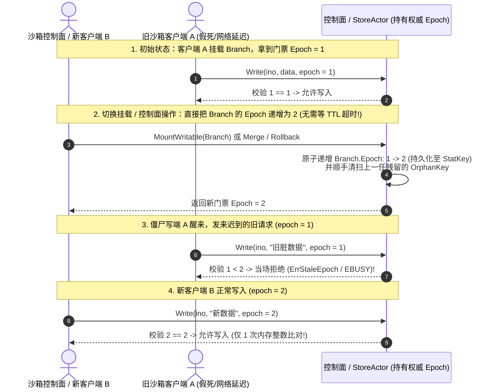

# 备选架构提案：基于 AWS EBS 世代号栅栏（`Epoch` Fencing）替代 `ClientSession` 会话租约与心跳表

## 状态
备选提案（Proposal / Draft） — 暂不落实，作为 [`ADR-0029`](../adr/0029-pebble-per-branch-storage-swmr-and-checkpoint-commit.md) 会话租约机制的轻量化替代方案存档备查。

---

## 一、 背景与痛点：为什么现有的 `ClientSession` 偏重？

在当前 [`ADR-0029`](../adr/0029-pebble-per-branch-storage-swmr-and-checkpoint-commit.md) 与 `services/storage/internal/meta/` 实现中，为了保证单个 `Branch` 的「一写多读（SWMR）」与拦截僵尸客户端，系统维护了一套完整的有状态会话机制（[`branch_session.go`](../../services/storage/internal/meta/branch_session.go) & [`branch_workspace_gate.go`](../../services/storage/internal/meta/branch_workspace_gate.go)）：
1. **数据库表与周期性心跳写入开销**：
   - PostgreSQL 必须维护一张 `client_sessions` 表；
   - 每个挂载的客户端必须启动后台协程，每隔固定周期（如数秒）向服务端发送 `RenewSession` 心跳 RPC，不断在 PostgreSQL 上执行事务更新 `expires_at`。当同时挂载成千上万个沙箱时，光心跳续期就会给 PostgreSQL 带来持续的无效写负载。
2. **服务端内存会话缓存与二次锁校验复杂度**：
   - 服务端每次处理读写 RPC（`Read`、`Write`、`Lookup` 等）时，不能每次都查 PostgreSQL，因此不得不引入 [`BranchWorkspaceGate`](../../services/storage/internal/meta/branch_workspace_gate.go#L34-L43)，在内存中维护 `sessionCache`（软过期 `1s`）并在获取分支锁后做二次校验。
3. **只读快照本来就是不可变的，根本不需要会话租约**：
   - 只读客户端挂载的是不可变的 `Commit` 快照目录，天然不会写坏数据，却也被迫走一遍 `RenewSession` 注册与续期。
4. **超时等待窗口（TTL 僵死期）**：
   - 如果旧沙箱突然崩溃（未发 `CloseSession`），在新沙箱挂载或控制面执行 `Merge` / `Rollback` 时，往往受制于租约过期时间（TTL）的判定；而实际上在沙箱场景中，**沙箱控制面（Orchestrator）本身就清楚地知道“我已经销毁了旧沙箱、现在要挂载新沙箱”**。

---

## 二、 核心洞察：AWS EBS 是怎么用 1 个 64 位整数（`Epoch`）干掉 Session 的？

在 AWS EBS（*Physalia*, NSDI '20）中，存储服务端（Storage Server）**不维护客户端心跳 Session 表**，而是采用 **单调递增世代号栅栏（`Epoch` / Generation Fencing）**：



### 为什么 `Epoch` 方案比 `Session + 心跳` 轻得多？
1. **0 心跳 RPC、0 数据库续期写入**：
   - 客户端拿到 `Epoch = 2` 后，只要没有新的客户端来抢占挂载，这个 `Epoch = 2` 就**永远有效**，不需要每隔几秒发一次 `RenewSession` 心跳！
2. **热路径校验从“查缓存/查表”退化为“1 次 64 位整数相等比较”**：
   - 当前分支的权威 `WriterEpoch`（`uint64`）直接存放在 [`StoreActor`](../../services/storage/internal/store/actor.go#L151) 的内存 `BranchStat`（持久化在 Pebble [`StatKey`](../../services/storage/internal/store/keys.go) `"sys:stat"`）中；
   - 每个写请求（`Write`、`Mknod`、`Unlink` 等）头部带一个 `uint64 epoch`；
   - [`StoreActor`](../../services/storage/internal/store/actor.go) 在 Phase A 纯内存校验时，只需一行：
     ```go
     if req.Epoch != s.stat.WriterEpoch {
         return ErrStaleEpoch
     }
     ```
   - **0 锁、0 查表、0 `sessionCache` 过期时间窗口**！
3. **只读挂载彻底无状态**：
   - 只读客户端挂载 `Commit` 快照时，直接传 `CommitID` 直读只读 [`StoreActor`](../../services/storage/internal/store/actor.go)，完全不需要任何 Session 或 Token。

---

## 三、 方案对比：`ClientSession`（现状） vs `Epoch` 世代号栅栏（备选）

| 评估维度 | 现状方案：`ClientSession` 租约表 + 定时心跳 | ➡️ 备选方案：EBS 式 `Epoch` 世代号栅栏（无 Session） |
| :--- | :--- | :--- |
| **PostgreSQL 表结构** | 需维护 `client_sessions` 表，高频读写 `expires_at` | **直接删除 `client_sessions` 表**（仅在 `branches` 记录或 Pebble `StatKey` 中存 1 个 `uint64 writer_epoch`） |
| **客户端后台心跳** | 每个挂载实例需常驻心跳协程，周期性发 `RenewSession` RPC | **0 心跳协程、0 续期 RPC** |
| **写请求热路径开销** | 经 `BranchWorkspaceGate` 查 `sessionCache`，每 `1s` 回源穿透 | `StoreActor` 内存直接比对 `req.Epoch == s.stat.WriterEpoch`（**1 条 CPU 比较指令，0 I/O**） |
| **僵尸写端拦截精度** | 依赖 `sessionCache` 软过期（最长 `1s` 延迟窗口）或锁内二次查库 | **绝对实时（0 延迟窗口）**：新 `Epoch` 一旦在 `StoreActor` 生效，旧 `Epoch` 下一微秒立即被拒 |
| **旧写端崩溃后的重挂载 / `Merge` / `Rollback` 速度** | 若旧写端未正常发 `CloseSession`，需等待租约 TTL 超时或强制驱逐 | **0 等待立即接管**：新 `Mount` 或控制面 `Merge`/`Rollback` 直接将 `WriterEpoch++`，当场廢除旧写端并同步清扫 [`OrphanKey`](../../services/storage/internal/store/keys.go) |
| **孤儿节点（`Orphan Inode`）何时回收？** | `CloseSession` 时或租约过期后清扫 | 每次 `WriterEpoch` 递增切换新写端时（或正常 `Umount` 时），在 `StoreActor` 内顺手调用 1 次 `CleanOrphans` 即可 |

---

## 四、 唯一需要注意的边界与解决方式

如果徹底砍掉心跳 Session、只用 `Epoch`，只有一个问题需要回答：
> **“如果两个客户端都想挂载同一个 `Branch`，没有心跳怎么知道上一个客户端是不是还在正常运行（防误踢）？”**

在沙箱架构下有 **2 种极简解法**：
1. **由沙箱控制面（Orchestrator）单点发号（最接近 AWS EBS + Nitro 控制面）**：
   - 沙箱的创建、销毁与挂载本来就由上层控制面统一调度；
   - `Mount` 默认带 `exclusive` 标记：正常 `Umount` 会把分支的 `writer_active` 置为 `false`；如果上一个沙箱崩溃未调 `Umount`，控制面在确认旧沙箱容器已销毁后，带 `force = true` 调用挂载接口，服务端直接 `WriterEpoch++` 踢掉旧任期并接管。
2. **在 [`StoreActor`](../../services/storage/internal/store/actor.go) 内存维护 1 个时间戳 `lastWriteTime`（无需写库）**：
   - 如果需要保护“未崩溃的客户端不被意外顶掉”，只需在 `StoreActor` 内存中用 `atomic.Int64` 记录最近一次收到该 `Epoch` 請求的时间，完全不需要写 PostgreSQL 表。

---

## 五、 落地改动清单（未来启用本方案时）

1. **`StatKey` (`"sys:stat"`) 扩充 8 字节**：在 `BranchStat`（[`values.go`](../../services/storage/internal/store/values.go)）中增加 `WriterEpoch uint64` 字段；
2. **`StoreActor` 增加 `AdvanceEpoch()` 原语**：原子递增 `s.stat.WriterEpoch`、持久化至 `StatKey` 并触发一次 `CleanOrphans()`；
3. **写路径 RPC 校验**：所有写命令在 `StoreActor` Phase A 比对 `req.Epoch == s.stat.WriterEpoch`；
4. **裁撤冗余组件**：删除 PostgreSQL `client_sessions` 表、`RenewSession` / `CloseSession` RPC、客户端后台心跳协程以及服务端 [`BranchWorkspaceGate`](../../services/storage/internal/meta/branch_workspace_gate.go) 的 `sessionCache`。
